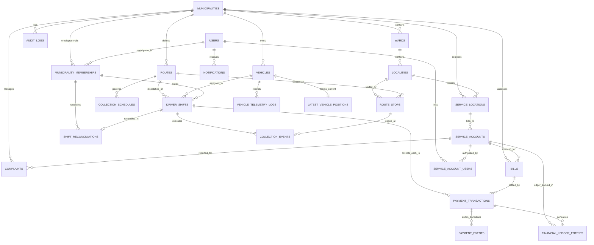

# Smart Municipal Waste Management Platform
## Phase 2: Data Model & Schema Design Specification

**Document Version:** 1.2.0 (Audited & Formally Hardened)  
**Phase:** 2 (System Architecture, Data Design, API Contracts & UI/UX)  
**Status:** Architecture Design Proposal (Awaiting Stakeholder Approval)  
**Source of Truth:** [docs/phase-1-requirements-and-scope.md](file:///d:/project/docs/phase-1-requirements-and-scope.md)  
**Author:** Senior Software Architect  

---

## 1. Data Model Overview & Design Principles

The data model is designed to support a multi-municipality solid waste collection platform with strict tenant isolation, auditable financial operations, and high-frequency GPS tracking.

### Core Data Principles
1. **Strict Logical Tenant Ownership:** Every tenant-owned table contains a mandatory, non-null `tenant_id UUID REFERENCES municipalities(id)` column. Row-Level Security (RLS) policies enforce data isolation on every query.
2. **Normalized Relational Integrity:** Clear foreign key constraints enforce administrative, fleet, and billing integrity.
3. **Append-Only Financial & Audit Records:** Financial transactions, ledger entries, and audit logs are append-only. Hard SQL `DELETE` queries are prohibited. Corrections are executed through compensating reversal entries.
4. **Separate Read-Optimized Telemetry Snapshot:** To avoid scanning high-frequency GPS history tables during citizen map browsing, current vehicle coordinates are maintained in a dedicated snapshot table (`latest_vehicle_positions`) and cached in-memory.
5. **No Speculative Bloat:** Every entity directly supports a confirmed Phase 1 requirement. No decorative or speculative tables are introduced.

---

## 2. Entity Relationship Diagram (ERD)



---

## 3. Entity Catalog & Detailed Schema Specifications

### 3.1 Tenant & Identity Subsystem

#### Entity: `municipalities`
- **Purpose:** Represents an Urban Local Body (ULB), city corporation, or municipality acting as a top-level tenant.
- **Tenant Ownership:** System root entity (Owner of all tenant data).
- **Primary Key:** `id UUID DEFAULT gen_random_uuid()`
- **Key Columns & Types:**
  - `name VARCHAR(128) NOT NULL` (e.g., "Verdant Hills Municipal Corporation")
  - `slug VARCHAR(64) NOT NULL UNIQUE` (e.g., "verdant-hills")
  - `state_region VARCHAR(64) NOT NULL`
  - `contact_email VARCHAR(128) NOT NULL`
  - `is_active BOOLEAN NOT NULL DEFAULT TRUE`
  - `settings JSONB NOT NULL DEFAULT '{}'` (stores configurable GPS freshness thresholds: `fresh_seconds`, `stale_seconds`, allowed payment modes, currency)
  - `created_at TIMESTAMPTZ NOT NULL DEFAULT clock_timestamp()`
  - `updated_at TIMESTAMPTZ NOT NULL DEFAULT clock_timestamp()`

#### Entity: `users`
- **Purpose:** Global user identity covering Citizens, Drivers, Municipal Administrators, and Platform Administrators.
- **Tenant Ownership:** Global entity. A user may have memberships across different municipalities.
- **Primary Key:** `id UUID DEFAULT gen_random_uuid()`
- **Key Columns & Types:**
  - `phone VARCHAR(20) NOT NULL UNIQUE` (E.164 standard, e.g., `+919876543210`)
  - `email VARCHAR(128) NULL UNIQUE`
  - `password_hash VARCHAR(255) NOT NULL` (Argon2id or bcrypt hash)
  - `full_name VARCHAR(128) NOT NULL`
  - `is_active BOOLEAN NOT NULL DEFAULT TRUE`
  - `created_at TIMESTAMPTZ NOT NULL DEFAULT clock_timestamp()`
  - `updated_at TIMESTAMPTZ NOT NULL DEFAULT clock_timestamp()`

#### Entity: `municipality_memberships`
- **Purpose:** Associates a global `user` with a specific `municipality` and assigns an operational role.
- **Tenant Ownership:** `tenant_id UUID REFERENCES municipalities(id)`
- **Primary Key:** `id UUID DEFAULT gen_random_uuid()`
- **Key Columns & Types:**
  - `tenant_id UUID NOT NULL REFERENCES municipalities(id) ON DELETE CASCADE`
  - `user_id UUID NOT NULL REFERENCES users(id) ON DELETE CASCADE`
  - `role VARCHAR(32) NOT NULL` (Enum: `CITIZEN`, `COLLECTOR`, `MUNICIPAL_ADMIN`, `PLATFORM_ADMIN`)
  - `badge_number VARCHAR(32) NULL` (Employee / Badge ID for drivers and staff)
  - `is_active BOOLEAN NOT NULL DEFAULT TRUE`
  - `created_at TIMESTAMPTZ NOT NULL DEFAULT clock_timestamp()`
- **Constraints & Indexes:**
  - `UNIQUE (tenant_id, user_id)`
  - Index on `(tenant_id, role)`

---

### 3.2 Geographical & Administrative Subsystem

#### Entity: `wards`
- **Purpose:** Represents an administrative electoral/sanitation ward within a municipality.
- **Tenant Ownership:** `tenant_id UUID REFERENCES municipalities(id)`
- **Primary Key:** `id UUID DEFAULT gen_random_uuid()`
- **Key Columns & Types:**
  - `tenant_id UUID NOT NULL REFERENCES municipalities(id) ON DELETE CASCADE`
  - `ward_number VARCHAR(16) NOT NULL` (e.g., "Ward-04")
  - `name VARCHAR(64) NOT NULL` (e.g., "North Greens")
  - `created_at TIMESTAMPTZ NOT NULL DEFAULT clock_timestamp()`
- **Constraints & Indexes:**
  - `UNIQUE (tenant_id, ward_number)`

#### Entity: `localities`
- **Purpose:** Neighborhood, street cluster, or collection beat within a ward.
- **Tenant Ownership:** `tenant_id UUID REFERENCES municipalities(id)`
- **Primary Key:** `id UUID DEFAULT gen_random_uuid()`
- **Key Columns & Types:**
  - `tenant_id UUID NOT NULL REFERENCES municipalities(id) ON DELETE CASCADE`
  - `ward_id UUID NOT NULL REFERENCES wards(id) ON DELETE CASCADE`
  - `code VARCHAR(32) NOT NULL` (e.g., "VH-W04-L01")
  - `name VARCHAR(128) NOT NULL` (e.g., "Cedar Heights Sector 1")
  - `center_latitude NUMERIC(10, 7) NOT NULL`
  - `center_longitude NUMERIC(10, 7) NOT NULL`
  - `boundary_geojson JSONB NULL` (optional polygon boundaries for map rendering)
  - `created_at TIMESTAMPTZ NOT NULL DEFAULT clock_timestamp()`
- **Constraints & Indexes:**
  - `UNIQUE (tenant_id, code)`
  - Index on `(tenant_id, ward_id)`

---

### 3.3 Property & Citizen Service Accounts

#### Entity: `service_locations`
- **Purpose:** Physical premises, building, or plot receiving solid waste collection service.
- **Tenant Ownership:** `tenant_id UUID REFERENCES municipalities(id)`
- **Primary Key:** `id UUID DEFAULT gen_random_uuid()`
- **Key Columns & Types:**
  - `tenant_id UUID NOT NULL REFERENCES municipalities(id) ON DELETE CASCADE`
  - `locality_id UUID NOT NULL REFERENCES localities(id) ON DELETE RESTRICT`
  - `property_identifier VARCHAR(64) NOT NULL` (e.g., Municipal Property Assessment PIN)
  - `address_line1 VARCHAR(128) NOT NULL`
  - `address_line2 VARCHAR(128) NULL`
  - `property_type VARCHAR(32) NOT NULL` (`RESIDENTIAL`, `COMMERCIAL`, `INDUSTRIAL`, `INSTITUTIONAL`)
  - `latitude NUMERIC(10, 7) NULL`
  - `longitude NUMERIC(10, 7) NULL`
  - `created_at TIMESTAMPTZ NOT NULL DEFAULT clock_timestamp()`
- **Constraints & Indexes:**
  - `UNIQUE (tenant_id, property_identifier)`
  - Index on `(tenant_id, locality_id)`

#### Entity: `service_accounts`
- **Purpose:** The commercial or residential customer billing and service record tied to a location.
- **Tenant Ownership:** `tenant_id UUID REFERENCES municipalities(id)`
- **Primary Key:** `id UUID DEFAULT gen_random_uuid()`
- **Key Columns & Types:**
  - `tenant_id UUID NOT NULL REFERENCES municipalities(id) ON DELETE CASCADE`
  - `service_location_id UUID NOT NULL REFERENCES service_locations(id) ON DELETE RESTRICT`
  - `account_number VARCHAR(32) NOT NULL` (Consumer Service Number: `VH-CON-00104`)
  - `primary_contact_name VARCHAR(128) NOT NULL`
  - `masked_phone VARCHAR(20) NOT NULL` (Masked for privacy on staff screens: `+91-98****1234`)
  - `current_balance_cents INT NOT NULL DEFAULT 0` (Balance in minor currency units: ₹100.00 = 10000)
  - `is_active BOOLEAN NOT NULL DEFAULT TRUE`
  - `created_at TIMESTAMPTZ NOT NULL DEFAULT clock_timestamp()`
- **Constraints & Indexes:**
  - `UNIQUE (tenant_id, account_number)`
  - Index on `(tenant_id, service_location_id)`

#### Entity: `service_account_users`
- **Purpose:** Associates authenticated citizen user accounts with service accounts they are authorized to view and pay for.
- **Tenant Ownership:** Derived via `service_account.tenant_id`.
- **Primary Key:** `id UUID DEFAULT gen_random_uuid()`
- **Key Columns & Types:**
  - `service_account_id UUID NOT NULL REFERENCES service_accounts(id) ON DELETE CASCADE`
  - `user_id UUID NOT NULL REFERENCES users(id) ON DELETE CASCADE`
  - `relationship_type VARCHAR(32) NOT NULL` (`OWNER`, `TENANT`, `AUTHORIZED_AGENT`)
  - `is_verified BOOLEAN NOT NULL DEFAULT FALSE` (verified via OTP to primary phone)
  - `linked_at TIMESTAMPTZ NOT NULL DEFAULT clock_timestamp()`
- **Constraints & Indexes:**
  - `UNIQUE (service_account_id, user_id)`

---

### 3.4 Fleet, Schedules & Shift Operations

#### Entity: `vehicles`
- **Purpose:** Represents sanitation trucks, compactors, tippers, and collection vehicles.
- **Tenant Ownership:** `tenant_id UUID REFERENCES municipalities(id)`
- **Primary Key:** `id UUID DEFAULT gen_random_uuid()`
- **Key Columns & Types:**
  - `tenant_id UUID NOT NULL REFERENCES municipalities(id) ON DELETE CASCADE`
  - `registration_number VARCHAR(32) NOT NULL` (e.g., "MH-04-AB-1234")
  - `vehicle_type VARCHAR(32) NOT NULL` (`COMPACTOR`, `TIPPER_TRUCK`, `MINI_TRUCK`, `E_RICKSHAW`)
  - `capacity_metric_tons NUMERIC(5, 2) NOT NULL`
  - `waste_stream_capability VARCHAR(32) NOT NULL` (`DUAL_WET_DRY`, `WET_ONLY`, `DRY_ONLY`, `BULK`)
  - `status VARCHAR(32) NOT NULL DEFAULT 'ACTIVE'` (`ACTIVE`, `MAINTENANCE`, `DECOMMISSIONED`)
  - `tracker_device_id VARCHAR(64) NULL` (hardware IMEI or tracking token)
  - `created_at TIMESTAMPTZ NOT NULL DEFAULT clock_timestamp()`
- **Constraints & Indexes:**
  - `UNIQUE (tenant_id, registration_number)`
  - Index on `(tenant_id, status)`

#### Entity: `routes`
- **Purpose:** Defines the planned sequence of localities and collection waypoints.
- **Tenant Ownership:** `tenant_id UUID REFERENCES municipalities(id)`
- **Primary Key:** `id UUID DEFAULT gen_random_uuid()`
- **Key Columns & Types:**
  - `tenant_id UUID NOT NULL REFERENCES municipalities(id) ON DELETE CASCADE`
  - `ward_id UUID NOT NULL REFERENCES wards(id) ON DELETE CASCADE`
  - `code VARCHAR(32) NOT NULL` (e.g., "ROUTE-W04-MORNING-A")
  - `name VARCHAR(64) NOT NULL`
  - `created_at TIMESTAMPTZ NOT NULL DEFAULT clock_timestamp()`
- **Constraints & Indexes:**
  - `UNIQUE (tenant_id, code)`

#### Entity: `route_stops`
- **Purpose:** Ordered sequence of locality stops on a route.
- **Tenant Ownership:** Derived via `route.tenant_id`.
- **Primary Key:** `id UUID DEFAULT gen_random_uuid()`
- **Key Columns & Types:**
  - `route_id UUID NOT NULL REFERENCES routes(id) ON DELETE CASCADE`
  - `locality_id UUID NOT NULL REFERENCES localities(id) ON DELETE RESTRICT`
  - `stop_sequence INT NOT NULL` (1, 2, 3...)
  - `expected_arrival_time TIME NULL`
  - `expected_departure_time TIME NULL`
- **Constraints & Indexes:**
  - `UNIQUE (route_id, stop_sequence)`
  - Index on `(route_id, locality_id)`

#### Entity: `collection_schedules`
- **Purpose:** Recurring weekly pickup rules and waste stream timetables.
- **Tenant Ownership:** `tenant_id UUID REFERENCES municipalities(id)`
- **Primary Key:** `id UUID DEFAULT gen_random_uuid()`
- **Key Columns & Types:**
  - `tenant_id UUID NOT NULL REFERENCES municipalities(id) ON DELETE CASCADE`
  - `route_id UUID NOT NULL REFERENCES routes(id) ON DELETE CASCADE`
  - `day_of_week SMALLINT NOT NULL` (1=Mon, 2=Tue, ..., 7=Sun)
  - `waste_stream_type VARCHAR(32) NOT NULL` (`WET_BIODEGRADABLE`, `DRY_RECYCLABLE`, `HAZARDOUS_SANITARY`, `MIXED`)
  - `window_start_time TIME NOT NULL` (e.g., "07:00:00")
  - `window_end_time TIME NOT NULL` (e.g., "09:30:00")
  - `is_active BOOLEAN NOT NULL DEFAULT TRUE`
- **Constraints & Indexes:**
  - `UNIQUE (route_id, day_of_week, waste_stream_type)`
  - Index on `(tenant_id, day_of_week)`

#### Entity: `driver_shifts`
- **Purpose:** A driver's active operating assignment for a specific vehicle and route on a given date.
- **Tenant Ownership:** `tenant_id UUID REFERENCES municipalities(id)`
- **Primary Key:** `id UUID DEFAULT gen_random_uuid()`
- **Key Columns & Types:**
  - `tenant_id UUID NOT NULL REFERENCES municipalities(id) ON DELETE CASCADE`
  - `vehicle_id UUID NOT NULL REFERENCES vehicles(id) ON DELETE RESTRICT`
  - `driver_membership_id UUID NOT NULL REFERENCES municipality_memberships(id) ON DELETE RESTRICT`
  - `route_id UUID NOT NULL REFERENCES routes(id) ON DELETE RESTRICT`
  - `shift_date DATE NOT NULL`
  - `status VARCHAR(32) NOT NULL DEFAULT 'PLANNED'` (`PLANNED`, `ACTIVE`, `COMPLETED`, `CANCELLED`)
  - `started_at TIMESTAMPTZ NULL`
  - `ended_at TIMESTAMPTZ NULL`
  - `total_cash_collected_cents INT NOT NULL DEFAULT 0`
  - `created_at TIMESTAMPTZ NOT NULL DEFAULT clock_timestamp()`
- **Constraints & Indexes:**
  - Index on `(tenant_id, shift_date, status)`
  - Index on `(driver_membership_id, status)`

#### Entity: `collection_events`
- **Purpose:** Records actual field stop completion marks submitted by collectors.
- **Tenant Ownership:** `tenant_id UUID REFERENCES municipalities(id)`
- **Primary Key:** `id UUID DEFAULT gen_random_uuid()`
- **Key Columns & Types:**
  - `tenant_id UUID NOT NULL REFERENCES municipalities(id) ON DELETE CASCADE`
  - `shift_id UUID NOT NULL REFERENCES driver_shifts(id) ON DELETE CASCADE`
  - `route_stop_id UUID NOT NULL REFERENCES route_stops(id) ON DELETE RESTRICT`
  - `status VARCHAR(32) NOT NULL` (`VISITED_COLLECTED`, `VISITED_NO_WASTE`, `SKIPPED_INACCESSIBLE`, `SKIPPED_NON_COMPLIANT`)
  - `recorded_at TIMESTAMPTZ NOT NULL DEFAULT clock_timestamp()`
  - `driver_latitude NUMERIC(10, 7) NOT NULL`
  - `driver_longitude NUMERIC(10, 7) NOT NULL`
  - `reason_notes TEXT NULL`
- **Constraints & Indexes:**
  - Index on `(tenant_id, recorded_at)`
  - Index on `(shift_id, route_stop_id)`

---

### 3.5 Telemetry & Vehicle Tracking Subsystem

#### Entity: `vehicle_telemetry_logs`
- **Purpose:** Append-only breadcrumb history of vehicle GPS coordinates.
- **Tenant Ownership:** `tenant_id UUID REFERENCES municipalities(id)`
- **Primary Key:** `id BIGSERIAL`
- **Key Columns & Types:**
  - `tenant_id UUID NOT NULL REFERENCES municipalities(id) ON DELETE CASCADE`
  - `vehicle_id UUID NOT NULL REFERENCES vehicles(id) ON DELETE CASCADE`
  - `shift_id UUID NULL REFERENCES driver_shifts(id) ON DELETE SET NULL`
  - `latitude NUMERIC(10, 7) NOT NULL`
  - `longitude NUMERIC(10, 7) NOT NULL`
  - `speed_kmh NUMERIC(5, 2) NOT NULL DEFAULT 0`
  - `heading_degrees NUMERIC(5, 2) NOT NULL DEFAULT 0`
  - `recorded_at TIMESTAMPTZ NOT NULL` (Device timestamp)
  - `ingested_at TIMESTAMPTZ NOT NULL DEFAULT clock_timestamp()` (Server timestamp)
  - `is_simulated BOOLEAN NOT NULL DEFAULT FALSE`
- **Constraints & Indexes:**
  - Composite index on `(vehicle_id, recorded_at DESC)`
  - Index on `(tenant_id, ingested_at)`

#### Entity: `latest_vehicle_positions`
- **Purpose:** Authoritative 1-to-1 persistent snapshot of current vehicle state for public and operational map queries.
- **Tenant Ownership:** `tenant_id UUID REFERENCES municipalities(id)`
- **Primary Key:** `vehicle_id UUID REFERENCES vehicles(id) ON DELETE CASCADE`
- **Key Columns & Types:**
  - `vehicle_id UUID PRIMARY KEY REFERENCES vehicles(id) ON DELETE CASCADE`
  - `tenant_id UUID NOT NULL REFERENCES municipalities(id) ON DELETE CASCADE`
  - `shift_id UUID NULL REFERENCES driver_shifts(id) ON DELETE SET NULL`
  - `latitude NUMERIC(10, 7) NOT NULL`
  - `longitude NUMERIC(10, 7) NOT NULL`
  - `speed_kmh NUMERIC(5, 2) NOT NULL DEFAULT 0`
  - `heading_degrees NUMERIC(5, 2) NOT NULL DEFAULT 0`
  - `last_recorded_at TIMESTAMPTZ NOT NULL`
  - `status VARCHAR(16) NOT NULL DEFAULT 'UNAVAILABLE'` (`CURRENT`, `STALE`, `UNAVAILABLE`)
  - `is_demo BOOLEAN NOT NULL` (Enforced via tenant demo inheritance trigger)
- **Constraints & Indexes:**
  - Index on `(tenant_id, status)`

#### Entity: `device_credentials`
- **Purpose:** Securely manages hashed authentication tokens, vehicle bindings, and rotation state for tracking hardware and driver mobile devices.
- **Tenant Ownership:** `tenant_id UUID REFERENCES municipalities(id)`
- **Primary Key:** `id UUID DEFAULT gen_random_uuid()`
- **Key Columns & Types:**
  - `tenant_id UUID NOT NULL REFERENCES municipalities(id) ON DELETE CASCADE`
  - `vehicle_id UUID NOT NULL UNIQUE REFERENCES vehicles(id) ON DELETE CASCADE`
  - `key_prefix VARCHAR(16) NOT NULL` (e.g., "dev_live_ab12")
  - `token_hash VARCHAR(255) NOT NULL` (Argon2id or salted SHA-256 hash of device secret token)
  - `secondary_token_hash VARCHAR(255) NULL` (Overlapping secondary credential hash for zero-downtime rotation)
  - `secondary_expires_at TIMESTAMPTZ NULL`
  - `status VARCHAR(16) NOT NULL DEFAULT 'ACTIVE'` (`ACTIVE`, `SUSPENDED`, `REVOKED`)
  - `last_used_at TIMESTAMPTZ NULL`
  - `created_at TIMESTAMPTZ NOT NULL DEFAULT clock_timestamp()`
- **Constraints & Indexes:**
  - `UNIQUE (tenant_id, vehicle_id)`
  - Index on `(key_prefix, status)`

---

### 3.6 Complaints & Service Requests

#### Entity: `complaints`
- **Purpose:** Citizen missed-collection complaints, spillage reports, and resolution lifecycle tracking.
- **Tenant Ownership:** `tenant_id UUID REFERENCES municipalities(id)`
- **Primary Key:** `id UUID DEFAULT gen_random_uuid()`
- **Key Columns & Types:**
  - `tenant_id UUID NOT NULL REFERENCES municipalities(id) ON DELETE CASCADE`
  - `ticket_number VARCHAR(32) NOT NULL UNIQUE` (e.g., "VHMC-2026-CMP-00412")
  - `locality_id UUID NOT NULL REFERENCES localities(id) ON DELETE RESTRICT`
  - `service_account_id UUID NULL REFERENCES service_accounts(id) ON DELETE SET NULL`
  - `submitted_by_user_id UUID NULL REFERENCES users(id) ON DELETE SET NULL`
  - `category VARCHAR(32) NOT NULL` (`MISSED_LOCALITY`, `MISSED_HOUSEHOLD`, `WASTE_SPILLAGE`, `COLLECTOR_BEHAVIOR`)
  - `description TEXT NOT NULL`
  - `photo_url VARCHAR(255) NULL`
  - `status VARCHAR(32) NOT NULL DEFAULT 'OPEN'` (`OPEN`, `ASSIGNED`, `IN_INVESTIGATION`, `RESOLVED`, `CLOSED`)
  - `assigned_to_membership_id UUID NULL REFERENCES municipality_memberships(id) ON DELETE SET NULL`
  - `resolution_notes TEXT NULL`
  - `created_at TIMESTAMPTZ NOT NULL DEFAULT clock_timestamp()`
  - `resolved_at TIMESTAMPTZ NULL`
- **Constraints & Indexes:**
  - `UNIQUE (tenant_id, ticket_number)`
  - Index on `(tenant_id, status)`
  - Index on `(locality_id, created_at)`

---

### 3.7 Billing, Payments & Reconciliation Subsystem

#### Entity: `bills`
- **Purpose:** Sanitation fee charges assessed against a service account.
- **Tenant Ownership:** `tenant_id UUID REFERENCES municipalities(id)`
- **Primary Key:** `id UUID DEFAULT gen_random_uuid()`
- **Key Columns & Types:**
  - `tenant_id UUID NOT NULL REFERENCES municipalities(id) ON DELETE CASCADE`
  - `service_account_id UUID NOT NULL REFERENCES service_accounts(id) ON DELETE RESTRICT`
  - `invoice_number VARCHAR(64) NOT NULL` (e.g., "INV-VHMC-2026-08101")
  - `billing_period_start DATE NOT NULL`
  - `billing_period_end DATE NOT NULL`
  - `amount_due_cents INT NOT NULL`
  - `amount_paid_cents INT NOT NULL DEFAULT 0`
  - `status VARCHAR(32) NOT NULL DEFAULT 'UNPAID'` (`UNPAID`, `PARTIALLY_PAID`, `PAID`, `CANCELLED`)
  - `due_date DATE NOT NULL`
  - `is_demo BOOLEAN NOT NULL DEFAULT FALSE`
  - `created_at TIMESTAMPTZ NOT NULL DEFAULT clock_timestamp()`
- **Constraints & Indexes:**
  - `UNIQUE (tenant_id, invoice_number)`
  - Index on `(service_account_id, status)`

#### Entity: `payment_transactions`
- **Purpose:** Records distinct payment attempts and completions across both online and cash methods.
- **Tenant Ownership:** `tenant_id UUID REFERENCES municipalities(id)`
- **Primary Key:** `id UUID DEFAULT gen_random_uuid()`
- **Key Columns & Types:**
  - `tenant_id UUID NOT NULL REFERENCES municipalities(id) ON DELETE CASCADE`
  - `service_account_id UUID NOT NULL REFERENCES service_accounts(id) ON DELETE RESTRICT`
  - `bill_id UUID NULL REFERENCES bills(id) ON DELETE SET NULL`
  - `payment_method VARCHAR(32) NOT NULL` (`ONLINE_GATEWAY`, `DOORSTEP_CASH`, `MUNICIPAL_COUNTER`)
  - `amount_cents INT NOT NULL`
  - `currency VARCHAR(3) NOT NULL DEFAULT 'INR'`
  - `status VARCHAR(32) NOT NULL` (Online: `ORDER_CREATED`, `CHECKOUT_INITIATED`, `PROVIDER_CONFIRMED`, `SETTLED`, `FAILED`, `REFUNDED`; Cash: `COLLECTED_AT_DOORSTEP`, `DEPOSITED_AT_TREASURY`, `RECONCILED`)
  - `gateway_order_id VARCHAR(128) NULL` (for online transactions)
  - `gateway_payment_id VARCHAR(128) NULL` (for online transactions)
  - `collected_by_membership_id UUID NULL REFERENCES municipality_memberships(id) ON DELETE RESTRICT` (for cash transactions)
  - `shift_id UUID NULL REFERENCES driver_shifts(id) ON DELETE RESTRICT` (for doorstep cash)
  - `receipt_number VARCHAR(64) NOT NULL UNIQUE` (e.g., `REC-VHMC-2026-00918` or `DEMO-REC-VHMC-2026-00918`)
  - `is_demo BOOLEAN NOT NULL DEFAULT FALSE`
  - `created_at TIMESTAMPTZ NOT NULL DEFAULT clock_timestamp()`
- **Constraints & Indexes:**
  - `UNIQUE (tenant_id, receipt_number)`
  - Index on `(tenant_id, created_at, status)`
  - Index on `(shift_id, payment_method)`

#### Entity: `payment_events`
- **Purpose:** Append-only lifecycle event trail and idempotency audit log for payment transactions.
- **Tenant Ownership:** Derived via `payment_transaction.tenant_id`.
- **Primary Key:** `id UUID DEFAULT gen_random_uuid()`
- **Key Columns & Types:**
  - `payment_id UUID NOT NULL REFERENCES payment_transactions(id) ON DELETE CASCADE`
  - `gateway_provider VARCHAR(32) NULL` (e.g., `RAZORPAY`, `PAYU`, `SIMULATED_GATEWAY`)
  - `gateway_event_id VARCHAR(128) NULL` (Provider-scoped stable event identifier)
  - `idempotency_key VARCHAR(128) NULL` (Internal client/system operation idempotency key)
  - `event_type VARCHAR(64) NOT NULL` (`ORDER_CREATED`, `PAYMENT_AUTHORIZED`, `PAYMENT_CAPTURED`, `PAYMENT_FAILED`, `REFUND_PROCESSED`, `DISPUTE_OPENED`, `CASH_COLLECTED`, `CASH_DEPOSITED`, `RECONCILED`)
  - `processing_status VARCHAR(32) NOT NULL DEFAULT 'PROCESSED'` (`PROCESSED`, `DUPLICATE_IGNORED`, `ANOMALY_PENDING_REVIEW`)
  - `error_details TEXT NULL`
  - `event_payload JSONB NOT NULL DEFAULT '{}'` (Raw webhook headers, body, gateway response hashes)
  - `occurred_at TIMESTAMPTZ NOT NULL DEFAULT clock_timestamp()`
- **Constraints & Indexes:**
  - `UNIQUE (gateway_provider, gateway_event_id)`: Enforces provider-scoped stable event deduplication. Retried webhook deliveries are identified and marked `DUPLICATE_IGNORED` without side effects, while safely allowing legitimate repeated events of the same `event_type` (e.g., multiple partial refunds or multiple webhook status notifications).
  - Index on `(payment_id, occurred_at)`
  - Index on `(idempotency_key)` WHERE idempotency_key IS NOT NULL
  - Index on `(processing_status)` WHERE processing_status = 'ANOMALY_PENDING_REVIEW'
- **Invalid Transition & Evidence Retention Policy:**
  - If a provider event violates state machine rules (e.g., `PAYMENT_CAPTURED` received for an already `CANCELLED` or `REFUNDED` transaction, or webhook amount differs from bill amount):
    - **Financial evidence is NEVER silently discarded.**
    - The raw event is inserted with `processing_status = 'ANOMALY_PENDING_REVIEW'` and diagnostic `error_details`.
    - No transition is applied to `payment_transactions.status`, and no credit is posted to `financial_ledger_entries`.
    - A high-priority supervisor review alert is created in the audit dashboard.

#### Entity: `financial_ledger_entries`
- **Purpose:** Append-only ledger recording all debits, credits, and balance adjustments against service accounts.
- **Tenant Ownership:** `tenant_id UUID REFERENCES municipalities(id)`
- **Primary Key:** `id UUID DEFAULT gen_random_uuid()`
- **Key Columns & Types:**
  - `tenant_id UUID NOT NULL REFERENCES municipalities(id) ON DELETE CASCADE`
  - `service_account_id UUID NOT NULL REFERENCES service_accounts(id) ON DELETE RESTRICT`
  - `payment_id UUID NULL REFERENCES payment_transactions(id) ON DELETE RESTRICT`
  - `entry_type VARCHAR(32) NOT NULL` (`CHARGE_ASSESSED`, `PAYMENT_CREDIT`, `REVERSAL_COMPENSATION`, `FEE_ADJUSTMENT`)
  - `amount_cents INT NOT NULL` (positive for credits, negative for debits)
  - `balance_after_cents INT NOT NULL`
  - `reference_document_number VARCHAR(64) NOT NULL` (Invoice number or receipt number)
  - `authorized_by_membership_id UUID NULL REFERENCES municipality_memberships(id) ON DELETE RESTRICT`
  - `notes TEXT NULL`
  - `is_demo BOOLEAN NOT NULL DEFAULT FALSE`
  - `created_at TIMESTAMPTZ NOT NULL DEFAULT clock_timestamp()`
- **Constraints & Indexes:**
  - Index on `(service_account_id, created_at)`
  - Index on `(tenant_id, is_demo, created_at)`
- **Immutability & Append-Only Enforcement Mechanisms:**
  - *Privilege Revocation:* Database permissions explicitly forbid mutations:
    ```sql
    REVOKE UPDATE, DELETE ON financial_ledger_entries FROM waste_app_user;
    ```
  - *Database Trigger Defense:* A trigger enforces append-only immutability even if application roles are misconfigured:
    ```sql
    CREATE OR REPLACE FUNCTION prevent_ledger_modification()
    RETURNS TRIGGER AS $$
    BEGIN
      RAISE EXCEPTION 'financial_ledger_entries is strictly append-only; updates and deletions are forbidden. Correct balances via compensating entries (REVERSAL_COMPENSATION or FEE_ADJUSTMENT).';
    END;
    $$ LANGUAGE plpgsql;

    CREATE TRIGGER trg_prevent_ledger_modification
    BEFORE UPDATE OR DELETE ON financial_ledger_entries
    FOR EACH ROW EXECUTE FUNCTION prevent_ledger_modification();
    ```
  - *Compensating Entries Policy:* Any billing correction, payment dispute, or fee reversal must append an explicit compensating record (`REVERSAL_COMPENSATION` or `FEE_ADJUSTMENT`), preserving full audit history and pre-correction balances.
  - *Accounting Model Decision:* Single-entry balance tracking with immutable audit trail is adopted for pilot; dual-entry general ledger accounting remains an open architectural decision requiring municipal auditor sign-off.

#### Entity: `shift_reconciliations`
- **Purpose:** Audited physical cash handover record between drivers and municipal counter supervisors.
- **Tenant Ownership:** `tenant_id UUID REFERENCES municipalities(id)`
- **Primary Key:** `id UUID DEFAULT gen_random_uuid()`
- **Key Columns & Types:**
  - `tenant_id UUID NOT NULL REFERENCES municipalities(id) ON DELETE CASCADE`
  - `shift_id UUID NOT NULL UNIQUE REFERENCES driver_shifts(id) ON DELETE RESTRICT`
  - `driver_membership_id UUID NOT NULL REFERENCES municipality_memberships(id) ON DELETE RESTRICT`
  - `reconciled_by_membership_id UUID NOT NULL REFERENCES municipality_memberships(id) ON DELETE RESTRICT`
  - `system_recorded_cash_cents INT NOT NULL`
  - `physical_cash_deposited_cents INT NOT NULL`
  - `variance_cents INT NOT NULL` (deposited minus recorded)
  - `status VARCHAR(32) NOT NULL` (`BALANCED`, `DISCREPANCY_FLAGGED`)
  - `supervisor_notes TEXT NULL`
  - `reconciled_at TIMESTAMPTZ NOT NULL DEFAULT clock_timestamp()`
  - `is_demo BOOLEAN NOT NULL DEFAULT FALSE`
- **Constraints & Indexes:**
  - `UNIQUE (tenant_id, shift_id)`
  - Index on `(tenant_id, reconciled_at)`

---

### 3.8 Auditing & Communications Subsystem

#### Entity: `audit_logs`
- **Purpose:** System-wide append-only audit trail capturing security-relevant and state-changing actions.
- **Tenant Ownership:** `tenant_id UUID NULL REFERENCES municipalities(id)` (Null for platform admin actions)
- **Primary Key:** `id BIGSERIAL`
- **Key Columns & Types:**
  - `tenant_id UUID NULL REFERENCES municipalities(id) ON DELETE SET NULL`
  - `actor_user_id UUID NULL REFERENCES users(id) ON DELETE SET NULL`
  - `actor_role VARCHAR(32) NOT NULL`
  - `action_type VARCHAR(64) NOT NULL` (e.g., `ROUTE_CREATED`, `COMPLAINT_RESOLVED`, `CASH_RECONCILED`, `ROLE_GRANTED`)
  - `resource_type VARCHAR(64) NOT NULL`
  - `resource_id VARCHAR(64) NOT NULL`
  - `before_state JSONB NULL`
  - `after_state JSONB NULL`
  - `ip_address INET NULL`
  - `user_agent TEXT NULL`
  - `correlation_id VARCHAR(64) NOT NULL`
  - `created_at TIMESTAMPTZ NOT NULL DEFAULT clock_timestamp()`
- **Constraints & Indexes:**
  - Index on `(tenant_id, created_at)`
  - Index on `(resource_type, resource_id)`

#### Entity: `notifications`
- **Purpose:** In-app notification messages delivered to citizens, drivers, and supervisors.
- **Tenant Ownership:** `tenant_id UUID REFERENCES municipalities(id)`
- **Primary Key:** `id UUID DEFAULT gen_random_uuid()`
- **Key Columns & Types:**
  - `tenant_id UUID NOT NULL REFERENCES municipalities(id) ON DELETE CASCADE`
  - `recipient_user_id UUID NOT NULL REFERENCES users(id) ON DELETE CASCADE`
  - `channel VARCHAR(16) NOT NULL DEFAULT 'IN_APP'` (`IN_APP`, `SMS`, `EMAIL`)
  - `category VARCHAR(32) NOT NULL` (`SCHEDULE_CHANGE`, `COMPLAINT_UPDATE`, `PAYMENT_RECEIPT`)
  - `title VARCHAR(128) NOT NULL`
  - `body TEXT NOT NULL`
  - `is_read BOOLEAN NOT NULL DEFAULT FALSE`
  - `created_at TIMESTAMPTZ NOT NULL DEFAULT clock_timestamp()`
- **Constraints & Indexes:**
  - Index on `(recipient_user_id, is_read, created_at)`

---

## 4. Evaluation of PostGIS vs. Standard Numeric Coordinates & GPS Accuracy

### 4.1 Evaluation & Technical Justification
- **Evaluation Question:** Is the PostGIS spatial database extension required for the initial requirements?
- **Decision:** **PostGIS is NOT required for the initial phase; standard `NUMERIC(10, 7)` coordinates with the Haversine formula are adopted.**
- **Technical Justification:**
  1. *Coordinate Representation Resolution (Grid Step):*
     - Storing latitude and longitude as `NUMERIC(10, 7)` allocates 10 total digits with 7 digits after the decimal point.
     - 1 degree of latitude is approximately $111.32\text{ km}$ anywhere on Earth.
     - $0.0000001^\circ$ (7th decimal place) represents:
       $$0.0000001 \times 111,320\text{ meters} \approx 0.0111\text{ meters} = 1.11\text{ centimeters}$$
     - Therefore, `NUMERIC(10, 7)` provides **centimeter-level representation resolution**, eliminating floating-point rounding errors (inherent to IEEE 754 binary floats) and accurately recording any real-world coordinate.
  2. *Device Measurement Accuracy vs. Representation Resolution:*
     - While the database can record coordinates to $\approx 1.1\text{ cm}$ resolution, **physical measurement accuracy** of commercial vehicular GPS trackers (AIS-140) and consumer smartphones is typically $\pm 3\text{ to }15\text{ meters}$ under open skies, and $\pm 20\text{ to }50\text{ meters}$ in dense urban environments due to atmospheric delays and building multipath reflections.
     - The platform design explicitly treats coordinates as probabilistic measurements within a $\pm 10\text{m}$ confidence circle, never claiming or relying on centimeter or millimeter physical precision.
  3. *Distance Calculation Accuracy (Haversine Formula):*
     - Calculating the distance between a truck's reported coordinate $(\phi_1, \lambda_1)$ and a locality/stop center $(\phi_2, \lambda_2)$ is performed via the Haversine great-circle formula assuming a spherical Earth ($R \approx 6,371\text{ km}$):
       $$d = 2R \arcsin\left(\sqrt{\sin^2\left(\frac{\Delta\phi}{2}\right) + \cos(\phi_1)\cos(\phi_2)\sin^2\left(\frac{\Delta\lambda}{2}\right)}\right)$$
     - Because Earth is an oblate spheroid (WGS-84 ellipsoid), the spherical assumption introduces a small mathematical discrepancy of $\approx 0.3\%-0.5\%$ depending on latitude.
     - Over a $1\text{ km}$ municipal route stop, this error is $\approx 3\text{ to }5\text{ meters}$—which is smaller than physical GPS receiver noise and completely sufficient for detecting stop arrival.
  4. *Coordinate Validation & Ingress Safeguards:*
     - *Range Checking:* Latitude must be strictly within $[-90.0000000, 90.0000000]$; Longitude within $[-180.0000000, 180.0000000]$.
     - *Suspicious `(0.0, 0.0)` Coordinate Handling:* `(0.0, 0.0)` is a valid geographic coordinate in the Atlantic Ocean ("Null Island"). However, vehicular GPS hardware frequently defaults to `(0.0, 0.0)` upon power-on before satellite lock is acquired. The ingestion pipeline **contextually rejects `(0.0, 0.0)` specifically because it lies thousands of kilometers outside the registered municipal boundary polygon**, rather than treating it as an intrinsically invalid mathematical coordinate.
     - *Timestamp & Sequence Integrity:* Device timestamp cannot deviate into the future by $> 30\text{ seconds}$ relative to server UTC. Readings with timestamps older than the latest accepted reading for that vehicle are discarded to prevent out-of-order replay bugs.
     - *Implausible Movement Checks:* The pipeline computes velocity between consecutive readings $\Delta d / \Delta t$. If implied speed exceeds a configurable physical threshold (default $> 100\text{ km/h}$ for municipal sanitation trucks), the point is flagged as a sensor spike or GPS glitch and excluded from live map interpolation.
  5. *Restart & Failure Behavior:*
     - If the application or telemetry ingest worker restarts, the latest state of all vehicles is preserved in the persistent `latest_vehicle_positions` table.
     - On restart, the in-process memory map is repopulated directly from `latest_vehicle_positions`. If telemetry ceases during the outage, the freshness state machine evaluates the elapsed time from `last_recorded_at` against the current clock, correctly transitioning stale vehicles to `STALE` or `UNAVAILABLE`.
  6. *Operational Simplicity:* Omitting PostGIS avoids heavy C-extension compilation dependencies, keeps container images lightweight, and avoids specialized managed database extensions during initial pilots. PostGIS can be added as an additive migration later if complex polygon operations are mandated.

---

## 5. Demo Data Separation & Synthetic Data Governance

### 5.1 Architectural Evaluation: Physical Table Partitioning vs. Discriminator Column + Filtered Views
- **Evaluation Question:** Are separate physical PostgreSQL table partitions (e.g., declarative table partitioning on `is_demo`) necessary to isolate demonstration records from production financial reporting?
- **Analysis of Physical Table Partitioning:**
  - *Theoretical Benefit:* Physical segment isolation on disk; partition pruning guarantees queries targeting production tables do not scan demo storage pages.
  - *Architectural Costs & Constraints:*
    1. *Foreign Key Restrictions:* In PostgreSQL, foreign keys referencing partitioned tables require the partition key (`is_demo`) to be included in the primary key and in all composite foreign keys across every referencing table (`payment_transactions`, `financial_ledger_entries`, `payment_events`, `bills`). This forces schema pollution across the entire relational model.
    2. *Migration & DDL Overhead:* Partition maintenance scripts, separate index management per partition, and detachment/attachment lifecycle handling add substantial operational complexity to database migrations.
    3. *Scale Mismatch:* At initial pilot scale, disk-level partition pruning provides negligible query latency benefits while dramatically increasing schema fragility.
- **Adopted Architectural Decision:** **Tenant-Level Demo Inheritance, Database Trigger Enforcement, Dedicated Production Views, and Watermarks.**
- **Guarantees of the Adopted Approach:**
  1. *Elimination of the Silent `DEFAULT FALSE` Vulnerability:*
     - Relying on a naive `DEFAULT FALSE` creates a severe risk: an application insert in a demo workflow that accidentally omits `is_demo` would silently default to `FALSE`, contaminating production financial metrics.
     - To prevent this, demo status is **authoritatively established at the tenant level** (`municipalities.is_demo BOOLEAN NOT NULL`).
     - A database `BEFORE INSERT OR UPDATE` trigger (`enforce_tenant_demo_inheritance`) is applied to all child operational and financial tables (`bills`, `payment_transactions`, `financial_ledger_entries`, `shift_reconciliations`, `vehicles`, `latest_vehicle_positions`):
       ```sql
       CREATE OR REPLACE FUNCTION enforce_tenant_demo_inheritance()
       RETURNS TRIGGER AS $$
       DECLARE
         v_tenant_is_demo BOOLEAN;
       BEGIN
         SELECT is_demo INTO v_tenant_is_demo FROM municipalities WHERE id = NEW.tenant_id;
         IF v_tenant_is_demo IS TRUE THEN
           -- Unconditionally force is_demo = TRUE for all records in demo municipalities
           NEW.is_demo := TRUE;
         ELSIF NEW.is_demo IS TRUE AND v_tenant_is_demo IS FALSE THEN
           -- Prohibit injecting synthetic records into production municipalities
           RAISE EXCEPTION 'Cannot insert demo records into production municipality tenant %', NEW.tenant_id;
         END IF;
         RETURN NEW;
       END;
       $$ LANGUAGE plpgsql;
       ```
     - This trigger guarantees that omitted or incorrectly supplied flags can never classify synthetic data as production.
  2. *Enforceable Production Reporting Views (Not Merely Developer Convention):*
     - Production revenue calculations, tax audit exports, and financial reporting queries are barred from querying raw tables directly.
     - All production reporting queries execute strictly against dedicated, non-updatable database views (e.g., `v_prod_financial_ledger`, `v_prod_cash_reconciliations`, `v_prod_bills`):
       ```sql
       CREATE VIEW v_prod_financial_ledger AS
       SELECT fle.*
       FROM financial_ledger_entries fle
       JOIN municipalities m ON m.id = fle.tenant_id
       WHERE fle.is_demo = FALSE AND m.is_demo = FALSE;
       ```
  3. *Tenant Boundary:* Demo data is provisioned under dedicated synthetic tenant IDs (e.g., `verdant-hills`, `oceanfront`). RLS prevents cross-tenant visibility between demo tenants and live municipal tenants.
  4. *Synthetic Sequence & Document Prefixes:* Demo financial records strictly use reserved synthetic sequence prefixes: `DEMO-REC-XXXX`, `DEMO-INV-XXXX`, preventing numerical collision with legal municipal tax invoices.
  5. *Mandatory Visual & PDF Watermark Safeguards:* Any receipt or invoice generated where `is_demo = TRUE` renders an immutable, diagonal watermark: **`DEMO RECEIPT - VOID - NOT A VALID TAX INVOICE - NO REAL MONEY MOVED`**, guaranteeing simulated records can never be presented or mistaken as valid fiscal instruments.

### 5.2 Synthetic Data Catalog for Demonstration
All demonstration data is purely synthetic:
- **Municipality 1:** "Verdant Hills Municipal Corporation" (`slug: verdant-hills`)
  - Wards: Ward 01 (Central), Ward 02 (Harbor), Ward 03 (Highlands)
  - 12 Localities with mock street coordinates centered at `(18.9220, 72.8340)`
- **Municipality 2:** "Oceanfront Nagar Panchayat" (`slug: oceanfront`)
  - Wards: Ward 01 (Coast), Ward 02 (Market)
  - 6 Localities centered at `(15.2993, 74.1240)`
- **Synthetic Accounts:** 150 fictional service accounts with synthetic Indian phone numbers from the official non-allocated test range (`+91-98765-00001` through `+91-98765-00150`) and realistic mock addresses.

---

## 6. Data Retention, Archival & Privacy Considerations

| Data Entity | Retention Policy | Archival / Pruning Strategy | Privacy & Masking Controls |
| :--- | :--- | :--- | :--- |
| **Raw GPS Telemetry Logs** | 90 Days active retention | Partitioned by month. Data older than 90 days pruned from active tables; daily aggregated route summary retained permanently. | Coordinates hidden when vehicle is off-shift. |
| **Stop Collection Events** | 2 Years active retention | Kept online for SLA audits; archived to cold storage after 2 years. | Driver coordinates captured only at moment of stop mark. |
| **Citizen PII (Phone/Name)** | Active account lifecycle | Retained while property is registered; deactivated upon property transfer. | Phone numbers masked on public screens (`+91-98****1234`). |
| **Complaints & Photos** | 1 Year active retention | Complaint metadata retained permanently; photo attachments pruned after 1 year. | EXIF metadata (embedded device GPS) stripped on photo upload. |
| **Financial Ledger Entries** | 7 Years minimum (Legal requirement) | Never pruned from database; immutable append-only ledger. | Strict access control restricted to authorized municipal billing staff. |
| **Audit Logs** | 3 Years active retention | Immutable append-only log; shipped to append-only cold object storage. | Zero access to unmasked citizen passwords or session tokens. |

---

## 7. Migrations & Seed-Data Strategy (Conceptual)

> [!NOTE]
> Per Phase 2 design guidelines, no database migrations, live database connections, or seed scripts are executed during this phase. The following specifies the technical implementation strategy to be executed in Phase 3.

### 7.1 Migration Strategy
- **Tooling:** Standard Node.js SQL migration tool (e.g., `node-pg-migrate` or Prisma/Drizzle migration engine).
- **Execution Workflow:**
  1. Migrations run as the dedicated non-superuser migration user: `waste_migration_user` (`NOSUPERUSER`, `NOBYPASSRLS`), which owns the application schema and tables. Superusers are strictly prohibited from routine migrations.
  2. Each migration creates tables, foreign keys, indexes, triggers, and applies `ENABLE ROW LEVEL SECURITY` and `FORCE ROW LEVEL SECURITY`.
  3. `FORCE ROW LEVEL SECURITY` ensures table-owning scripts are constrained during data queries, but does **not** constrain superusers or roles with `BYPASSRLS`.
  4. RLS policies are applied granting least-privilege DML permissions to the unprivileged runtime role: `waste_app_user` (`NOSUPERUSER`, `NOBYPASSRLS`).
  5. Migration rollback scripts (`down.sql`) are authored and tested in parity with forward migrations (`up.sql`).

### 7.2 Seed-Data Strategy
- Seed files organized into distinct environments:
  - `seed-demo.ts`: Loads synthetic municipalities, wards, localities, routes, vehicles, demo drivers, and synthetic citizen accounts.
  - `seed-production-template.ts`: Minimal template loading only platform admin accounts and system configuration tables.

---
*End of Phase 2 Data Model & Schema Design Specification.*
