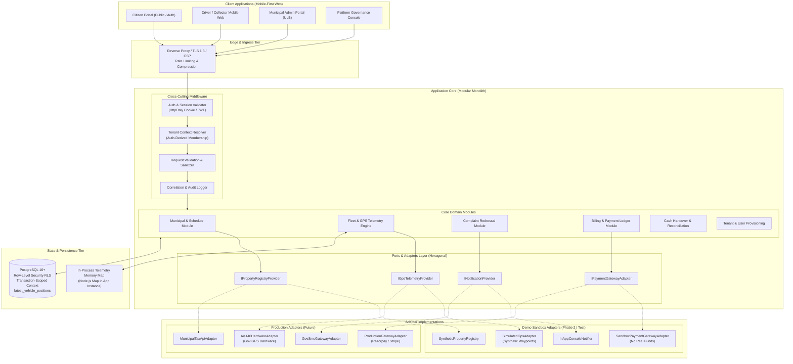
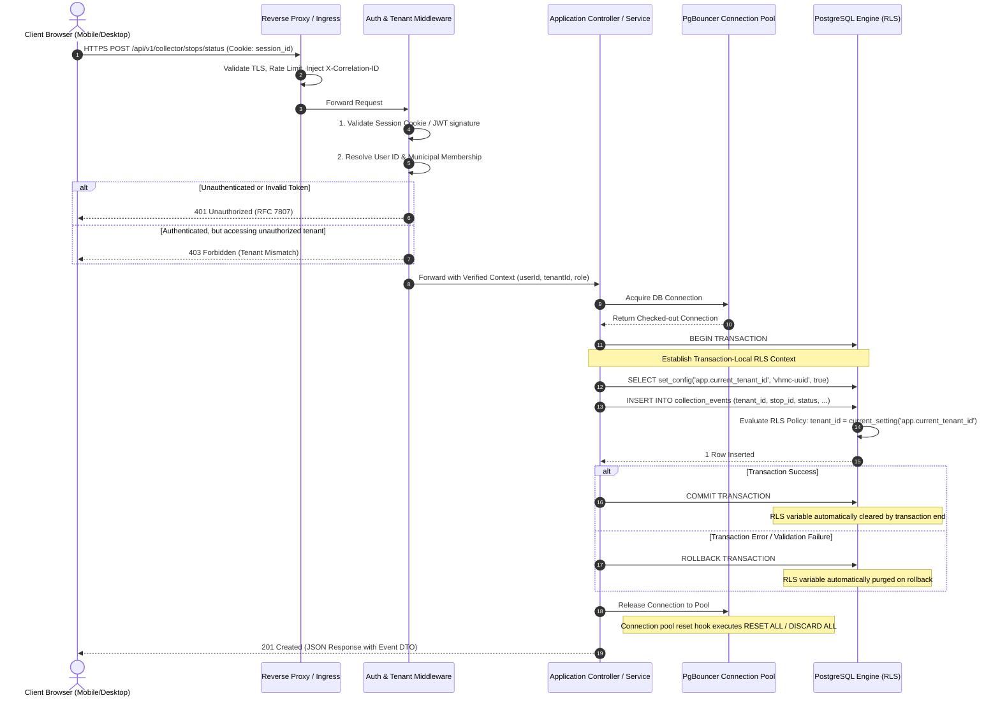
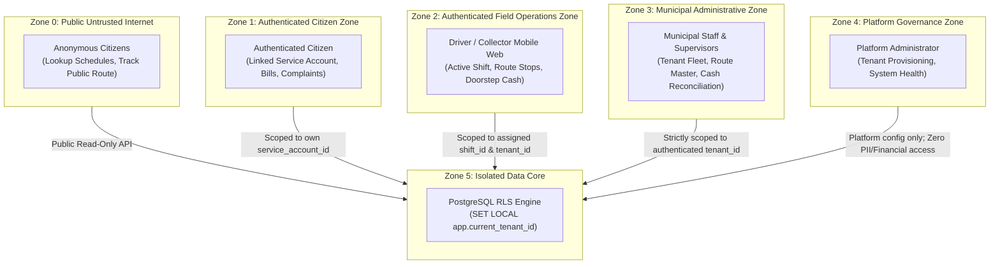

# Smart Municipal Waste Management Platform
## Phase 2: System Architecture Specification

**Document Version:** 1.2.0 (Audited & Formally Hardened)  
**Phase:** 2 (System Architecture, Data Design, API Contracts & UI/UX)  
**Status:** Architecture Design Proposal (Awaiting Stakeholder Approval)  
**Source of Truth:** [docs/phase-1-requirements-and-scope.md](file:///d:/project/docs/phase-1-requirements-and-scope.md)  
**Author:** Senior Software Architect  

---

## 1. System Goals and Non-Goals

### 1.1 Architectural Goals
- **Multi-Municipality Logical Multi-Tenancy:** A single shared application and shared PostgreSQL database serving multiple independent municipalities with strict tenant data isolation enforced at the database level via Row-Level Security (RLS) and transaction-scoped configuration.
- **Minimalistic Modular Monolith:** A single, clean, cohesive, deployable backend service organized into bounded domains, eliminating the operational overhead, network latency, distributed transaction hazards, and deployment complexity of microservices.
- **Provider-Agnostic Hexagonal Integration Layer:** Complete decoupling of external systems (GPS trackers, payment gateways, property databases, notifications) behind abstract Ports and Adapters, allowing instant swapping between synthetic demonstration sandboxes and real production vendors without changing domain logic.
- **Deterministic Telemetry Freshness Engine:** An in-memory and persistence pipeline delivering vehicle tracking with an explicit 3-tier status machine (`CURRENT`, `STALE`, `UNAVAILABLE`) based on configurable freshness thresholds.
- **Auditable, Tamper-Evident Financial Workflows:** Distinct, method-appropriate state workflows for online payments and doorstep cash collections, protected against silent modification through append-only ledgers and compensating adjustment records.
- **Resilient Mobile-First Field Usability:** Low-bandwidth, high-contrast, touch-optimized interfaces operable by field drivers and citizens under 3G/4G network conditions, supporting offline data caching and synchronization.

### 1.2 Explicit Non-Goals
- **No Microservices Architecture:** No distributed event brokers (Kafka), service meshes (Istio), or multi-repo microservices. A modular monolith fulfills all operational, scaling, and tenant isolation needs for urban municipal waste operations.
- **No AI / LLM Chatbots or Predictive Route Optimization:** Operations require deterministic scheduling, clear accountability, and predictable vehicle timetables. Dynamic algorithmic re-routing and probabilistic AI assistants introduce confusion and unnecessary infrastructure overhead.
- **No Citizen Gamification or Social Features:** No citizen badges, reward points, community feeds, or public forums. The platform is strictly an operational utility.
- **No Speculative Direct Government Integrations:** Zero reverse-engineered hooks or unverified integration agreements with proprietary government databases.
- **No Distributed Multi-Region Database Sharding:** The initial phase scales vertically and with read replicas. Complex multi-region distributed sharding is out of scope.

---

## 2. High-Level Architecture

The platform follows a **Hexagonal (Ports-and-Adapters) Modular Monolith** architecture pattern.



---

## 3. Subsystem Responsibilities

### 3.1 Frontend Tier
- **Technology:** Modern, lightweight HTML5, Vanilla CSS / responsive design tokens, and lightweight clientside JavaScript.
- **Responsibilities:**
  - Responsive, mobile-first presentation across 320px to 4K viewports.
  - Interactive map visualization (Leaflet/MapLibre with OpenStreetMap tiles).
  - High-visibility telemetry freshness indicators (Icons + text badges: `CURRENT`, `STALE`, `UNAVAILABLE`).
  - Touch-first stop completion logging for drivers with large touch targets ($\ge 48\times 48\text{px}$).
  - Client-side offline caching (IndexedDB) for field stop status and cash entries during cellular dropouts, with automatic background synchronization upon reconnection.
  - Prominent presentation of sandbox banners and unremovable demo watermarks on receipts in demo mode.

### 3.2 Ingress & Middleware Tier
- **Responsibilities:**
  - TLS termination (TLS 1.3 enforced, TLS 1.2 fallback).
  - Strict Content Security Policy (CSP), anti-clickjacking (`X-Frame-Options: DENY`), and MIME sniffing protection.
  - Rate limiting: Public endpoints (60 req/min per IP); Auth & Complaint endpoints (10 req/min per IP); Telemetry ingestion (burst allowance up to 100 req/sec from registered vehicle gateways).
  - Correlation ID injection (`X-Correlation-ID`) on every incoming HTTP request for unified log tracing.

### 3.3 Backend Modular Core (Application Layer)
- **Architecture:** Monolithic service partitioned into distinct modules communicating via typed in-memory interfaces.
- **Responsibilities:**
  - **Tenant Resolution & Security:** Validates session credentials, extracts authenticated user municipal membership, and enforces tenant scoping.
  - **Transaction & RLS Context Management:** Opens an explicit transaction for every tenant-scoped request, executes `SELECT set_config('app.current_tenant_id', :tenantId, true)`, executes domain logic, and commits/rolls back cleanly.
  - **Domain Logic:** Manages master data, schedules, routes, stops, complaints, billing invoices, receipts, and reconciliations.
  - **Telemetry Processing:** Ingests GPS packets, validates coordinate plausibility, filters anomalies, updates the in-memory latest position cache, and appends valid points to telemetry history.

### 3.4 Telemetry Persistence & Cache Architecture
- **PostgreSQL as Authoritative Store:**
  - The PostgreSQL table `latest_vehicle_positions` serves as the **authoritative persistent store and single source of truth** for the latest accepted coordinates and freshness status of every vehicle.
- **Pilot Architecture (Zero Extra Infrastructure):**
  - For the initial pilot (1–2 municipalities, 10–20 active vehicles pinging every 10–15 seconds), write throughput is approximately **1 to 2 writes per second**, and citizen read queries are well within standard relational capacity.
  - Direct indexed primary-key queries against PostgreSQL's `latest_vehicle_positions` table (`WHERE vehicle_id = :id`) provide robust, low-latency reads. PostgreSQL's internal shared buffer pool naturally caches the active 10–20 position rows in memory, making an external caching layer unnecessary for the pilot.
- **Optional In-Process Memory Cache (Application-Layer Optimization):**
  - If read load benchmarks demonstrate a need to offload database query workers, an in-process memory map (`Map<string, VehicleTelemetrySnapshot>`) can be retained within the Node.js process:
    - *Write-Through Consistency:* The cache is updated synchronously only upon successful completion of the PostgreSQL upsert transaction.
    - *Recovery & Cold Start:* On server boot or crash recovery, a cache-warming query (`SELECT * FROM latest_vehicle_positions`) populates the in-process map from PostgreSQL.
    - *Cache Miss / Anomaly Fallback:* Any cache miss falls back transparently to an authoritative query against `latest_vehicle_positions`.
- **Scale-Out Distributed Cache (Future Option):**
  - If the platform scales horizontally to multiple application instances where in-process maps would drift, an external distributed cache (e.g., Redis) can be introduced behind the `ITelemetryCache` interface without modifying domain tracking logic. This is an optional future scale-out path, not a pilot dependency.

### 3.5 Database Tier (PostgreSQL with RLS)
- **Responsibilities:**
  - System of record for all persistent data.
  - Logical tenant isolation via Row-Level Security (RLS) on all tenant-owned tables.
  - Append-only financial transaction ledger and immutable audit log.
  - Persistence of latest vehicle snapshots in `latest_vehicle_positions`.
  - Point-in-time recovery (PITR) with continuous Write-Ahead Logging (WAL).

---

## 4. End-to-End Request Flow

The following sequence illustrates an authenticated request (e.g., Municipal Admin viewing complaints or Driver logging a stop status) from client ingress to database persistence:



### 4.1 Public Unauthenticated Request Flow
- For public schedule and locality discovery (e.g., `/api/v1/public/municipalities/vhmc/schedule`):
  1. The client supplies the municipal slug in the URL path.
  2. Middleware looks up the municipality by slug in a public, cached read-only catalog table.
  3. If the municipality exists and is active, the query executes as a public read-only query filtered by that specific `tenant_id`.
  4. **Security Invariant:** The slug is purely a query filter for public catalog data; it grants zero administrative permissions, zero access to citizen PII, and zero ability to mutate data.

---

## 5. Proposed Technology Stack & Rationale

| Layer | Proposed Technology | Justification & Architecture Rationale | Identified Assumptions |
| :--- | :--- | :--- | :--- |
| **Backend Runtime** | **Node.js (LTS 20+) with TypeScript** | Strong static typing across domain models; non-blocking asynchronous event loop well suited for concurrent GPS telemetry ingestion and REST APIs; unified TypeScript contracts shared between frontend and backend. | Node.js runtime available on host/container environment. |
| **API Framework** | **Fastify or Express.js** | Minimalistic, battle-tested, low-overhead HTTP frameworks. Fastify provides high-throughput JSON serialization and built-in schema validation (JSON Schema/Ajv). | No complex web framework magic required; standard RESTful controllers. |
| **Database** | **PostgreSQL 16+** | Native, mature Row-Level Security (RLS); robust ACID transaction compliance for financial ledgers; high-performance composite B-Tree indexes; excellent JSONB and spatial indexing support. | PostgreSQL managed database service available. |
| **Connection Pooler** | **PgBouncer (Transaction Mode)** | Essential for scaling PostgreSQL concurrent connections without excessive memory consumption per client thread; supports transaction-local configuration settings (`set_config(..., true)`). | Pooler is configured in transaction pooling mode. |
| **Telemetry Storage & Cache (Pilot)** | **PostgreSQL `latest_vehicle_positions` (+ Optional In-Process Node.js Map)** | PostgreSQL is the authoritative persistent store for vehicle positions; low-latency indexed queries require zero extra caching infrastructure for pilot scale. Application in-process map can be used for optional read offloading. Redis can be added if scaling to multi-instance clusters. | Single or small clustered application instance; database handles write throughput. |
| **Frontend Core** | **HTML5 / Vanilla CSS / TypeScript (Vite-bundled)** | Maximum control over bundle size ($\le 150\text{ KB}$ initial payload), zero vendor bloat, zero heavy runtime frameworks. Delivers immediate page load times on throttled 3G/4G networks. | Modern standard browser (Chrome, Safari, Firefox, Edge). |
| **Mapping Engine** | **Leaflet.js + OpenStreetMap Tiles** | Lightweight ($< 40\text{ KB}$ JS/CSS), non-proprietary, open-source mapping engine requiring no expensive API keys or commercial license agreements. | OpenStreetMap tile server reachable or cached locally. |

---

## 6. Deployment Model

### 6.1 Initial Pilot Deployment (Cost-Effective & Minimalist)
For initial municipal pilot deployments and staging demonstrations, the entire platform deploys as a **compact, single-server topology with zero unnecessary infrastructure**:

```mermaid
flowchart LR
    Internet((Public Internet)) --> Caddy["Reverse Proxy\n(Caddy / Nginx)\nAutomatic Let's Encrypt TLS"]
    Caddy --> AppInstance["App Monolith (Node.js/TS)\n[Port 3000]\n(Includes In-Process Telemetry Map)"]
    AppInstance --> PgBouncerInstance["PgBouncer\n[Port 6432]"]
    PgBouncerInstance --> PostgresInstance[(PostgreSQL 16 DB\n[Port 5432])]
```

- **Sizing:** A single virtual server (2 vCPUs, 4 GB RAM, 40 GB SSD storage) easily supports up to 5 pilot municipalities, 50 concurrent active vehicles, and 5,000 daily citizen visits.
- **Operational Simplicity:** Zero Kubernetes overhead; zero external cache brokers; managed via a single clean Docker Compose file or systemd services.

### 6.2 Path to Production Scale
When expanding to dozens of city corporations with thousands of active vehicles:
1. **Stateless App Scaling:** Multiple application instances sit behind a standard cloud load balancer (AWS ALB, Cloudflare, or GCP Load Balancer).
2. **Dedicated Telemetry Path & Shared Cache:** If multi-instance telemetry synchronization is required, an external Redis cache is introduced behind the existing `ITelemetryCache` port interface.
3. **Database Read Replicas:** Read replicas serve public schedule lookups and administrative historical reports, leaving the primary PostgreSQL instance dedicated to transactional writes, stop logs, and reconciliations.

---

## 7. Trust Boundaries & Security Architecture

### 7.1 Trust Zones



### 7.2 Comprehensive PostgreSQL RLS Governance, Threat Model & Bypass Prevention

PostgreSQL Row-Level Security (RLS) is an essential database-level defense-in-depth boundary against multi-tenant data leakage. However, architectural rigor requires documenting its **exact security guarantees, threat model, and explicit limitations**.

#### 1. Threat Model & Scope of `app.current_tenant_id`
- **What RLS Guarantees:**
  - When application code executes queries within an active transaction where `app.current_tenant_id` is set, PostgreSQL transparently appends the tenant predicate to all SQL operations (`SELECT`, `INSERT`, `UPDATE`, `DELETE`).
  - If application logic contains a software defect (such as omitting a `WHERE tenant_id = :tenantId` filter in an ORM query, or an insecure object reference bug in business logic), RLS automatically restricts visibility and mutation exclusively to rows owned by that tenant.
- **What RLS Does NOT Guarantee (Limitations):**
  - **RLS is NOT an absolute cryptographic boundary against arbitrary SQL execution.** In PostgreSQL, any session executing arbitrary SQL can run `SELECT set_config('app.current_tenant_id', 'target-tenant-uuid', true)`. Therefore, if an application suffers from a critical SQL injection vulnerability, an attacker capable of executing raw DDL/DML can reconfigure the session variable.
  - **First-Line Defense Mandate:** RLS is a secondary defense. The primary defense against cross-tenant attacks is strict parameterized query compilation, typed query builders (no dynamic SQL concatenation), rigorous input validation, and least-privilege database user permissions.
  - **Derivation Integrity:** The database cannot verify whether the tenant ID supplied to `set_config` is "correct" on its own—it trusts the application middleware. Tenant context is therefore derived strictly on the backend by:
    1. Cryptographically verifying the user's session token/JWT.
    2. Looking up verified active municipal membership in the `municipality_memberships` table.
    3. Passing solely the verified database-stored `tenant_id` to `set_config`. **Zero client-controlled route slugs, query parameters, or request headers can influence the tenant ID passed to the database.**

#### 2. Missing, Invalid, or Stale Tenant Context (Fail-Closed Default)
- All tenant RLS policies are formulated using the fail-closed pattern:
  ```sql
  tenant_id = NULLIF(current_setting('app.current_tenant_id', true), '')::UUID
  ```
- **Evaluation Matrix:**
  - *Context Missing / Unset:* `current_setting(..., true)` returns `NULL`. `tenant_id = NULL` evaluates to `UNKNOWN` in three-valued SQL logic $\rightarrow$ **0 rows returned (Read), 0 rows mutated (Write/Delete).**
  - *Context Empty String (`""`):* `NULLIF("", "")` evaluates to `NULL` $\rightarrow$ **0 rows returned.**
  - *Context Invalid UUID (e.g. `'abc'` or SQL injection attempt):* PostgreSQL aborts the transaction immediately with a type casting error (`ERROR: invalid input syntax for type uuid`) $\rightarrow$ **Transaction rolled back.**
  - *Context Changed Mid-Session:* Because context is set with `is_local = true`, it is scoped strictly to the current transaction. A subsequent request checked out from the pool without setting context inherits zero state.

#### 3. Formal Table Policy Specifications (SELECT, INSERT, UPDATE, DELETE)
Every tenant-owned table must define explicit policies covering all SQL operations:
```sql
-- 1. Read Policy (SELECT)
CREATE POLICY tenant_select_policy ON <tenant_table>
  FOR SELECT
  USING (tenant_id = NULLIF(current_setting('app.current_tenant_id', true), '')::UUID);

-- 2. Insert Policy (INSERT with validation)
CREATE POLICY tenant_insert_policy ON <tenant_table>
  FOR INSERT
  WITH CHECK (tenant_id = NULLIF(current_setting('app.current_tenant_id', true), '')::UUID);

-- 3. Mutation Policy (UPDATE)
CREATE POLICY tenant_update_policy ON <tenant_table>
  FOR UPDATE
  USING (tenant_id = NULLIF(current_setting('app.current_tenant_id', true), '')::UUID)
  WITH CHECK (tenant_id = NULLIF(current_setting('app.current_tenant_id', true), '')::UUID);

-- 4. Delete Policy (DELETE)
CREATE POLICY tenant_delete_policy ON <tenant_table>
  FOR DELETE
  USING (tenant_id = NULLIF(current_setting('app.current_tenant_id', true), '')::UUID);
```

#### 4. Append-Only Ledger Immutability Enforcement
On financial tables (`financial_ledger_entries`, `vehicle_telemetry_logs`, `audit_logs`), documentation alone does not ensure immutability. Immutability is enforced at the database privilege and trigger level:
```sql
-- 1. Role-Level Revocation
REVOKE UPDATE, DELETE ON financial_ledger_entries FROM waste_app_user;

-- 2. Database Trigger Defense
CREATE OR REPLACE FUNCTION prevent_immutable_record_modification()
RETURNS TRIGGER AS $$
BEGIN
  RAISE EXCEPTION 'Table % is strictly append-only. UPDATE and DELETE operations are prohibited.', TG_TABLE_NAME;
END;
$$ LANGUAGE plpgsql;

CREATE TRIGGER trg_protect_financial_ledger
BEFORE UPDATE OR DELETE ON financial_ledger_entries
FOR EACH ROW EXECUTE FUNCTION prevent_immutable_record_modification();
```

#### 5. Role Separation, Table Ownership & Bypass Prevention
In PostgreSQL, `FORCE ROW LEVEL SECURITY` causes row security policies to be applied even if the querying user is the table owner. **Crucially, `FORCE ROW LEVEL SECURITY` does NOT constrain PostgreSQL superusers or roles possessing the `BYPASSRLS` attribute—superusers and `BYPASSRLS` roles always bypass RLS unconditionally.**

Therefore, multi-tenant isolation depends on strict database role separation and least-privilege architecture:
- **Tripartite Database Role Architecture:**
  1. **Runtime Application Role (`waste_app_user`):**
     - Used by the PgBouncer connection pool for all web application traffic.
     - Granted `NOSUPERUSER`, `NOBYPASSRLS`, `NOCREATEDB`, `NOCREATEROLE`.
     - Owns zero database tables and cannot execute DDL.
     - Granted solely least-privilege DML (`SELECT, INSERT, UPDATE` on mutable tables; `SELECT, INSERT` only on append-only logs/ledger; strictly `REVOKE UPDATE, DELETE` on `financial_ledger_entries`).
     - Because it is `NOBYPASSRLS` and does not own tables, RLS policies are unconditionally and irrevocably enforced on every query.
  2. **Dedicated Migration Role (`waste_migration_user`):**
     - Dedicated DDL execution role for CI/CD schema migration pipelines.
     - Granted `NOSUPERUSER`, `NOBYPASSRLS`.
     - Owns the application schema (`public`) and all tenant tables, views, sequences, triggers, and functions.
     - Never used for handling web application client requests or connected via runtime application connection pools.
  3. **Database Administration Role (`waste_dba_admin`):**
     - Used exclusively out-of-band by human database administrators for initial database creation, role provisioning, PostgreSQL parameter tuning, extension installation, and disaster recovery.
     - Strictly barred from automated CI/CD migration scripts and routine runtime application traffic.
- **Limits of Transaction-Local Tenant Context & Threat Model Boundaries:**
  - Setting `set_config('app.current_tenant_id', :tenantId, true)` scopes tenant context strictly to the transaction boundary (`is_local = true`). If an error occurs and `ROLLBACK` executes, the context automatically evaporates, leaving zero residual state.
  - **SQL Injection Boundary:** RLS is an internal defense-in-depth control against application logic bugs, ORM filtering omissions, and missing tenant filter clauses. It does **not** protect against arbitrary SQL injection. If an attacker can execute arbitrary SQL queries, they can invoke `SELECT set_config('app.current_tenant_id', '<target_uuid>', false)` to re-scope the session or query un-scoped system catalogs. The primary defense against SQL injection remains parameterized queries, typed query builders, and strict input validation.
  - **Database Compromise Boundary:** RLS does not protect against physical storage tampering, database superuser credential compromise, or connection pooler software vulnerabilities.
- **Connection Pool Cleanup & Rollback:**
  ```sql
  BEGIN;
  SELECT set_config('app.current_tenant_id', :tenantId, true); -- true = local to transaction
  -- execute tenant queries as waste_app_user
  COMMIT; -- automatically clears local setting
  ```
  If `ROLLBACK` occurs on error, the setting is purged automatically. PgBouncer pool reset hooks execute `RESET ALL` / `DISCARD ALL` upon connection checkout/checkin.

#### 6. Database-Level Isolation Test Suite (Mandatory in CI/CD)
To empirically verify tenant isolation rather than assuming it:
1. **Direct SQL Isolation Test:** Connect via `psql` as `waste_app_user`. Set `app.current_tenant_id` to Tenant A. Execute `SELECT * FROM complaints`. Assert that zero rows belonging to Tenant B are returned.
2. **Cross-Tenant Mutation Test:** With context set to Tenant A, attempt `INSERT INTO service_accounts (tenant_id, ...)` using Tenant B's UUID. Assert that PostgreSQL raises a policy violation error (`new row violates row-level security policy`).
3. **Empty Context Fail-Closed Test:** Execute queries as `waste_app_user` without setting `app.current_tenant_id`. Assert that all queries return 0 rows.
4. **Pool Reuse Sanitization Test:** On connection C1, set context to Tenant A, execute a query, and return C1 to pool. Check out C1 without setting context; assert that context does not persist.

### 7.3 Major Security Controls Matrix

| Vulnerability / Attack Vector | Mitigation Control | Verification Mechanism |
| :--- | :--- | :--- |
| **Cross-Tenant Data Leakage** | Backend auth token derives `tenant_id`; RLS enforces `tenant_id = current_setting('app.current_tenant_id')` on all queries. | Automated cross-tenant database and API integration test suite in CI/CD. |
| **Slug Parameter Tampering** | Slugs in URLs are used exclusively for public catalog lookups; authenticated endpoints ignore URL slugs for authorization. | Security test verifying slug manipulation yields 403 or is ignored. |
| **Horizontal Privilege Escalation (Citizen to Citizen)** | Object-level authorization checks: `service_account.user_id == authenticated_user.id`. | Test verifying Citizen A cannot view Citizen B's bills or receipts. |
| **SQL Injection (SQLi)** | Parameterized queries exclusively via typed query builders / ORM; raw string concatenation prohibited. | Static analysis security scanning (Semgrep/SonarQube). |
| **Cross-Site Scripting (XSS)** | HTML entity encoding on all dynamic outputs; strict Content Security Policy (`script-src 'self'`). | Browser-based automated security audit tests. |
| **CSRF & Session Hijacking** | Session tokens stored in `HttpOnly`, `SameSite=Strict`, `Secure` cookies; Anti-CSRF double-submit tokens on state-changing forms. | OWASP ZAP automated penetration testing scan. |
### 7.4 Telemetry Ingestion Security & Device Authentication Model

1. **Device Authentication & Binding (Anti-Spoofing):**
   - Telemetry ingestion endpoints require a pre-shared Device API Key submitted in the `X-Device-Token` header.
   - Each token is cryptographically bound in the database (`device_credentials` table) to exactly one authorized `vehicle_id` and one `tenant_id`.
   - **Cross-Vehicle Spoofing Prevention:** When a payload is ingested, the server verifies that the payload's `vehicle_id` strictly matches the `vehicle_id` bound to the authenticated token. If any discrepancy exists, the request is immediately rejected with HTTP 403 Forbidden (`AUTH_DEVICE_VEHICLE_MISMATCH`), and an alert is recorded in `audit_logs`. A field device can never submit readings for any vehicle other than its assigned vehicle.
2. **Payload Validation & Filtering:**
   - *Payload Size Limit:* Ingestion requests are strictly capped at $2\text{ KB}$. Oversized packets are rejected with HTTP 413 Payload Too Large.
   - *Data Type & Range Validation:* Strict schema validation rejects non-decimal coordinates, non-ISO timestamps, or negative speed/heading values.
   - *Contextual Municipal Boundary Filtering:* Incoming coordinates are evaluated against the registered municipal boundary polygon. Coordinates falling outside (including `(0.0, 0.0)` Null Island) are rejected with HTTP 422 Unprocessable Entity.
3. **Replay, Duplicate, and Out-of-Order Safeguards:**
   - *Clock Skew:* Timestamps deviating $> 30\text{ seconds}$ into the future relative to server UTC are rejected.
   - *Sequence Enforcement:* Readings with `recorded_at <= last_recorded_at` for that vehicle are silently dropped to eliminate network replay and out-of-order jitter.
   - *Movement Velocity Sanity Check:* Successive readings implying speeds $> 100\text{ km/h}$ for sanitation vehicles are flagged as sensor glitches and omitted from map interpolation.
4. **Credential Lifecycle & Storage Standards:**
   - *Secure Storage:* Device tokens are never stored in plaintext. Tokens are hashed using Argon2id or salted SHA-256 (`token_hash`), storing only an unhashed 8-character prefix (`key_prefix`) for identification.
   - *Zero-Downtime Rotation:* Supports dual active credentials (`primary_token_hash` and `secondary_token_hash` with an expiration window) to allow field devices to be re-provisioned without downtime.
   - *Instant Revocation:* A compromised or retired device can be revoked immediately by updating `status = 'REVOKED'`, which takes effect synchronously across all ingestion workers.
   - *Audit Trail:* All token generation, rotation, revocation, and failed authentication attempts are logged to `audit_logs`.
5. **Vendor & Protocol Agnosticism:**
   - The platform specifies standard HTTP REST ingestion (`POST /api/v1/ingest/telemetry`) for Phase 2 contracts. Selection of specific hardware vendors and physical transport protocols (e.g., direct HTTP vs. MQTT broker vs. TCP gateway) remains an open decision pending hardware procurement; no vendor or existing integration is assumed.

---

## 8. Failure Handling, Logging, Monitoring & Disaster Recovery

### 8.1 Error Handling & Standardized Response Format
All application errors follow the **RFC 7807 (Problem Details for HTTP APIs)** standard format. Internal server stack traces, database table names, and system details are never exposed to clients.

```json
{
  "type": "https://errors.smartwaste.local/errors/tenant-mismatch",
  "title": "Forbidden Tenant Access",
  "status": 403,
  "detail": "You do not have active municipal membership for the requested resource.",
  "instance": "/api/v1/admin/fleet/vehicles",
  "code": "AUTH_TENANT_ACCESS_DENIED",
  "correlation_id": "req-98f2b740-42ab-4e31-89d1-729910a56112",
  "timestamp": "2026-10-18T11:20:00Z"
}
```

### 8.2 Structured Observability & Audit Logging
- **Logging Format:** Structured JSON output written to `stdout`, ingested by standard log collectors (Fluentbit/Vector).
- **Core Log Fields:** `timestamp`, `level`, `correlation_id`, `tenant_id`, `user_id`, `user_role`, `method`, `path`, `status_code`, `latency_ms`.
- **Audit Log Table:** State-changing administrative and financial actions (creating routes, resolving complaints, recording cash, approving reconciliations) are written to an append-only, immutable `audit_logs` database table.

### 8.3 Health Monitoring & Probes
- **`/healthz/live` (Liveness Probe):** Returns HTTP 200 if the Node.js application process is running and responding.
- **`/healthz/ready` (Readiness Probe):** Verifies that the PostgreSQL database connection pool is healthy, reachable, and accepting queries. Returns HTTP 503 if the database is degraded.

### 8.4 Backup & Disaster Recovery Strategy
- **Continuous Archiving:** PostgreSQL Write-Ahead Logging (WAL) continuously shipped to secure object storage.
- **Daily Snapshots:** Automated nightly database snapshot backups retained for 30 days.
- **Point-in-Time Recovery (PITR):** Enables restoring the complete database to any second within the preceding 14 days in the event of catastrophic data corruption.
- **RTO & RPO Objectives:**
  - Recovery Time Objective (RTO): $< 2\text{ hours}$ to spin up a replacement deployment.
  - Recovery Point Objective (RPO): $< 5\text{ minutes}$ of transaction data loss via continuous WAL archiving.

---

## 9. Demo Mode vs. Production Mode

The platform features an explicit, environment-controlled **Demonstration Sandbox Mode** configured via `APP_MODE=demo` or `APP_MODE=production`.

```
┌────────────────────────────────────────────────────────────────────────┐
│                   DEMO MODE VS PRODUCTION MODE MATRIX                  │
├──────────────────────────┬──────────────────────┬──────────────────────┤
│ CAPABILITY               │ DEMONSTRATION MODE   │ PRODUCTION MODE      │
├──────────────────────────┼──────────────────────┼──────────────────────┤
│ Data Fixtures            │ Synthetic mock data  │ Real municipal master│
│                          │ (Verdant Hills Corp) │ data and accounts    │
├──────────────────────────┼──────────────────────┼──────────────────────┤
│ Map Telemetry Display    │ Prominent Badge:     │ Standard live map    │
│                          │ "SIMULATED TELEMETRY"│ with verified GPS    │
├──────────────────────────┼──────────────────────┼──────────────────────┤
│ GPS Telemetry Feed       │ Synthetic waypoint   │ Approved AIS-140     │
│                          │ emitter background   │ hardware / phone GPS │
├──────────────────────────┼──────────────────────┼──────────────────────┤
│ Payment Processing       │ Sandbox Simulator    │ Certified Payment    │
│                          │ (No real money moved)│ Gateway (BBPS/Stripe)│
├──────────────────────────┼──────────────────────┼──────────────────────┤
│ Digital Receipts         │ Diagonal Watermark:  │ Official Municipal   │
│                          │ "DEMO RECEIPT - VOID"│ Tax/Sanitation Bill  │
├──────────────────────────┼──────────────────────┼──────────────────────┤
│ Financial Ledger Storage │ Tenant RLS + is_demo │ Official Production  │
│                          │ flag segregation     │ General Ledger       │
└──────────────────────────┴──────────────────────┴──────────────────────┘
```

---

## 10. Architectural Trade-offs & Unresolved Decisions

### 10.1 Trade-off Analyses

1. **Modular Monolith vs. Microservices:**
   - *Decision:* **Modular Monolith**.
   - *Rationale:* Municipal waste management involves closely correlated data models (routes, vehicles, schedules, complaints, and cash balances). A modular monolith enables single-transaction ACID guarantees across stop logs and cash records, avoids distributed network latency, and requires vastly less cloud infrastructure. Can be partitioned into independent services later if specific modules (e.g. high-volume GPS ingestion) require distinct horizontal scaling.
2. **PostgreSQL as Authoritative Store vs. External Telemetry Cache for Pilot:**
   - *Decision:* **PostgreSQL `latest_vehicle_positions` is the Authoritative Store; Direct Database Queries Preferred for Pilot; Redis Deferred to Scale-Out**.
   - *Rationale:* For an initial pilot of 1–2 municipalities with 10–20 active vehicles, telemetry write traffic is approximately 1–2 writes per second. PostgreSQL handles primary-key upserts trivially, and its shared buffer pool keeps these 10–20 rows in memory. Querying PostgreSQL directly avoids cache invalidation bugs and eliminates Redis operational overhead. An in-process memory map can be utilized as an optional application-layer optimization if read traffic justifies it. Redis remains an optional horizontal scale-out adapter for multi-instance deployments.
3. **GPS Precision, Device Measurement Accuracy & Distance Calculations:**
   - *Clarification & Decision:* **Distinguish coordinate representation, device accuracy, and distance calculations**.
     - *Coordinate Representation Resolution:* Storing coordinates as `NUMERIC(10, 7)` provides 7 decimal places, which represents a grid resolution of $\approx 1.11\text{ cm}$ at the equator ($0.0000001^\circ$). This is **centimeter-level coordinate representation resolution** (avoiding IEEE 754 binary floating-point rounding anomalies), NOT sub-millimeter precision.
     - *Device Measurement Accuracy:* Commercial vehicle GPS trackers and consumer smartphones have physical measurement accuracy of $\pm 3\text{ to }15\text{ meters}$ under clear skies, degrading to $\pm 20\text{ to }50\text{ meters}$ in dense urban corridors due to multipath reflections. Therefore, sub-meter positioning is physically unachievable with commercial field hardware.
     - *Calculated Distance Accuracy:* Haversine spherical distance calculations assume Earth radius $R \approx 6,371\text{ km}$, carrying an error margin of $\approx 0.3\%-0.5\%$ relative to ellipsoidal geodesics (WGS-84/Vincenty). Over a $1\text{ km}$ collection beat, this error is $\approx 5\text{ meters}$, which is well within GPS measurement noise and completely acceptable for municipal stop arrival detection.
     - *Suspicious `(0.0, 0.0)` Coordinate Handling:* `(0.0, 0.0)` is a valid geographic coordinate in the Atlantic Ocean ("Null Island"), but GPS hardware commonly outputs `(0.0, 0.0)` as an uninitialized default when satellite fix is lost. In this platform, `(0.0, 0.0)` is **contextually rejected because it lies thousands of kilometers outside registered municipal boundaries**, not because it is an inherently impossible mathematical coordinate.
     - *Failure & Restart Behavior:* When the application server restarts, vehicle positions are loaded directly from the PostgreSQL `latest_vehicle_positions` table. The freshness state engine evaluates `last_recorded_at` against current server time to determine whether the vehicle has transitioned to `STALE` or `UNAVAILABLE` during the restart window.
4. **Standard Numeric Coordinates vs. PostGIS Extension:**
   - *Decision:* **Standard `NUMERIC(10, 7)` with Haversine formula for initial phase; PostGIS deferred to later enhancement**.
   - *Rationale:* Initial MVP requirements require point coordinates for vehicles, stops, and locality centers. Spatial distance checks are performed efficiently with standard mathematical formulas. Deferring PostGIS keeps the database lightweight, reduces cloud dependency, and simplifies local development until complex multi-polygon spatial geofences are formally requested.
5. **Double-Entry Bookkeeping vs. Append-Only Event Ledger:**
   - *Decision:* **Append-only transaction ledger with distinct lifecycle states and compensating entries (Double-entry kept as an open decision pending auditor sign-off)**.
   - *Rationale:* Full multi-ledger double-entry accounting (charts of accounts, debit/credit legs) introduces high domain complexity without clear municipal legal requirements. An append-only ledger with compensating reversals and database-level immutability triggers guarantees complete traceability and non-repudiation while keeping implementation minimalistic.

### 10.2 Decisions Requiring Stakeholder Approval Prior to Phase 3

The following open decisions are categorized by whether they block initial relational schema design or only block subsequent feature integration:

#### 10.2.1 Architectural Decisions Blocking Initial Data Design (Required before schema freeze)
1. **Required Accounting Model (Single-Entry with Audit Trail vs. Double-Entry General Ledger):**
   - *Current Design:* Single-entry balance tracking in `financial_ledger_entries` with strict append-only trigger protection and compensating entries (`REVERSAL_COMPENSATION`, `FEE_ADJUSTMENT`).
   - *Pending Stakeholder Action:* Municipal audit sign-off. If statutory rules require dual-entry accounting, dedicated journal entry, ledger leg, and chart-of-accounts tables must be introduced before database schema freeze.
2. **Doorstep Cash Collection Authorization & Treasury Policy:**
   - *Current Design:* Collectors record physical cash collections during active shifts (`driver_shifts.total_cash_collected_cents`, `shift_reconciliations`).
   - *Pending Stakeholder Action:* Municipal treasury confirmation on whether collectors are legally bonded and permitted to collect cash at doorsteps, or if cash payments are restricted to municipal counters.
3. **Public Vehicle Tracking Privacy & Permission Policy:**
   - *Current Design:* Unauthenticated citizens can view live truck positions for their locality while a truck is on an active public route shift (with off-shift redaction).
   - *Pending Stakeholder Action:* Municipality confirmation of whether live vehicle tracking can be public or must require authenticated resident verification.

#### 10.2.2 Integration Decisions Blocking Later Features (Do NOT block initial data design)
1. **Driver GPS Hardware Standard & Ingestion Transport Protocol:**
   - *Scope:* Choice between smartphone-based web tracking vs. dedicated AIS-140 vehicular GPS units; transport via HTTP REST (`POST /api/v1/ingest/telemetry`) vs. MQTT broker / TCP socket gateway. Relational schema and device authentication requirements remain identical.
2. **Notification & Transactional SMS Provider Selection:**
   - *Scope:* Selection of SMS gateway (e.g. CDAC/NIC government gateway, Twilio, Gupshup) for citizen OTPs and cash collection SMS receipts. Handled as an infrastructure adapter in Phase 4.
3. **Payment Gateway Provider Selection:**
   - *Scope:* Selection of payment aggregator (Razorpay, PayU, BillDesk). Data model and API contracts are payment-provider-agnostic.
4. **Scale-Out Distributed Telemetry Cache (Redis):**
   - *Scope:* Deferred until load testing of multi-instance deployments demonstrates database read saturation.

---
*End of Phase 2 System Architecture Specification.*
