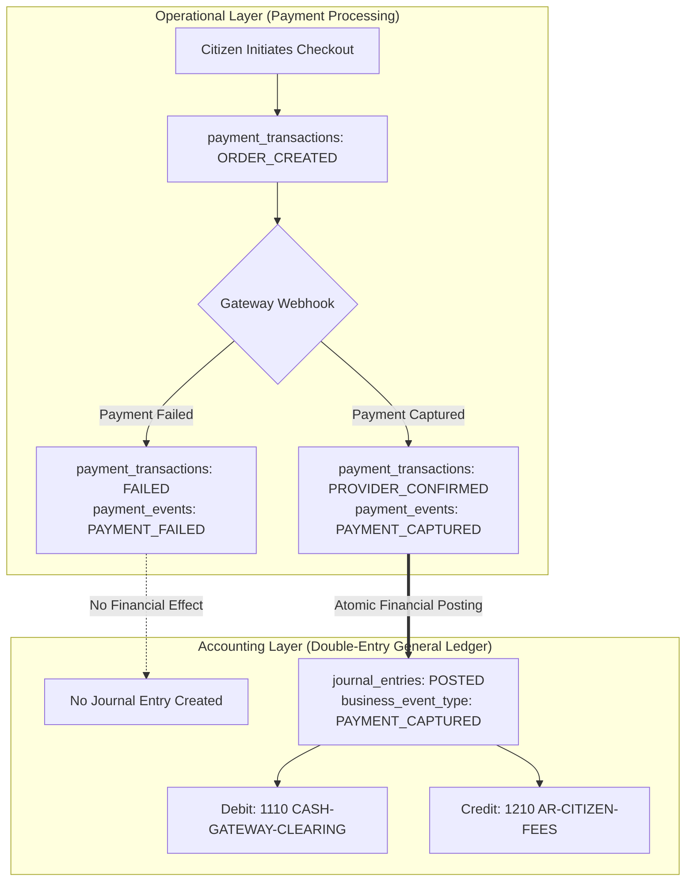

# Smart Municipal Waste Management Platform
## Phase 3: Double-Entry Accounting Design Specification

**Document Version:** 1.1.0 (Audited & Formally Hardened)  
**Phase:** 3 of 9 (Data Architecture, Double-Entry Accounting & Synthetic Demo Data)  
**Status:** Accounting Architecture Specification (Awaiting Municipal Finance Review)  
**Workspace:** `D:\project`  
**Sources of Truth:**  
- [Phase 3 Data Architecture Specification](file:///d:/project/docs/phase-3-data-architecture.md) (v1.1.0)  
- [Phase 3 Field-Level Data Dictionary Specification](file:///d:/project/docs/phase-3-data-dictionary.md) (v1.1.0)  
- [Phase 1 Requirements & Project Scope](file:///d:/project/docs/phase-1-requirements-and-scope.md) (v1.2.0)  
- [README.md](file:///d:/project/README.md) (v1.2.0)  
**Author:** Senior Software Architect  

---

## 1. Executive Summary & Mandatory Accounting Governance Notice

> [!WARNING]
> **STATUTORY MUNICIPAL FINANCE & TAX DISCLAIMER:**  
> The double-entry general ledger architecture specified in this document is a software engineering design. It defines logical schemas, data structures, transactional lifecycles, and relational constraints. **It does NOT constitute legal, tax, or statutory municipal accounting advice.**  
> 
> Prior to implementing or deploying these structures in production:
> 1. The Chart of Accounts, revenue recognition points, gateway fee expense treatment, and settlement reconciliation workflows **must be formally reviewed and approved by the Chief Finance Officer (CFO), Municipal Commissioner, or Statutory Auditor of the respective Urban Local Body (ULB)**.
> 2. The tax treatment (Goods & Services Tax / Municipal Sanitation Cess) of waste collection fees is **unconfirmed pending qualified municipal finance and tax review**. Zero GST or tax exemption is NOT an established requirement.  
> 3. Retention schedules across accounting and audit records are **preliminary design proposals pending formal validation by municipal legal and financial governance authorities**.

This specification fulfills Confirmed Stakeholder Decision 2.1 by establishing an auditable, multi-tenant double-entry accounting subsystem. It replaces the single-entry balance tracking ledger with formal general ledger accounting where:
- Every financial event is expressed through balanced debits and credits ($\sum \text{Debits} = \sum \text{Credits} > 0$).
- Monetary values are represented strictly in integer minor currency units (paise in INR, $100\text{ paise} = ₹1.00$).
- Posted entries are immutable. Posted entries remain `status = 'POSTED'` indefinitely; corrections occur strictly through separate, balanced compensating reversal entries referencing the original.
- Idempotency guarantees prevent the same financial event from posting more than once.
- Doorstep cash collection is explicitly disabled for the pilot, with accounts marked inactive and zero-cash reconciliations enforced.

---

## 2. Proposed Chart of Accounts (COA) Structure

Each municipality operates an isolated Chart of Accounts scoped by `tenant_id`. Standard account codes use a structured 4-digit hierarchical numbering scheme aligned with standard municipal accounting standards:
- **`1000–1999`:** **Assets** (Cash, clearing accounts, citizen receivables)
- **`2000–2999`:** **Liabilities** (Payables to treasury, unearned customer revenue)
- **`3000–3999`:** **Equity / Municipal Net Position** (Opening balance equity, operating reserves)
- **`4000–4999`:** **Revenues** (User fees, penalties, special collection charges)
- **`5000–5999`:** **Expenses** (Gateway processing fees, bad-debt write-offs)

### Standard Municipal Waste Management Chart of Accounts

| Account Code | Account Name | Category | Normal Balance | Pilot Status | Description & Accounting Purpose |
| :--- | :--- | :--- | :--- | :--- | :--- |
| `1010` | `CASH-IN-HAND-COLLECTORS` | `ASSET` | Debit | **INACTIVE (PILOT)** | Physical cash collected in the field by drivers/collectors. Prohibited and disabled for the pilot. |
| `1110` | `CASH-GATEWAY-CLEARING` | `ASSET` | Debit | **ACTIVE** | Funds captured by payment aggregators (e.g. Razorpay) awaiting daily batch settlement into the municipal treasury bank account. |
| `1120` | `MUNICIPAL-TREASURY-BANK` | `ASSET` | Debit | **ACTIVE** | The designated scheduled commercial bank account owned by the municipal corporation treasury. |
| `1210` | `AR-CITIZEN-FEES` | `ASSET` | Debit | **ACTIVE** | Accounts Receivable: Outstanding sanitation fee obligations assessed on citizens via monthly service invoices. |
| `2110` | `MUNICIPAL-TREASURY-PAYABLE`| `LIABILITY` | Credit | **ACTIVE** | Fiduciary payable representing collected net utility revenues held for transfer to municipal core accounts. |
| `2210` | `UNEARNED-CITIZEN-REVENUE` | `LIABILITY` | Credit | **ACTIVE** | Customer advance payments and unapplied credit balances prior to bill generation. |
| `3010` | `MUNICIPAL-OPERATING-EQUITY`| `EQUITY` | Credit | **ACTIVE** | Cumulative municipal net position and opening balance equity for the solid waste utility fund. |
| `4110` | `REVENUE-SOLID-WASTE-FEE` | `REVENUE` | Credit | **ACTIVE** | Recognized operating revenue earned from residential and commercial solid waste collection charges. |
| `4120` | `REVENUE-LATE-PENALTY` | `REVENUE` | Credit | **ACTIVE** | Fines and interest penalties assessed on overdue sanitation bills. |
| `5110` | `EXPENSE-GATEWAY-FEES` | `EXPENSE` | Debit | **ACTIVE** | Transaction processing fees and MDR deducted by online payment aggregators. |
| `5210` | `EXPENSE-FEE-WAIVERS` | `EXPENSE` | Debit | **ACTIVE** | Contra-revenue expense or allowance for authorized administrative fee waivers and dispute settlements. |

---

## 3. General Ledger Schemas & Transactional Boundaries

The double-entry model is partitioned into two distinct tables:
1. **`journal_entries`:** Transaction header capturing business event metadata, audit trails, and status.
2. **`journal_entry_lines`:** Debits and credits referencing individual accounts in integer minor units.

### 3.1 Separation of Operational Payment State vs. Accounting Effect
A fundamental architecture principle is the strict boundary between operational payment records (`payment_transactions`) and accounting general ledger records (`journal_entries`):



- Operational failures (e.g. gateway timeouts, declined cards) are tracked in `payment_transactions` and `payment_events`. They do **not** generate accounting journal entries because no financial value changed hands.
- Only confirmed business events (`BILL_ISSUANCE`, `PAYMENT_CAPTURED`, `GATEWAY_SETTLEMENT`, `REFUND_ISSUED`) trigger the creation and posting of balanced journal entries.

---

## 4. Invariants, Validation Rules & Database Enforcement Mechanisms

### 4.1 Mandatory Posting Invariants
Every posted journal entry in the platform must strictly satisfy six fundamental validation invariants before transitioning to `POSTED`:
1. **Minimum Debit and Credit Legs:** Every entry must contain at least one line with `entry_type = 'DEBIT'` and at least one line with `entry_type = 'CREDIT'`.
2. **Minimum Line Count:** Every entry must contain at least two constituent line items (`COUNT(lines) >= 2`).
3. **Exact Zero Balance Imbalance:** Total debits must equal total credits within integer minor units:
   $$\sum_{\text{entry}} \text{Debit Amounts} - \sum_{\text{entry}} \text{Credit Amounts} = 0$$
4. **Valid and Active Accounts:** Every referenced general ledger account must exist in the same tenant (`accounts.tenant_id = journal_entries.tenant_id`) and must be active (`accounts.is_active = TRUE`). Posting to inactive accounts or foreign-tenant accounts is strictly prohibited.
5. **Currency Homogeneity:** All constituent lines must share the identical ISO 4217 currency code (`INR`) matching the parent header. Multi-currency mixing within a journal entry is forbidden.
6. **Strictly Positive Integer Quantities:** All line amounts must be integers strictly greater than zero (`amount_minor_units > 0`). Floating-point types are prohibited.

### 4.2 Lifecycle Transitions, Immutability & Reversals
- **Draft Composition:** In `DRAFT` status, debits and credits may be temporarily unbalanced as lines are iteratively inserted, updated, or removed. Draft entries do not affect general ledger balances, trial balances, or financial statements.
- **Atomic Posting Transition:** When an entry is submitted for posting, an atomic routine validates all six invariants simultaneously. Upon successful validation, `status` transitions to `POSTED` and `posted_at = clock_timestamp()`.
- **Permanent Immutability:** Once an entry is `POSTED`, its header and constituent lines are **strictly immutable**. SQL `UPDATE` and `DELETE` operations are permanently revoked. The status remains `POSTED` indefinitely and is **never updated to a reversed state**.
- **Separate Compensating Reversal Entries:** To reverse or adjust a posted entry, a **new, separate, balanced journal entry** is created with `business_event_type = 'COMPENSATING_REVERSAL'`, `status = 'POSTED'`, and `reversal_of_entry_id = <original_entry_id>`. The original entry remains `POSTED` and completely untouched. Financial reports determine net account balances by aggregating all posted entries.

### 4.3 Atomicity, Concurrency & Multi-Tier Database Enforcement

> [!IMPORTANT]
> **Enforcement Architecture Notice:**  
> A cross-row balancing rule cannot be enforced by a simple SQL `CHECK` constraint on a single row, because SQL check constraints evaluate individual rows in isolation.  
> Furthermore, **a deferred constraint trigger on lines alone is insufficient**, because it does not govern header state transitions, account active status locks, race conditions during concurrent posting attempts, or subsequent tampering with header rows.
> 
> Robust enforcement requires a coordinated multi-tier mechanism:

1. **Atomic Application Posting Transaction & Row-Level Locking:**
   - The posting workflow runs inside an isolated database transaction (`READ COMMITTED` with explicit locking, or `SERIALIZABLE`).
   - The transaction immediately acquires an exclusive row lock on the draft header:
     ```sql
     SELECT id, tenant_id, currency, status FROM journal_entries WHERE id = $1 FOR UPDATE;
     ```
   - This serializes concurrent posting requests and prevents race conditions where two processes attempt to post the same draft simultaneously.
2. **Atomic Pre-Commit Invariant Validation:**
   - Inside the locked transaction, the posting engine computes sums and verifies account active status:
     ```sql
     SELECT 
       COUNT(*) AS total_lines,
       COUNT(*) FILTER (WHERE jel.entry_type = 'DEBIT') AS debit_count,
       COUNT(*) FILTER (WHERE jel.entry_type = 'CREDIT') AS credit_count,
       COALESCE(SUM(jel.amount_minor_units) FILTER (WHERE jel.entry_type = 'DEBIT'), 0) AS total_debits,
       COALESCE(SUM(jel.amount_minor_units) FILTER (WHERE jel.entry_type = 'CREDIT'), 0) AS total_credits,
       COUNT(*) FILTER (WHERE a.is_active = FALSE OR a.tenant_id != je.tenant_id) AS invalid_accounts
     FROM journal_entry_lines jel
     JOIN journal_entries je ON jel.journal_entry_id = je.id
     JOIN accounts a ON jel.account_id = a.id
     WHERE je.id = $1;
     ```
   - If `total_debits != total_credits`, or `debit_count < 1`, or `credit_count < 1`, or `invalid_accounts > 0`, the transaction is rolled back with an explicit exception before any status change occurs.
3. **Database Trigger Defense:**
   - *Line Protection Trigger:* A `BEFORE INSERT OR UPDATE OR DELETE` trigger on `journal_entry_lines` verifies whether the parent header's `status` is already `POSTED`. If `POSTED`, the operation is aborted with an exception, guaranteeing lines cannot be altered after posting.
   - *Header Protection Trigger:* A `BEFORE UPDATE OR DELETE` trigger on `journal_entries` verifies that once `status = 'POSTED'`, all subsequent mutations and deletions are permanently rejected.
4. **Idempotency & Business-Event Deduplication:**
   - Table `journal_entries` enforces:
     ```sql
     UNIQUE (tenant_id, business_event_type, business_event_id)
     ```
   - Any duplicate callback, repeated billing batch run, or duplicate user submission targeting the same business event fails at the database level with a unique constraint violation, guaranteeing that financial events are posted exactly once.

---

## 5. Illustrative Journal Entry Scenarios

> [!NOTE]
> All entries below are **illustrative examples** designed to demonstrate the double-entry mechanics. Final posting workflows and account classifications remain subject to formal municipal finance approval. All monetary figures are in Indian Rupee paise (₹1.00 = 100 paise).

---

### Scenario 1: Monthly Sanitation Fee Assessment (Bill Issuance)
- **Business Event:** The municipality assesses monthly residential solid waste collection fees of ₹300.00 (`30000` paise) on citizen service account `VH-SA-00104` (Invoice: `INV-VHMC-2026-08101`).
- **Accounting Interpretation:** Increases citizen accounts receivable (Asset) and recognizes earned solid waste service revenue (Revenue).
- **Journal Entry Header:**
  - `entry_number`: `JE-VHMC-2026-00101`
  - `business_event_type`: `BILL_ISSUANCE`
  - `business_event_id`: `INV-VHMC-2026-08101`
  - `effective_date`: `2026-11-01`
  - `status`: `POSTED`
  - `description`: "Monthly sanitation fee assessment for November 2026 - Account VH-SA-00104"

| Line # | Account Code | Account Name | Type | Debit (Paise) | Credit (Paise) | Memo |
| :---: | :--- | :--- | :---: | :---: | :---: | :--- |
| 1 | `1210` | `AR-CITIZEN-FEES` | Asset | `30000` | — | Assessment for Invoice INV-VHMC-2026-08101 |
| 2 | `4110` | `REVENUE-SOLID-WASTE-FEE`| Revenue | — | `30000` | Sanitation service revenue recognized |
| **Total** | | | | **`30000`** | **`30000`** | **Balanced ($\Delta = 0$)** |

---

### Scenario 2: Successful Citizen Online Payment Capture
- **Business Event:** The citizen pays the ₹300.00 bill online via payment aggregator (Payment Transaction: `pt_9901a`, Receipt: `REC-VHMC-2026-00918`). Aggregator captures funds.
- **Accounting Interpretation:** Increases gateway clearing asset (Asset) and extinguishes citizen accounts receivable (Asset).
- **Journal Entry Header:**
  - `entry_number`: `JE-VHMC-2026-00102`
  - `business_event_type`: `PAYMENT_CAPTURED`
  - `business_event_id`: `pt_9901a`
  - `effective_date`: `2026-11-02`
  - `status`: `POSTED`
  - `description`: "Online payment capture for Bill INV-VHMC-2026-08101 - Receipt REC-VHMC-2026-00918"

| Line # | Account Code | Account Name | Type | Debit (Paise) | Credit (Paise) | Memo |
| :---: | :--- | :--- | :---: | :---: | :---: | :--- |
| 1 | `1110` | `CASH-GATEWAY-CLEARING` | Asset | `30000` | — | Gateway captured funds (Receipt REC-VHMC-2026-00918) |
| 2 | `1210` | `AR-CITIZEN-FEES` | Asset | — | `30000` | Extinguish AR for service account VH-SA-00104 |
| **Total** | | | | **`30000`** | **`30000`** | **Balanced ($\Delta = 0$)** |

---

### Scenario 3: Gateway Settlement & Processing Fee Deduction
- **Business Event:** Payment aggregator executes daily batch payout. Gross collection of ₹300.00 is settled into the Municipal Treasury Bank Account net of ₹6.00 (`600` paise) gateway processing fee (2% MDR). Net deposited: ₹294.00 (`29400` paise).
- **Accounting Interpretation:** Increases treasury bank balance (Asset), records gateway processing expense (Expense), and clears the gateway clearing asset (Asset).
- **Journal Entry Header:**
  - `entry_number`: `JE-VHMC-2026-00103`
  - `business_event_type`: `GATEWAY_SETTLEMENT`
  - `business_event_id`: `SETTLE-RAZORPAY-20261103-01`
  - `effective_date`: `2026-11-03`
  - `status`: `POSTED`
  - `description`: "Aggregator settlement batch payout - Payout #SETTLE-RAZORPAY-20261103-01"

| Line # | Account Code | Account Name | Type | Debit (Paise) | Credit (Paise) | Memo |
| :---: | :--- | :--- | :---: | :---: | :---: | :--- |
| 1 | `1120` | `MUNICIPAL-TREASURY-BANK`| Asset | `29400` | — | Net settlement deposited to Treasury Bank |
| 2 | `5110` | `EXPENSE-GATEWAY-FEES` | Expense | `600` | — | Gateway MDR / processing fee deducted |
| 3 | `1110` | `CASH-GATEWAY-CLEARING` | Asset | — | `30000` | Clear gross funds from gateway clearing |
| **Total** | | | | **`30000`** | **`30000`** | **Balanced ($\Delta = 0$)** |

---

### Scenario 4: Full Refund Processed
- **Business Event:** The municipality grants a full refund of ₹300.00 (`30000` paise) due to a double billing error. The refund is remitted back to the citizen via the gateway before daily settlement.
- **Accounting Interpretation:** Re-establishes citizen receivable (or reverses payment), reducing gateway clearing cash.
- **Journal Entry Header:**
  - `entry_number`: `JE-VHMC-2026-00104`
  - `business_event_type`: `REFUND_ISSUED`
  - `business_event_id`: `ref_8820b`
  - `effective_date`: `2026-11-04`
  - `status`: `POSTED`
  - `description`: "Full refund for Payment pt_9901a - Double billing adjustment"

| Line # | Account Code | Account Name | Type | Debit (Paise) | Credit (Paise) | Memo |
| :---: | :--- | :--- | :---: | :---: | :---: | :--- |
| 1 | `1210` | `AR-CITIZEN-FEES` | Asset | `30000` | — | Reopen citizen receivable / cancel payment credit |
| 2 | `1110` | `CASH-GATEWAY-CLEARING` | Asset | — | `30000` | Deduct refund from in-flight gateway balance |
| **Total** | | | | **`30000`** | **`30000`** | **Balanced ($\Delta = 0$)** |

---

### Scenario 5: Partial Refund Processed
- **Business Event:** Citizen disputed a commercial bill of ₹500.00 (`50000` paise). An authorized supervisor approves a partial refund of ₹100.00 (`10000` paise).
- **Accounting Interpretation:** Reopens receivable for ₹100.00, reducing gateway clearing balance by ₹100.00.
- **Journal Entry Header:**
  - `entry_number`: `JE-VHMC-2026-00105`
  - `business_event_type`: `REFUND_ISSUED`
  - `business_event_id`: `ref_partial_4411`
  - `effective_date`: `2026-11-05`
  - `status`: `POSTED`
  - `description`: "Partial refund of ₹100.00 for service dispute on Bill INV-VHMC-2026-08109"

| Line # | Account Code | Account Name | Type | Debit (Paise) | Credit (Paise) | Memo |
| :---: | :--- | :--- | :---: | :---: | :---: | :--- |
| 1 | `1210` | `AR-CITIZEN-FEES` | Asset | `10000` | — | Partial AR reopening for service dispute |
| 2 | `1110` | `CASH-GATEWAY-CLEARING` | Asset | — | `10000` | Gateway partial refund remittance |
| **Total** | | | | **`10000`** | **`10000`** | **Balanced ($\Delta = 0$)** |

---

### Scenario 6: Gateway Dispute / Chargeback Deduction
- **Business Event:** A cardholder issues an unauthorized transaction dispute through their issuing bank. Gateway debits ₹300.00 (`30000` paise) dispute hold from the municipal gateway clearing balance.
- **Accounting Interpretation:** Debits citizen receivable (or dispute suspense) and credits gateway clearing asset.
- **Journal Entry Header:**
  - `entry_number`: `JE-VHMC-2026-00106`
  - `business_event_type`: `COMPENSATING_REVERSAL`
  - `business_event_id`: `dispute_cb_5512`
  - `effective_date`: `2026-11-06`
  - `status`: `POSTED`
  - `description`: "Dispute chargeback provisional deduction by gateway provider"

| Line # | Account Code | Account Name | Type | Debit (Paise) | Credit (Paise) | Memo |
| :---: | :--- | :--- | :---: | :---: | :---: | :--- |
| 1 | `1210` | `AR-CITIZEN-FEES` | Asset | `30000` | — | Reopen citizen receivable pending dispute outcome |
| 2 | `1110` | `CASH-GATEWAY-CLEARING` | Asset | — | `30000` | Gateway clawback of disputed funds |
| **Total** | | | | **`30000`** | **`30000`** | **Balanced ($\Delta = 0$)** |

---

### Scenario 7: Administrative Fee Waiver / Adjustment
- **Business Event:** Municipal Commissioner approves a formal fee waiver of ₹300.00 (`30000` paise) for an indigent resident or non-serviced property.
- **Accounting Interpretation:** Debits fee waiver expense (Expense) and credits citizen accounts receivable (Asset), extinguishing the bill without cash receipt.
- **Journal Entry Header:**
  - `entry_number`: `JE-VHMC-2026-00107`
  - `business_event_type`: `FEE_ADJUSTMENT`
  - `business_event_id`: `WAIVER-AUTH-2026-041`
  - `effective_date`: `2026-11-07`
  - `status`: `POSTED`
  - `description`: "Approved administrative fee waiver for Indigent Service Account VH-SA-00104"

| Line # | Account Code | Account Name | Type | Debit (Paise) | Credit (Paise) | Memo |
| :---: | :--- | :--- | :---: | :---: | :---: | :--- |
| 1 | `5210` | `EXPENSE-FEE-WAIVERS` | Expense | `30000` | — | Authorized municipal fee waiver |
| 2 | `1210` | `AR-CITIZEN-FEES` | Asset | — | `30000` | Extinguish AR for service account VH-SA-00104 |
| **Total** | | | | **`30000`** | **`30000`** | **Balanced ($\Delta = 0$)** |

---

### Scenario 8: Compensating Reversal of an Erroneous Journal Entry
- **Business Event:** Journal Entry `JE-VHMC-2026-00101` was mistakenly posted with an incorrect amount. In accordance with append-only rules, the original entry cannot be modified or deleted. An exact compensating reversal is posted.
- **Accounting Interpretation:** Mirrors the exact amounts of the original entry with opposite debit/credit directions.
- **Journal Entry Header:**
  - `entry_number`: `JE-VHMC-2026-00108`
  - `business_event_type`: `COMPENSATING_REVERSAL`
  - `business_event_id`: `REVERSE-JE-VHMC-2026-00101`
  - `reversal_of_entry_id`: `UUID of JE-VHMC-2026-00101`
  - `effective_date`: `2026-11-08`
  - `status`: `POSTED`
  - `description`: "Compensating reversal of erroneous journal entry JE-VHMC-2026-00101"

| Line # | Account Code | Account Name | Type | Debit (Paise) | Credit (Paise) | Memo |
| :---: | :--- | :--- | :---: | :---: | :---: | :--- |
| 1 | `4110` | `REVENUE-SOLID-WASTE-FEE`| Revenue | `30000` | — | Reversal: Debit revenue (extinguish recognition) |
| 2 | `1210` | `AR-CITIZEN-FEES` | Asset | — | `30000` | Reversal: Credit AR (extinguish receivable) |
| **Total** | | | | **`30000`** | **`30000`** | **Balanced ($\Delta = 0$)** |

*Post-Condition:* The original entry `JE-VHMC-2026-00101` remains `status = 'POSTED'` and is **strictly unmodified**. The reversal entry `JE-VHMC-2026-00108` is created as a separate balanced entry with `status = 'POSTED'`, `business_event_type = 'COMPENSATING_REVERSAL'`, and references `reversal_of_entry_id = JE-VHMC-2026-00101.id`. General ledger balances net the two entries to ₹0.00. No historical record is edited or deleted.

---

## 6. Access Control & Authorization Policies

| Action / Operation | Permitted Roles | Authorization Mechanism | Audit Logging Level |
| :--- | :--- | :--- | :--- |
| **View Chart of Accounts** | `MUNICIPAL_ADMIN`, `PLATFORM_ADMIN` | Scoped by `tenant_id` session context | Low (Standard read) |
| **Create Draft Journal Entry** | `MUNICIPAL_ADMIN` (Finance Role) | Scoped by `tenant_id` | Medium (Draft created) |
| **Post Journal Entry** | `MUNICIPAL_ADMIN` (Chief Finance Officer) | Two-person approval check (Four-eyes principle) | High (Financial commitment) |
| **Post System Automated Entry** | `SYSTEM_INTERNAL_WORKER` | Triggered by verified gateway webhooks / billing batches | High (Automated posting) |
| **Post Compensating Reversal** | `MUNICIPAL_ADMIN` (Chief Finance Officer) | Requires written justification and supervisor sign-off | High (Audit alert triggered) |
| **Execute Batch Settlement Reconcile** | `MUNICIPAL_ADMIN` (Treasury Officer) | Verified against aggregator settlement file | High (Treasury balance shift) |

---

## 7. Open Questions Requiring Municipal Finance Authority Approval

The following critical policy decisions must be formally resolved by the municipal finance authority prior to Phase 4 implementation:

1. **Revenue Recognition Point:**  
   *Question:* Should solid waste collection revenue be recognized on **accrual basis upon bill generation** (`BILL_ISSUANCE`) or on **cash basis upon payment realization** (`PAYMENT_CAPTURED`)?  
   *Recommended Default:* Accrual basis upon billing (standard for municipal property/utility taxes), with bad debt allowances.  
   *Decision-Maker:* Municipal Chief Finance Officer / Auditor.

2. **Payment Gateway Processing Fee Allocation:**  
   *Question:* Is the gateway processing fee (MDR ~1.5–2%) borne by the municipality as an operating expense (`5110 EXPENSE-GATEWAY-FEES`), or passed directly to the citizen as a convenience surcharge at checkout?  
   *Recommended Default:* Absorbed by municipality for citizen convenience and digital adoption incentive.  
   *Decision-Maker:* Municipal Standing Committee / Treasury.

3. **Tax Liabilities (GST / Local Cess):**  
   *Question:* Are municipal residential and commercial waste collection services subject to GST, exempt under municipal constitutional functions (Article 243W), or nil-rated?  
   *Status:* **UNCONFIRMED PENDING QUALIFIED TAX COUNSEL REVIEW**. Zero tax or tax exemption is NOT an established requirement. If determined to be taxable, an explicit liability account (`2120 GST-OUTPUT-PAYABLE`) and invoice tax line must be added before schema freeze.  
   *Decision-Maker:* State Commercial Tax Department / Municipal Tax Counsel / Chief Finance Officer.

4. **Advance Payments & Unapplied Balances:**  
   *Question:* If a citizen pays in excess of the invoiced amount, should the excess be held in `2210 UNEARNED-CITIZEN-REVENUE` and automatically offset against the next month's bill?  
   *Recommended Default:* Yes, held as unearned revenue and applied as credit during next billing cycle.  
   *Decision-Maker:* Municipal Billing Supervisor.
