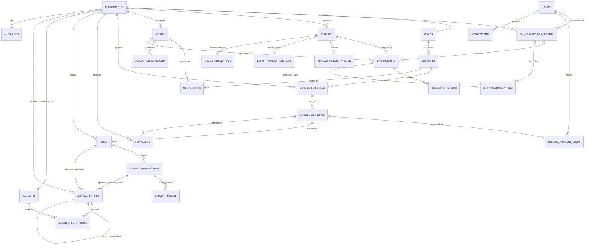

# Smart Municipal Waste Management Platform
## Phase 3: Data Architecture Specification

**Document Version:** 1.1.0 (Audited & Formally Hardened)  
**Phase:** 3 of 9 (Data Architecture, Double-Entry Accounting & Synthetic Demo Data)  
**Status:** Data Design & Planning Specification (Awaiting Stakeholder Review)  
**Workspace:** `D:\project`  
**Sources of Truth:**  
- [Phase 1 Requirements & Project Scope](file:///d:/project/docs/phase-1-requirements-and-scope.md) (v1.2.0)  
- [Phase 2 System Architecture Specification](file:///d:/project/docs/phase-2-system-architecture.md) (v1.2.0)  
- [Phase 2 Data Model & Schema Design Specification](file:///d:/project/docs/phase-2-data-model.md) (v1.2.0)  
- [Phase 2 API Contracts Specification](file:///d:/project/docs/phase-2-api-contracts.md) (v1.2.0)  
- [Phase 2 UI/UX Specification & Wireframes](file:///d:/project/docs/phase-2-ui-ux-specification.md) (v1.2.0)  
- [README.md](file:///d:/project/README.md) (v1.2.0)  
**Author:** Senior Software Architect  

---

## 1. Executive Summary & Design Governance

This document establishes the authoritative logical data architecture for Phase 3 of the Smart Municipal Waste Management Platform. It synthesizes all preceding architecture guidelines while formally implementing three confirmed stakeholder decisions:

1. **Double-Entry General Ledger Accounting:** Transitioning from a single-entry balance ledger to a multi-tenant double-entry accounting system with a chart of accounts, journal headers, journal lines, balanced debits/credits in integer minor currency units, immutable posting lifecycles, and separate compensating reversal entries.
2. **Doorstep Cash Collection Disabled for Pilot:** Preserving the schema structure for future extensibility while strictly disabling doorstep cash in pilot workflows, shift reconciliations, and citizen interfaces.
3. **Vehicle Tracking Restricted to Authenticated Citizens:** Retiring unauthenticated public live-tracking endpoints. Vehicle telemetry access requires verified citizen authentication and server-side locality authorization.

> [!IMPORTANT]
> **Strict Phase 3 Boundary:** This document defines logical structures, relational constraints, and data validation rules. No executable database migrations, live database connections, or application code are deployed in this phase.

> [!WARNING]
> **Accounting & Statutory Governance Disclaimers:**  
> - **Accounting Model:** The logical accounting model documented herein is an engineering design specification. It does **not** constitute legal, tax, or statutory municipal accounting advice. All account codes, posting rules, and revenue recognition policies must be formally reviewed and ratified by the respective Urban Local Body (ULB) chief finance officer or statutory municipal auditor prior to production deployment.  
> - **Tax Liabilities (GST):** The tax treatment (Goods & Services Tax / Municipal Cess) of solid waste collection charges is **unconfirmed pending qualified municipal finance and tax counsel review**. Tax exemption or zero GST is NOT an established requirement.  
> - **Data Retention Schedules:** All data retention periods (financial, citizen PII, complaints, telemetry) are preliminary engineering proposals and are **strictly pending validation and formal approval by the municipal legal, finance, and data-governance authorities**. No universal statutory minimums are assumed without an authoritative, verified legal basis.

---

## 2. Tenant Ownership Categorization & Logical Entity Catalog

To guarantee row-level security (RLS) enforcement and prevent cross-tenant data leakage, every entity is explicitly categorized by ownership. Ownership is never left implicit.

| Entity Name | Logical Domain | Tenant Ownership Classification | Ownership Key / Derivation |
| :--- | :--- | :--- | :--- |
| `users` | Identity & Access | Platform-Owned (Global) | None (Shared across tenants) |
| `municipalities` | Tenancy & Settings | System Root (Tenant Root) | `id UUID` (Defines tenant boundary) |
| `municipality_memberships` | Identity & Access | Explicitly Shared (Junction) | `tenant_id` + `user_id` |
| `wards` | Administrative Geography | Municipality-Owned | `tenant_id REFERENCES municipalities(id)` |
| `localities` | Administrative Geography | Municipality-Owned | `tenant_id REFERENCES municipalities(id)` |
| `service_locations` | Service & Property | Municipality-Owned | `tenant_id REFERENCES municipalities(id)` |
| `service_accounts` | Billing & Property | Municipality-Owned | `tenant_id REFERENCES municipalities(id)` |
| `service_account_users` | Service & Property | Municipality-Owned | `tenant_id REFERENCES municipalities(id)` |
| `vehicles` | Fleet Operations | Municipality-Owned | `tenant_id REFERENCES municipalities(id)` |
| `device_credentials` | Telemetry & Security | Municipality-Owned | `tenant_id REFERENCES municipalities(id)` |
| `routes` | Fleet Operations | Municipality-Owned | `tenant_id REFERENCES municipalities(id)` |
| `route_stops` | Fleet Operations | Municipality-Owned | `tenant_id REFERENCES municipalities(id)` |
| `collection_schedules` | Fleet Operations | Municipality-Owned | `tenant_id REFERENCES municipalities(id)` |
| `driver_shifts` | Fleet Operations | Municipality-Owned | `tenant_id REFERENCES municipalities(id)` |
| `collection_events` | Field Operations | Municipality-Owned | `tenant_id REFERENCES municipalities(id)` |
| `latest_vehicle_positions` | Telemetry & Tracking | Municipality-Owned | `tenant_id REFERENCES municipalities(id)` |
| `vehicle_telemetry_logs` | Telemetry & Tracking | Municipality-Owned | `tenant_id REFERENCES municipalities(id)` |
| `complaints` | Citizen Engagement | Municipality-Owned | `tenant_id REFERENCES municipalities(id)` |
| `bills` | Invoicing & Revenue | Municipality-Owned | `tenant_id REFERENCES municipalities(id)` |
| `payment_transactions` | Financial Operations | Municipality-Owned | `tenant_id REFERENCES municipalities(id)` |
| `payment_events` | Financial Auditing | Municipality-Owned | `tenant_id REFERENCES municipalities(id)` |
| `accounts` | General Ledger (COA) | Municipality-Owned | `tenant_id REFERENCES municipalities(id)` |
| `journal_entries` | General Ledger (Headers) | Municipality-Owned | `tenant_id REFERENCES municipalities(id)` |
| `journal_entry_lines` | General Ledger (Lines) | Municipality-Owned | `tenant_id REFERENCES municipalities(id)` |
| `shift_reconciliations` | Financial Reconciliation | Municipality-Owned | `tenant_id REFERENCES municipalities(id)` |
| `audit_logs` | Compliance & Security | Municipality-Owned | `tenant_id REFERENCES municipalities(id)` |
| `notifications` | Citizen Communications | Municipality-Owned | `tenant_id REFERENCES municipalities(id)` |

---

## 3. Logical Entity-Relationship Diagram (ERD)



---

## 4. Entity Specifications, Constraints & Deletion Policies

### 4.1 Tenancy & Identity

#### `municipalities`
- **Purpose:** Top-level tenant container representing an Urban Local Body (ULB).
- **Primary Key:** `id UUID DEFAULT gen_random_uuid()`
- **Key Columns:**
  - `name VARCHAR(128) NOT NULL`
  - `slug VARCHAR(64) NOT NULL UNIQUE` (Strict lower alphanumeric with hyphens)
  - `state_region VARCHAR(64) NOT NULL`
  - `contact_email VARCHAR(128) NOT NULL`
  - `currency VARCHAR(3) NOT NULL DEFAULT 'INR'`
  - `is_demo BOOLEAN NOT NULL DEFAULT FALSE`
  - `is_active BOOLEAN NOT NULL DEFAULT TRUE`
  - `settings JSONB NOT NULL DEFAULT '{}'` (Stores thresholds: `gps_fresh_seconds`, `gps_stale_seconds`, `allowed_payment_methods`)
  - `created_at TIMESTAMPTZ NOT NULL DEFAULT clock_timestamp()`
  - `updated_at TIMESTAMPTZ NOT NULL DEFAULT clock_timestamp()`
- **Constraints:** `CHECK (slug ~ '^[a-z0-9-]+$')`
- **Deletion Policy:** Prohibited. Deactivation via `is_active = FALSE`.

#### `users`
- **Purpose:** Global identity container for authentication across citizen, staff, and admin roles.
- **Primary Key:** `id UUID DEFAULT gen_random_uuid()`
- **Key Columns:**
  - `phone VARCHAR(20) NOT NULL UNIQUE` (E.164 format: `+919876543210`)
  - `email VARCHAR(128) NULL UNIQUE`
  - `password_hash VARCHAR(255) NOT NULL` (Argon2id)
  - `full_name VARCHAR(128) NOT NULL`
  - `is_active BOOLEAN NOT NULL DEFAULT TRUE`
  - `created_at TIMESTAMPTZ NOT NULL DEFAULT clock_timestamp()`
  - `updated_at TIMESTAMPTZ NOT NULL DEFAULT clock_timestamp()`
- **Constraints:** `CHECK (phone ~ '^\+[1-9]\d{7,14}$')`
- **Deletion Policy:** Prohibited if linked to audit, financial, or service account records.

#### `municipality_memberships`
- **Purpose:** Tenant authorization junction granting specific operational roles within a municipality.
- **Primary Key:** `id UUID DEFAULT gen_random_uuid()`
- **Foreign Keys:**
  - `tenant_id UUID NOT NULL REFERENCES municipalities(id) ON DELETE CASCADE`
  - `user_id UUID NOT NULL REFERENCES users(id) ON DELETE RESTRICT`
- **Key Columns:**
  - `role VARCHAR(32) NOT NULL` (`CITIZEN`, `COLLECTOR`, `MUNICIPAL_ADMIN`, `PLATFORM_ADMIN`)
  - `badge_number VARCHAR(32) NULL`
  - `is_active BOOLEAN NOT NULL DEFAULT TRUE`
  - `created_at TIMESTAMPTZ NOT NULL DEFAULT clock_timestamp()`
- **Constraints:**
  - `UNIQUE (tenant_id, user_id)`
  - `CHECK (role IN ('CITIZEN', 'COLLECTOR', 'MUNICIPAL_ADMIN', 'PLATFORM_ADMIN'))`
- **Deletion Policy:** `ON DELETE RESTRICT` if shift or reconciliation records exist.

---

### 4.2 Administrative Geography & Properties

#### `wards`
- **Primary Key:** `id UUID DEFAULT gen_random_uuid()`
- **Foreign Keys:** `tenant_id UUID NOT NULL REFERENCES municipalities(id) ON DELETE CASCADE`
- **Key Columns:** `ward_number VARCHAR(16) NOT NULL`, `name VARCHAR(64) NOT NULL`, `created_at TIMESTAMPTZ NOT NULL`
- **Constraints:** `UNIQUE (tenant_id, ward_number)`
- **Deletion Policy:** `ON DELETE RESTRICT` if localities exist.

#### `localities`
- **Primary Key:** `id UUID DEFAULT gen_random_uuid()`
- **Foreign Keys:**
  - `tenant_id UUID NOT NULL REFERENCES municipalities(id) ON DELETE CASCADE`
  - `ward_id UUID NOT NULL REFERENCES wards(id) ON DELETE RESTRICT`
- **Key Columns:**
  - `code VARCHAR(32) NOT NULL` (e.g. `VH-W04-L01`)
  - `name VARCHAR(128) NOT NULL`
  - `center_latitude NUMERIC(10, 7) NOT NULL`
  - `center_longitude NUMERIC(10, 7) NOT NULL`
  - `boundary_geojson JSONB NULL`
  - `created_at TIMESTAMPTZ NOT NULL`
- **Constraints:**
  - `UNIQUE (tenant_id, code)`
  - `CHECK (center_latitude BETWEEN -90.0 AND 90.0)`
  - `CHECK (center_longitude BETWEEN -180.0 AND 180.0)`
- **Deletion Policy:** `ON DELETE RESTRICT` if service locations or route stops exist.

#### `service_locations`
- **Primary Key:** `id UUID DEFAULT gen_random_uuid()`
- **Foreign Keys:**
  - `tenant_id UUID NOT NULL REFERENCES municipalities(id) ON DELETE CASCADE`
  - `locality_id UUID NOT NULL REFERENCES localities(id) ON DELETE RESTRICT`
- **Key Columns:**
  - `property_identifier VARCHAR(64) NOT NULL` (Municipal Property PIN / Assessment No.)
  - `address_line1 VARCHAR(255) NOT NULL`
  - `address_line2 VARCHAR(255) NULL`
  - `latitude NUMERIC(10, 7) NULL`
  - `longitude NUMERIC(10, 7) NULL`
  - `property_type VARCHAR(32) NOT NULL` (`RESIDENTIAL`, `COMMERCIAL`, `INSTITUTIONAL`)
  - `created_at TIMESTAMPTZ NOT NULL`
- **Constraints:**
  - `UNIQUE (tenant_id, property_identifier)`
  - `CHECK (property_type IN ('RESIDENTIAL', 'COMMERCIAL', 'INSTITUTIONAL'))`
- **Deletion Policy:** `ON DELETE RESTRICT`.

#### `service_accounts`
- **Primary Key:** `id UUID DEFAULT gen_random_uuid()`
- **Foreign Keys:**
  - `tenant_id UUID NOT NULL REFERENCES municipalities(id) ON DELETE CASCADE`
  - `service_location_id UUID NOT NULL REFERENCES service_locations(id) ON DELETE RESTRICT`
- **Key Columns:**
  - `account_number VARCHAR(32) NOT NULL` (e.g. `VH-SA-00104`)
  - `status VARCHAR(32) NOT NULL DEFAULT 'ACTIVE'` (`ACTIVE`, `SUSPENDED`, `CLOSED`)
  - `created_at TIMESTAMPTZ NOT NULL`
- **Constraints:**
  - `UNIQUE (tenant_id, account_number)`
  - `CHECK (status IN ('ACTIVE', 'SUSPENDED', 'CLOSED'))`
- **Deletion Policy:** `ON DELETE RESTRICT`.

#### `service_account_users`
- **Primary Key:** `id UUID DEFAULT gen_random_uuid()`
- **Foreign Keys:**
  - `tenant_id UUID NOT NULL REFERENCES municipalities(id) ON DELETE CASCADE`
  - `service_account_id UUID NOT NULL REFERENCES service_accounts(id) ON DELETE CASCADE`
  - `user_id UUID NOT NULL REFERENCES users(id) ON DELETE RESTRICT`
- **Key Columns:**
  - `relationship_type VARCHAR(32) NOT NULL` (`OWNER`, `TENANT`, `AUTHORIZED_FAMILY`)
  - `is_primary_billing_contact BOOLEAN NOT NULL DEFAULT FALSE`
  - `created_at TIMESTAMPTZ NOT NULL`
- **Constraints:**
  - `UNIQUE (tenant_id, service_account_id, user_id)`
  - `CHECK (relationship_type IN ('OWNER', 'TENANT', 'AUTHORIZED_FAMILY'))`
- **Deletion Policy:** `ON DELETE CASCADE` on link removal.

---

### 4.3 Fleet, Routes & Shift Operations

#### `vehicles`
- **Primary Key:** `id UUID DEFAULT gen_random_uuid()`
- **Foreign Keys:** `tenant_id UUID NOT NULL REFERENCES municipalities(id) ON DELETE CASCADE`
- **Key Columns:**
  - `registration_number VARCHAR(32) NOT NULL`
  - `vehicle_label VARCHAR(64) NOT NULL` (e.g. "Tipper Truck #04")
  - `vehicle_type VARCHAR(32) NOT NULL` (`COMPACTOR`, `TIPPER`, `AUTO_TIPPER`, `TRACTOR`)
  - `capacity_metric_tonnes NUMERIC(4, 2) NOT NULL`
  - `is_active BOOLEAN NOT NULL DEFAULT TRUE`
  - `created_at TIMESTAMPTZ NOT NULL`
- **Constraints:** `UNIQUE (tenant_id, registration_number)`
- **Deletion Policy:** `ON DELETE RESTRICT`.

#### `device_credentials`
- **Primary Key:** `id UUID DEFAULT gen_random_uuid()`
- **Foreign Keys:**
  - `tenant_id UUID NOT NULL REFERENCES municipalities(id) ON DELETE CASCADE`
  - `vehicle_id UUID NOT NULL UNIQUE REFERENCES vehicles(id) ON DELETE CASCADE`
- **Key Columns:**
  - `key_prefix VARCHAR(16) NOT NULL` (e.g. `dev_live_ab12`)
  - `token_hash VARCHAR(255) NOT NULL` (Argon2id hash of device pre-shared token)
  - `secondary_token_hash VARCHAR(255) NULL`
  - `secondary_expires_at TIMESTAMPTZ NULL`
  - `status VARCHAR(16) NOT NULL DEFAULT 'ACTIVE'` (`ACTIVE`, `SUSPENDED`, `REVOKED`)
  - `last_used_at TIMESTAMPTZ NULL`
  - `created_at TIMESTAMPTZ NOT NULL`
- **Constraints:**
  - `UNIQUE (tenant_id, vehicle_id)`
  - `CHECK (status IN ('ACTIVE', 'SUSPENDED', 'REVOKED'))`
- **Deletion Policy:** `ON DELETE CASCADE` when vehicle is decommissioned.

#### `routes` & `route_stops`
- **`routes`:** `tenant_id`, `route_code`, `name`, `status` (`ACTIVE`, `INACTIVE`). `UNIQUE (tenant_id, route_code)`.
- **`route_stops`:** `tenant_id`, `route_id REFERENCES routes(id) ON DELETE CASCADE`, `locality_id REFERENCES localities(id) ON DELETE RESTRICT`, `stop_order INT NOT NULL`, `geofence_radius_meters INT NOT NULL DEFAULT 50`. `UNIQUE (route_id, stop_order)`.

#### `driver_shifts`
- **Primary Key:** `id UUID DEFAULT gen_random_uuid()`
- **Foreign Keys:**
  - `tenant_id UUID NOT NULL REFERENCES municipalities(id) ON DELETE CASCADE`
  - `vehicle_id UUID NOT NULL REFERENCES vehicles(id) ON DELETE RESTRICT`
  - `driver_membership_id UUID NOT NULL REFERENCES municipality_memberships(id) ON DELETE RESTRICT`
  - `route_id UUID NOT NULL REFERENCES routes(id) ON DELETE RESTRICT`
- **Key Columns:**
  - `shift_date DATE NOT NULL`
  - `status VARCHAR(32) NOT NULL DEFAULT 'PLANNED'` (`PLANNED`, `ACTIVE`, `COMPLETED`, `CANCELLED`)
  - `started_at TIMESTAMPTZ NULL`
  - `ended_at TIMESTAMPTZ NULL`
  - `total_cash_collected_minor_units BIGINT NOT NULL DEFAULT 0` (Preserved for extensibility; strictly `0` in pilot)
  - `created_at TIMESTAMPTZ NOT NULL`
- **Constraints:**
  - `CHECK (status IN ('PLANNED', 'ACTIVE', 'COMPLETED', 'CANCELLED'))`
  - `CHECK (total_cash_collected_minor_units = 0)` (Enforces pilot cash prohibition at schema level for pilot phase)
- **Deletion Policy:** `ON DELETE RESTRICT`.

#### `collection_events`
- Records stop arrival and service status: `VISITED_COLLECTED`, `VISITED_NO_WASTE`, `SKIPPED_INACCESSIBLE`, `SKIPPED_NON_COMPLIANT`.
- Foreign Keys: `tenant_id`, `shift_id REFERENCES driver_shifts(id) ON DELETE CASCADE`, `route_stop_id REFERENCES route_stops(id) ON DELETE RESTRICT`.
- Deletion Policy: `ON DELETE RESTRICT`.

---

### 4.4 Telemetry & Vehicle Tracking Subsystem

#### `vehicle_telemetry_logs`
- **Purpose:** Append-only breadcrumb history of vehicle GPS coordinates.
- **Primary Key:** `id BIGSERIAL`
- **Foreign Keys:**
  - `tenant_id UUID NOT NULL REFERENCES municipalities(id) ON DELETE CASCADE`
  - `vehicle_id UUID NOT NULL REFERENCES vehicles(id) ON DELETE CASCADE`
  - `shift_id UUID NULL REFERENCES driver_shifts(id) ON DELETE SET NULL`
- **Key Columns:**
  - `latitude NUMERIC(10, 7) NOT NULL`
  - `longitude NUMERIC(10, 7) NOT NULL`
  - `speed_kmh NUMERIC(5, 2) NOT NULL DEFAULT 0.00`
  - `heading_degrees NUMERIC(5, 2) NOT NULL DEFAULT 0.00`
  - `recorded_at TIMESTAMPTZ NOT NULL` (Device timestamp)
  - `ingested_at TIMESTAMPTZ NOT NULL DEFAULT clock_timestamp()` (Server timestamp)
  - `is_simulated BOOLEAN NOT NULL DEFAULT FALSE`
- **Constraints:**
  - `CHECK (latitude BETWEEN -90.0 AND 90.0)`
  - `CHECK (longitude BETWEEN -180.0 AND 180.0)`
  - `CHECK (speed_kmh >= 0.0 AND speed_kmh <= 140.0)`
  - `CHECK (heading_degrees >= 0.0 AND heading_degrees < 360.0)`
- **Deletion Policy:** Rolling retention purge via automated background partition/batch job.

#### `latest_vehicle_positions`
- **Purpose:** Authoritative 1-to-1 persistent snapshot of current vehicle state for operational and authenticated citizen tracking queries.
- **Primary Key:** `vehicle_id UUID PRIMARY KEY REFERENCES vehicles(id) ON DELETE CASCADE`
- **Foreign Keys:**
  - `tenant_id UUID NOT NULL REFERENCES municipalities(id) ON DELETE CASCADE`
  - `shift_id UUID NULL REFERENCES driver_shifts(id) ON DELETE SET NULL`
- **Key Columns:**
  - `latitude NUMERIC(10, 7) NOT NULL`
  - `longitude NUMERIC(10, 7) NOT NULL`
  - `speed_kmh NUMERIC(5, 2) NOT NULL DEFAULT 0.00`
  - `heading_degrees NUMERIC(5, 2) NOT NULL DEFAULT 0.00`
  - `last_recorded_at TIMESTAMPTZ NOT NULL`
  - `status VARCHAR(16) NOT NULL DEFAULT 'UNAVAILABLE'` (`CURRENT`, `STALE`, `UNAVAILABLE`)
  - `is_demo BOOLEAN NOT NULL DEFAULT FALSE`
- **Constraints:**
  - `CHECK (status IN ('CURRENT', 'STALE', 'UNAVAILABLE'))`
- **Deletion Policy:** Cascades with vehicle.

---

### 4.5 Complaints & Service Requests

#### `complaints`
- **Primary Key:** `id UUID DEFAULT gen_random_uuid()`
- **Foreign Keys:**
  - `tenant_id UUID NOT NULL REFERENCES municipalities(id) ON DELETE CASCADE`
  - `locality_id UUID NOT NULL REFERENCES localities(id) ON DELETE RESTRICT`
  - `service_account_id UUID NULL REFERENCES service_accounts(id) ON DELETE SET NULL`
  - `submitted_by_user_id UUID NULL REFERENCES users(id) ON DELETE SET NULL`
  - `assigned_to_membership_id UUID NULL REFERENCES municipality_memberships(id) ON DELETE SET NULL`
- **Key Columns:**
  - `ticket_number VARCHAR(32) NOT NULL` (e.g. `VHMC-2026-CMP-00412`)
  - `category VARCHAR(32) NOT NULL` (`MISSED_LOCALITY`, `MISSED_HOUSEHOLD`, `WASTE_SPILLAGE`, `COLLECTOR_BEHAVIOR`)
  - `description TEXT NOT NULL`
  - `photo_url VARCHAR(255) NULL` (Optional; governed by municipal photo policy)
  - `status VARCHAR(32) NOT NULL DEFAULT 'OPEN'` (`OPEN`, `ASSIGNED`, `IN_INVESTIGATION`, `RESOLVED`, `CLOSED`)
  - `resolution_notes TEXT NULL`
  - `created_at TIMESTAMPTZ NOT NULL`
  - `resolved_at TIMESTAMPTZ NULL`
- **Constraints:**
  - `UNIQUE (tenant_id, ticket_number)`
  - `CHECK (category IN ('MISSED_LOCALITY', 'MISSED_HOUSEHOLD', 'WASTE_SPILLAGE', 'COLLECTOR_BEHAVIOR'))`
  - `CHECK (status IN ('OPEN', 'ASSIGNED', 'IN_INVESTIGATION', 'RESOLVED', 'CLOSED'))`
- **Deletion Policy:** `ON DELETE RESTRICT`.

---

### 4.6 Billing, Payments & Double-Entry Accounting

#### `bills`
- **Primary Key:** `id UUID DEFAULT gen_random_uuid()`
- **Foreign Keys:**
  - `tenant_id UUID NOT NULL REFERENCES municipalities(id) ON DELETE CASCADE`
  - `service_account_id UUID NOT NULL REFERENCES service_accounts(id) ON DELETE RESTRICT`
- **Key Columns:**
  - `invoice_number VARCHAR(64) NOT NULL` (e.g. `INV-VHMC-2026-08101`)
  - `billing_period_start DATE NOT NULL`
  - `billing_period_end DATE NOT NULL`
  - `amount_due_minor_units BIGINT NOT NULL` (e.g. `30000` = ₹300.00)
  - `amount_paid_minor_units BIGINT NOT NULL DEFAULT 0`
  - `currency VARCHAR(3) NOT NULL DEFAULT 'INR'`
  - `status VARCHAR(32) NOT NULL DEFAULT 'UNPAID'` (`UNPAID`, `PARTIALLY_PAID`, `PAID`, `CANCELLED`)
  - `due_date DATE NOT NULL`
  - `is_demo BOOLEAN NOT NULL DEFAULT FALSE`
  - `created_at TIMESTAMPTZ NOT NULL`
- **Constraints:**
  - `UNIQUE (tenant_id, invoice_number)`
  - `CHECK (amount_due_minor_units > 0)`
  - `CHECK (amount_paid_minor_units >= 0 AND amount_paid_minor_units <= amount_due_minor_units)`
  - `CHECK (status IN ('UNPAID', 'PARTIALLY_PAID', 'PAID', 'CANCELLED'))`
- **Deletion Policy:** `ON DELETE RESTRICT`.

#### `payment_transactions`
- **Purpose:** Records operational state of payment attempts across online gateways (and extensible to cash when authorized).
- **Primary Key:** `id UUID DEFAULT gen_random_uuid()`
- **Foreign Keys:**
  - `tenant_id UUID NOT NULL REFERENCES municipalities(id) ON DELETE CASCADE`
  - `service_account_id UUID NOT NULL REFERENCES service_accounts(id) ON DELETE RESTRICT`
  - `bill_id UUID NULL REFERENCES bills(id) ON DELETE RESTRICT`
- **Key Columns:**
  - `payment_method VARCHAR(32) NOT NULL` (`ONLINE_GATEWAY`, `DOORSTEP_CASH`, `MUNICIPAL_COUNTER`)
  - `amount_minor_units BIGINT NOT NULL`
  - `currency VARCHAR(3) NOT NULL DEFAULT 'INR'`
  - `status VARCHAR(32) NOT NULL` (`ORDER_CREATED`, `CHECKOUT_INITIATED`, `PROVIDER_CONFIRMED`, `SETTLED`, `FAILED`, `REFUNDED`)
  - `gateway_provider VARCHAR(32) NULL` (e.g. `RAZORPAY`, `SIMULATED_GATEWAY`)
  - `gateway_order_id VARCHAR(128) NULL`
  - `gateway_payment_id VARCHAR(128) NULL`
  - `receipt_number VARCHAR(64) NOT NULL` (e.g. `REC-VHMC-2026-00918`)
  - `is_demo BOOLEAN NOT NULL DEFAULT FALSE`
  - `created_at TIMESTAMPTZ NOT NULL`
- **Constraints:**
  - `UNIQUE (tenant_id, receipt_number)`
  - `CHECK (amount_minor_units > 0)`
  - `CHECK (payment_method IN ('ONLINE_GATEWAY', 'DOORSTEP_CASH', 'MUNICIPAL_COUNTER'))`
  - `CHECK (status IN ('ORDER_CREATED', 'CHECKOUT_INITIATED', 'PROVIDER_CONFIRMED', 'SETTLED', 'FAILED', 'REFUNDED'))`
- **Deletion Policy:** `ON DELETE RESTRICT`.

#### `payment_events`
- **Purpose:** Append-only audit trail and webhook idempotency store.
- **Primary Key:** `id UUID DEFAULT gen_random_uuid()`
- **Foreign Keys:**
  - `payment_id UUID NOT NULL REFERENCES payment_transactions(id) ON DELETE RESTRICT`
  - `tenant_id UUID NOT NULL REFERENCES municipalities(id) ON DELETE CASCADE`
- **Key Columns:**
  - `gateway_provider VARCHAR(32) NOT NULL`
  - `gateway_event_id VARCHAR(128) NOT NULL`
  - `idempotency_key VARCHAR(128) NULL`
  - `event_type VARCHAR(64) NOT NULL` (`ORDER_CREATED`, `PAYMENT_AUTHORIZED`, `PAYMENT_CAPTURED`, `PAYMENT_FAILED`, `REFUND_PROCESSED`, `DISPUTE_OPENED`)
  - `processing_status VARCHAR(32) NOT NULL DEFAULT 'PROCESSED'` (`PROCESSED`, `DUPLICATE_IGNORED`, `ANOMALY_PENDING_REVIEW`)
  - `error_details TEXT NULL`
  - `event_payload JSONB NOT NULL DEFAULT '{}'`
  - `occurred_at TIMESTAMPTZ NOT NULL DEFAULT clock_timestamp()`
- **Constraints:**
  - `UNIQUE (gateway_provider, gateway_event_id)` (Provider-scoped idempotency)
  - `CHECK (processing_status IN ('PROCESSED', 'DUPLICATE_IGNORED', 'ANOMALY_PENDING_REVIEW'))`
- **Deletion Policy:** Prohibited (`REVOKE DELETE`).

#### `accounts` (Chart of Accounts)
- **Purpose:** Municipality-owned financial account definitions for double-entry bookkeeping.
- **Primary Key:** `id UUID DEFAULT gen_random_uuid()`
- **Foreign Keys:**
  - `tenant_id UUID NOT NULL REFERENCES municipalities(id) ON DELETE CASCADE`
- **Key Columns:**
  - `account_code VARCHAR(32) NOT NULL` (e.g. `1110-CASH-GATEWAY-CLEARING`, `1210-AR-CITIZEN-FEES`)
  - `name VARCHAR(128) NOT NULL`
  - `account_type VARCHAR(32) NOT NULL` (`ASSET`, `LIABILITY`, `EQUITY`, `REVENUE`, `EXPENSE`)
  - `currency VARCHAR(3) NOT NULL DEFAULT 'INR'`
  - `is_active BOOLEAN NOT NULL DEFAULT TRUE`
  - `description TEXT NULL`
  - `created_at TIMESTAMPTZ NOT NULL DEFAULT clock_timestamp()`
- **Constraints:**
  - `UNIQUE (tenant_id, account_code)`
  - `CHECK (account_type IN ('ASSET', 'LIABILITY', 'EQUITY', 'REVENUE', 'EXPENSE'))`
- **Deletion Policy:** `ON DELETE RESTRICT` if journal entry lines reference the account. Deactivate via `is_active = FALSE`.

#### `journal_entries` (General Ledger Header)
- **Purpose:** Header record for double-entry financial events.
- **Primary Key:** `id UUID DEFAULT gen_random_uuid()`
- **Foreign Keys:**
  - `tenant_id UUID NOT NULL REFERENCES municipalities(id) ON DELETE CASCADE`
  - `created_by_user_id UUID NULL REFERENCES users(id) ON DELETE RESTRICT`
  - `reversal_of_entry_id UUID NULL REFERENCES journal_entries(id) ON DELETE RESTRICT`
- **Key Columns:**
  - `entry_number VARCHAR(64) NOT NULL` (Unique human-readable reference, e.g. `JE-VHMC-2026-00045`)
  - `business_event_type VARCHAR(64) NOT NULL` (`BILL_ISSUANCE`, `PAYMENT_CAPTURED`, `GATEWAY_FEE_RECORDED`, `GATEWAY_SETTLEMENT`, `REFUND_ISSUED`, `COMPENSATING_REVERSAL`, `FEE_ADJUSTMENT`)
  - `business_event_id VARCHAR(128) NOT NULL` (External operational reference, e.g. invoice UUID or payment UUID)
  - `effective_date DATE NOT NULL`
  - `status VARCHAR(16) NOT NULL DEFAULT 'DRAFT'` (`DRAFT`, `POSTED`)
  - `reversal_of_entry_id UUID NULL REFERENCES journal_entries(id) ON DELETE RESTRICT` (Populated on compensating reversal entries to point to the original unchanged entry)
  - `description TEXT NOT NULL`
  - `currency VARCHAR(3) NOT NULL DEFAULT 'INR'`
  - `is_demo BOOLEAN NOT NULL DEFAULT FALSE`
  - `created_at TIMESTAMPTZ NOT NULL DEFAULT clock_timestamp()`
  - `posted_at TIMESTAMPTZ NULL`
- **Constraints:**
  - `UNIQUE (tenant_id, entry_number)`
  - `UNIQUE (tenant_id, business_event_type, business_event_id)` (Financial business-event posting idempotency)
  - `CHECK (status IN ('DRAFT', 'POSTED'))`
- **Immutability & Deletion Policy:** 
  - Strictly prohibited to `DELETE` or `UPDATE` once `POSTED`.
  - Posted entries remain `status = 'POSTED'` indefinitely. An entry is NEVER updated to a reversed status.
  - Reversals are recorded as separate balanced journal entries (`business_event_type = 'COMPENSATING_REVERSAL'`, `status = 'POSTED'`, `reversal_of_entry_id = <original_entry_id>`).
  - The existence of a reversal is derived by querying for compensating entries referencing the original entry ID. Historical accounting evidence is preserved without mutation.

#### `journal_entry_lines` (General Ledger Line Items)
- **Purpose:** Balanced debits and credits referencing accounts in integer minor currency units.
- **Primary Key:** `id UUID DEFAULT gen_random_uuid()`
- **Foreign Keys:**
  - `tenant_id UUID NOT NULL REFERENCES municipalities(id) ON DELETE CASCADE`
  - `journal_entry_id UUID NOT NULL REFERENCES journal_entries(id) ON DELETE CASCADE`
  - `account_id UUID NOT NULL REFERENCES accounts(id) ON DELETE RESTRICT`
- **Key Columns:**
  - `line_number INT NOT NULL` (1-indexed within the journal entry)
  - `entry_type VARCHAR(6) NOT NULL` (`DEBIT`, `CREDIT`)
  - `amount_minor_units BIGINT NOT NULL`
  - `currency VARCHAR(3) NOT NULL DEFAULT 'INR'`
  - `memo TEXT NULL`
- **Constraints:**
  - `UNIQUE (journal_entry_id, line_number)`
  - `CHECK (entry_type IN ('DEBIT', 'CREDIT'))`
  - `CHECK (amount_minor_units > 0)`
- **Deletion Policy:** Prohibited once parent `journal_entry` is `POSTED`.

#### `shift_reconciliations`
- **Purpose:** Shift financial reconciliation container. In pilot, records verified zero-cash status.
- **Primary Key:** `id UUID DEFAULT gen_random_uuid()`
- **Foreign Keys:**
  - `tenant_id UUID NOT NULL REFERENCES municipalities(id) ON DELETE CASCADE`
  - `shift_id UUID NOT NULL UNIQUE REFERENCES driver_shifts(id) ON DELETE RESTRICT`
  - `driver_membership_id UUID NOT NULL REFERENCES municipality_memberships(id) ON DELETE RESTRICT`
  - `reconciled_by_membership_id UUID NOT NULL REFERENCES municipality_memberships(id) ON DELETE RESTRICT`
- **Key Columns:**
  - `system_recorded_cash_minor_units BIGINT NOT NULL DEFAULT 0`
  - `physical_cash_deposited_minor_units BIGINT NOT NULL DEFAULT 0`
  - `variance_minor_units BIGINT NOT NULL DEFAULT 0`
  - `status VARCHAR(32) NOT NULL DEFAULT 'BALANCED'` (`BALANCED`, `DISCREPANCY_FLAGGED`)
  - `supervisor_notes TEXT NULL`
  - `created_at TIMESTAMPTZ NOT NULL DEFAULT clock_timestamp()`
- **Constraints:**
  - `CHECK (status IN ('BALANCED', 'DISCREPANCY_FLAGGED'))`
  - `CHECK (system_recorded_cash_minor_units = 0)` (Enforces pilot zero-cash invariant)
- **Deletion Policy:** `ON DELETE RESTRICT`.

---

## 5. Required Indexes & Performance Justification

| Table | Index Columns | Index Type | Business / Performance Justification |
| :--- | :--- | :--- | :--- |
| `municipality_memberships` | `(tenant_id, role)` | B-tree | Accelerates staff lookup by role during shift assignment and dispatch. |
| `localities` | `(tenant_id, ward_id)` | B-tree | Enables rapid locality filtering when selecting wards during citizen lookup. |
| `service_locations` | `(tenant_id, property_identifier)` | B-tree Unique | Enforces property PIN uniqueness and supports millisecond lookup during account linking. |
| `service_accounts` | `(tenant_id, account_number)` | B-tree Unique | Instant resolution of citizen utility billing accounts. |
| `service_account_users` | `(user_id, tenant_id)` | B-tree | Resolves all service accounts accessible to a logged-in citizen across municipalities. |
| `driver_shifts` | `(tenant_id, shift_date, status)` | B-tree | Operational supervisor dashboard queries for active/planned daily shifts. |
| `latest_vehicle_positions` | `(tenant_id, status)` | B-tree | Filters currently active vehicles for map rendering while excluding off-shift fleet. |
| `vehicle_telemetry_logs` | `(vehicle_id, recorded_at DESC)` | B-tree Composite | Enables sub-second retrieval of breadcrumb trails and historical route replays. |
| `vehicle_telemetry_logs` | `(tenant_id, ingested_at)` | B-tree | Supports telemetry ingestion auditing and partition-based rolling data purge. |
| `device_credentials` | `(key_prefix, status)` | B-tree Partial | Optimizes high-frequency device authentication lookups on GPS ingress. |
| `complaints` | `(tenant_id, status, created_at DESC)` | B-tree Composite | Powers municipal supervisor inbox and SLA escalation queues. |
| `complaints` | `(locality_id, created_at DESC)` | B-tree | Aggregates locality-specific complaints to detect systemic collection failures. |
| `bills` | `(service_account_id, status)` | B-tree | Citizen billing portal query for outstanding/unpaid invoices. |
| `payment_transactions` | `(tenant_id, created_at DESC, status)` | B-tree Composite | Financial reporting and reconciliation batch export queries. |
| `payment_events` | `(gateway_provider, gateway_event_id)` | B-tree Unique | Critical idempotency index preventing double-crediting from webhook retries. |
| `payment_events` | `(processing_status)` WHERE status = 'ANOMALY_PENDING_REVIEW' | B-tree Partial | Immediate alerting and query queue for webhook signature/order anomalies. |
| `accounts` | `(tenant_id, account_code)` | B-tree Unique | Fast lookup of general ledger accounts during journal entry preparation. |
| `journal_entries` | `(tenant_id, effective_date, status)` | B-tree Composite | General ledger extraction, trial balance generation, and audit trail traversal. |
| `journal_entries` | `(tenant_id, business_event_type, business_event_id)` | B-tree Unique | Prevents duplicate journal entry posting for the same business event. |
| `journal_entry_lines` | `(journal_entry_id, line_number)` | B-tree Unique | Fast assembly of debit/credit lines when loading journal entries. |
| `journal_entry_lines` | `(account_id, tenant_id)` | B-tree Composite | Powers account-level ledger balances and financial statement generation. |

---

## 6. Double-Entry Accounting Model & Posting Lifecycle

### 6.1 Mandatory Posting Invariants
Every posted journal entry in the platform must satisfy the fundamental double-entry equation:

$$\sum \text{Debits} = \sum \text{Credits} > 0$$

Specifically, before a journal entry can transition to `POSTED`, the following six validation invariants are strictly enforced:
1. **Minimum Legs:** Every entry must contain at least one line with `entry_type = 'DEBIT'` and at least one line with `entry_type = 'CREDIT'`.
2. **Minimum Line Count:** Every entry must contain at least two constituent line items (`COUNT(lines) >= 2`).
3. **Exact Balance Equality:** The sum of `amount_minor_units` for all `DEBIT` lines must exactly equal the sum of `amount_minor_units` for all `CREDIT` lines within the entry ($\Delta = 0$).
4. **Valid Active Accounts:** Every line must reference an existing account belonging to the same tenant (`accounts.tenant_id = journal_entries.tenant_id`) that is currently active (`accounts.is_active = TRUE`).
5. **Currency Homogeneity:** All lines within a journal entry must share the identical ISO 4217 currency code (`INR`) matching the parent header. Cross-currency mixing within an entry is strictly prohibited.
6. **Strictly Positive Integer Quantities:** All line amounts must be strictly positive integers (`amount_minor_units > 0`). Floating-point types are prohibited.

### 6.2 Journal Posting Lifecycle & Immutability Architecture

```mermaid
stateDiagram-v2
    [*] --> DRAFT : Create Entry Header & Add Lines
    DRAFT --> DRAFT : Insert / Update / Delete Lines
    DRAFT --> CANCELLED : Discard Unposted Draft
    DRAFT --> POSTED : Atomic Validation & Commit Lock
    POSTED --> [*] : Permanent Append-Only State (Never Mutated)
    CANCELLED --> [*]

    %% Compensating Reversal Relationship
    POSTED -.-> |Referenced by reversal_of_entry_id| COMPENSATING_ENTRY[New Separate Entry: POSTED]
```

- **`DRAFT`:** Editable working state. Constituent debit and credit lines may be freely inserted, updated, or removed while balancing is in progress. Draft entries have zero impact on account balances, financial statements, or trial balances.
- **`POSTED`:** Atomically validated, permanent accounting record. Once transitioned to `POSTED`, the header and all constituent lines are **strictly immutable**. SQL `UPDATE` and `DELETE` privileges are revoked. The status remains `POSTED` indefinitely.
- **`CANCELLED`:** Discarded draft entry.
- **Compensating Reversal Entries:** To reverse or correct a posted entry, a **new, separate, balanced journal entry** is created with `business_event_type = 'COMPENSATING_REVERSAL'`, `status = 'POSTED'`, and `reversal_of_entry_id = <original_entry_id>`. The original entry remains `POSTED` and is never updated. Financial reporting queries determine net position by summing all posted entries.

### 6.3 Atomicity, Concurrency & Multi-Tier Database Enforcement

A deferred constraint trigger alone is insufficient to guarantee journal integrity, because deferred triggers on lines do not govern header transitions, account active status locks, or race conditions. Complete enforcement requires a multi-tier architecture:

1. **Atomic Application Posting Transaction:**
   - The posting routine runs inside an isolated transaction (`READ COMMITTED` with explicit locking, or `SERIALIZABLE`).
   - The transaction acquires an exclusive row lock on the draft header:
     ```sql
     SELECT id, tenant_id, currency, status FROM journal_entries WHERE id = $1 FOR UPDATE;
     ```
   - This prevents concurrent posting workers from processing the same draft twice.
2. **Pre-Commit Invariant Validation:**
   - Inside the transaction, the posting engine computes sums and verifies active accounts:
     ```sql
     SELECT 
       COUNT(*) AS total_lines,
       COUNT(*) FILTER (WHERE jel.entry_type = 'DEBIT') AS debit_count,
       COUNT(*) FILTER (WHERE jel.entry_type = 'CREDIT') AS credit_count,
       COALESCE(SUM(jel.amount_minor_units) FILTER (WHERE jel.entry_type = 'DEBIT'), 0) AS total_debits,
       COALESCE(SUM(jel.amount_minor_units) FILTER (WHERE jel.entry_type = 'CREDIT'), 0) AS total_credits,
       COUNT(*) FILTER (WHERE a.is_active = FALSE OR a.tenant_id != je.tenant_id) AS invalid_accounts
     FROM journal_entry_lines jel
     JOIN journal_entries je ON jel.journal_entry_id = je.id
     JOIN accounts a ON jel.account_id = a.id
     WHERE je.id = $1;
     ```
   - If `total_debits != total_credits`, or `debit_count < 1`, or `credit_count < 1`, or `invalid_accounts > 0`, the transaction is immediately aborted.
3. **Trigger-Level Append-Only Immutability:**
   - *Line Protection:* A database trigger on `journal_entry_lines` blocks any `INSERT`, `UPDATE`, or `DELETE` if the parent header is already in status `POSTED`.
   - *Header Protection:* A database trigger on `journal_entries` permanently blocks any subsequent `UPDATE` or `DELETE` once `status = 'POSTED'`.
4. **Business Event Idempotency:**
   - Database constraint `UNIQUE (tenant_id, business_event_type, business_event_id)` on `journal_entries` prevents duplicate financial postings from retried payment webhooks or repeated batch runs.

---

## 7. Pilot Policy Constraints

### 7.1 Doorstep Cash Collection: Disabled for Pilot
Per confirmed stakeholder requirements, doorstep cash collection is disabled during the pilot:
- **Application Invariant:** Cash collection endpoints (`POST /api/v1/collector/shifts/:id/cash-collections`) are deactivated. User interfaces for collectors and citizens omit cash payment options.
- **Schema Extensibility:** Table columns (`driver_shifts.total_cash_collected_minor_units`, `shift_reconciliations`) remain defined to avoid future schema churn, but are constrained via schema check constraints (`CHECK (total_cash_collected_minor_units = 0)`).
- **Shift Reconciliation Consequence:** Collector shift end reconciliation records `system_recorded_cash_minor_units = 0` and `physical_cash_deposited_minor_units = 0`. No physical cash variances can occur in the pilot.
- **Accounting Consequence:** Chart of accounts entry `1010-CASH-IN-HAND-COLLECTORS` is marked `is_active = FALSE` for the pilot. No cash journal entries are generated.

### 7.2 Vehicle Tracking: Authenticated Citizens Only
Per confirmed stakeholder requirements, live vehicle tracking requires authenticated resident verification:
- **Decommissioned Route:** Public route `GET /api/v1/public/municipalities/:slug/tracking/:localityId` is retired.
- **Authorized Route:** Authenticated endpoint `GET /api/v1/citizen/tracking/:localityId` requires an active session token.
- **Server-Side Authorization Invariant:** The server derives `tenant_id` from the authenticated session and verifies that the citizen is authorized for the requested locality (via an active `service_account` or verified resident profile). Attempting to access vehicle coordinates across tenants or unauthorized localities returns `403 Forbidden` (`AUTH_FORBIDDEN_OBJECT_ACCESS`).
- **Telemetry Freshness:** The three-state classification (`CURRENT`, `STALE`, `UNAVAILABLE`) is retained with municipal-configurable thresholds (`gps_fresh_seconds`, `gps_stale_seconds`).

---

## 8. Demo vs. Production Data Boundaries

To prevent synthetic pilot data from contaminating production reporting:

1. **Authoritative Demo Inheritance:**
   The database implements an explicit `BEFORE INSERT OR UPDATE` trigger (`enforce_tenant_demo_inheritance`):
   - Any record inserted under a municipality with `is_demo = TRUE` has its `is_demo` flag automatically set to `TRUE`.
   - Attempting to insert a record with `is_demo = TRUE` under a production tenant (`is_demo = FALSE`) is aborted with an exception.
2. **Dedicated Production Views:**
   All production financial, operational, and audit reports query exclusively through non-updatable database views enforcing:
   ```sql
   WHERE record.is_demo = FALSE AND tenant.is_demo = FALSE
   ```
3. **Receipt Void Watermark:**
   All receipts, invoices, and accounting exports generated from demo records render an immutable diagonal watermark:  
   `DEMONSTRATION RECORD — NOT A LEGAL OR TAX RECEIPT — VOID`.

---

## 9. Data Retention & Sensitive Data Classification (Provisional Proposals)

> [!WARNING]
> **Data Governance Notice:**  
> All retention periods and purge strategies below are **provisional engineering proposals pending formal review and validation by the appropriate municipal legal, finance, and data-governance authorities**.  
> No period is asserted as a universal statutory minimum without an authoritative, verified legal basis. Specific retention rules must be confirmed per municipality before production implementation.

| Data Category | Tables Involved | Classification | Proposed Retention Period (Pending Review) | Purge / Masking Strategy |
| :--- | :--- | :--- | :--- | :--- |
| **Citizen PII** | `users`, `service_account_users` | Confidential PII | Proposed: Active account duration + post-closure review window | Phone/email masked in operational views; physical deletion upon approved statutory data erasure requests. |
| **Financial Records** | `bills`, `payment_transactions`, `journal_entries`, `journal_entry_lines`, `accounts` | Restricted Financial | Proposed: Period determined by municipal finance/audit regulations | Immutable, append-only storage. Encrypted backups. |
| **Payment Secrets & Webhook Payloads** | `payment_events` | Sensitive Compliance | Proposed: 90 days raw payload; event audit metadata aligned with financial policy | Raw headers and request bodies scrubbed of auth tokens/signatures after designated quarantine window. |
| **High-Frequency GPS** | `vehicle_telemetry_logs` | Operational Fleet | Proposed: Rolling raw window (e.g. 30 days); downsampled summaries pending fleet policy | Automated daily rolling partition drop or chunk purge. |
| **Device Credentials** | `device_credentials` | Cryptographic Secret | Proposed: Active device lifecycle + rotation grace period | Salted Argon2id hashes only. Plaintext secret tokens are never stored. |
| **Audit Logs** | `audit_logs` | Governance & Security | Proposed: Window determined by municipal compliance authority | Append-only. Updates/deletes revoked. |

---

## 10. Security & Tripartite Role Architecture

The data architecture relies on PostgreSQL Row-Level Security (RLS) under a strictly separated three-role model:

1. **`waste_app_user` (Runtime Application Role):**
   - Configured with `NOSUPERUSER` and `NOBYPASSRLS`.
   - Owns zero database objects.
   - Granted standard DML permissions (`SELECT`, `INSERT`, `UPDATE` where permitted).
   - Strictly bounded by RLS policies using transaction-local configuration:
     ```sql
     SELECT set_config('app.current_tenant_id', $1, true);
     ```
2. **`waste_migration_user` (Schema Migration Role):**
   - Configured with `NOSUPERUSER` and `NOBYPASSRLS`.
   - Owns application tables and schemas.
   - Used exclusively in CI/CD pipelines to execute DDL migrations. Prohibited from running application workloads.
3. **`waste_dba_admin` (Database Administrator):**
   - Cluster provisioning role. Strictly prohibited from routine application connection pools.

> [!CAUTION]
> **RLS Boundary Reminder:** In PostgreSQL, superusers and roles with `BYPASSRLS` bypass RLS unconditionally. `FORCE ROW LEVEL SECURITY` constrains table owners, but **never constrains superusers or `BYPASSRLS` roles**. The runtime role `waste_app_user` must never possess superuser or `BYPASSRLS` privileges. Furthermore, transaction-local tenant context is an internal defense-in-depth measure against ORM/application bugs; it does not replace strict parameterized queries to prevent SQL injection.
