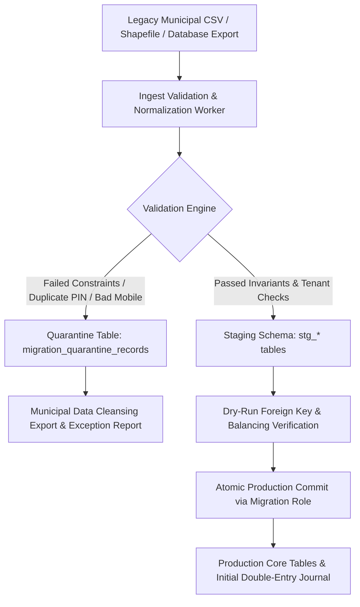

# Smart Municipal Waste Management Platform
## Phase 3: Real Data Transition & Migration Architecture Specification

**Document Version:** 1.1.0 (Audited & Formally Hardened)  
**Phase:** 3 of 9 (Data Architecture, Double-Entry Accounting & Synthetic Demo Data)  
**Status:** Transition Planning Specification (Awaiting Stakeholder Review)  
**Workspace:** `D:\project`  
**Sources of Truth:**  
- [Phase 3 Data Architecture Specification](file:///d:/project/docs/phase-3-data-architecture.md) (v1.1.0)  
- [Phase 3 Field-Level Data Dictionary Specification](file:///d:/project/docs/phase-3-data-dictionary.md) (v1.1.0)  
- [Phase 3 Double-Entry Accounting Design Specification](file:///d:/project/docs/phase-3-accounting-design.md) (v1.1.0)  
- [README.md](file:///d:/project/README.md) (v1.2.0)  
**Author:** Senior Software Architect  

---

## 1. Governance & Legal Pre-Conditions

> [!CAUTION]
> **GOVERNANCE & PRIVACY MANDATE:**  
> Prior to ingesting any real municipal data, live citizen contact details, property assessment records, or employee lists into this platform, **formal data-owner authorization and statutory data protection compliance must be executed in writing**.  
> 
> - Under no circumstances may development or operations personnel scrape, import, or connect to unapproved government registries, GIS portals, or municipal databases without explicit data processing agreements.  
> - Tax treatment (GST/cess) is **unconfirmed pending qualified municipal finance and tax review**; zero tax is not an established requirement.  
> - Data retention periods across citizen, financial, complaint, and telemetry records are **preliminary engineering proposals pending formal approval by municipal legal and data-governance authorities**. Universal statutory minimums are not assumed.

### 1.1 Lawful Access & Municipal Authorization
1. **Data Processing Agreement (DPA):** Signed between the platform provider and the Urban Local Body (ULB) establishing the municipality as the legal Data Fiduciary / Controller and the platform as the Data Processor.
2. **Statutory Basis:** Ingestion must align with the Digital Personal Data Protection (DPDP) Act (or relevant regional data privacy framework) under legitimate municipal utility service delivery.
3. **Data Protection Impact Assessment (DPIA):** A documented assessment of citizen PII risks, particularly regarding property addresses, mobile numbers, and GPS tracking associations.

---

## 2. Source-to-Target Field Mapping Framework

When onboarding a live municipality, legacy municipal records typically originate from four distinct departmental silos:
1. **Property Tax / Assessment Department:** Master property rolls, building indices, ownership records.
2. **Town Planning / GIS Department:** Ward boundaries, locality beat shapefiles, route coordinates.
3. **Mechanical / Transport Department:** Vehicle registrations, compactor capacities, GPS hardware inventories.
4. **Health / Sanitation Department:** Sanitation supervisor rosters, permanent driver badges, collection schedules.

### Field Mapping Specification

| Target Entity & Field | Legacy Municipal Source Field | Transformation & Sanitization Rule | Rejection Criteria |
| :--- | :--- | :--- | :--- |
| `wards.ward_number` | Property Tax Ward Index / Census Ward | Trim whitespace, format as `Ward-XX` | Missing or non-alphanumeric |
| `localities.code` | Sanitation Beat Code / GIS Zone ID | Uppercase, hyphenated (e.g. `MUM-W04-B01`) | Duplicate code within tenant |
| `localities.center_coordinates`| GIS Locality Centroid (WGS84) | Validate latitude/longitude ranges | Out of municipal bounding polygon |
| `service_locations.property_identifier` | Municipal Property Tax PIN / Assessment # | String normalization; strip punctuation | Non-unique PIN in municipal roll |
| `service_locations.address_line1` | Municipal Rateable Value Address | Standardize casing, remove control characters | Empty string |
| `users.phone` | Citizen Mobile Number (Tax Register) | Clean to E.164 format: `+91XXXXXXXXXX` | Invalid mobile digits (<10 digits) |
| `users.full_name` | Assessee / Resident Name | Capitalize, strip honorific duplicates | Empty string |
| `vehicles.registration_number` | Municipal RTO Registration Certificate | Uppercase, remove spaces/hyphens | Invalid regional transport format |
| `vehicles.capacity_metric_tonnes` | Vehicle Logbook / RC Book Tonnage | Cast to numeric decimal (`NUMERIC(4, 2)`) | `<= 0.0` or `> 40.0` tonnes |

---

## 3. Data Ingestion Pipeline & Quarantine Architecture

To ensure that corrupted, incomplete, or duplicate legacy municipal records never compromise production data integrity, ingestion operates through a strictly isolated staging and quarantine pipeline:



### 3.1 The Quarantine Table (`migration_quarantine_records`)
Any row failing validation (e.g. malformed phone numbers, missing ward IDs, duplicate property identifiers) is diverted to a quarantine table rather than halting the entire migration batch:

```sql
CREATE TABLE migration_quarantine_records (
    id UUID PRIMARY KEY DEFAULT gen_random_uuid(),
    tenant_id UUID NOT NULL REFERENCES municipalities(id),
    source_dataset VARCHAR(64) NOT NULL, -- e.g. 'PROPERTY_TAX_EXPORT_2026'
    source_row_number INT NOT NULL,
    raw_payload JSONB NOT NULL,
    error_code VARCHAR(64) NOT NULL,    -- e.g. 'ERR_INVALID_E164_PHONE'
    error_message TEXT NOT NULL,
    quarantined_at TIMESTAMPTZ NOT NULL DEFAULT clock_timestamp()
);
```

Municipal staff receive an automated exception workbook listing quarantined records with clear remediation guidance (e.g. "Row 412: Property PIN MH-101 has invalid mobile number '98200' (must be 10 digits)").

---

## 4. Tenant Assignment & Cross-Contamination Prevention

During batch migrations involving multiple municipalities:
1. **Mandatory Explicit Tenant Scoping:** Every migration script requires an explicit, hardcoded or environment-injected `TARGET_TENANT_ID`. The ingestion script is hardcoded to refuse execution if `TARGET_TENANT_ID` is empty or references a non-existent municipality.
2. **Session Variable Enforcement:** During staging loads under `waste_migration_user`, the connection explicitly sets:
   ```sql
   SELECT set_config('app.current_tenant_id', 'target-tenant-uuid', true);
   ```
3. **Cross-Tenant Primary Key Verification:** Before committing staged data to production tables, a verification query asserts that zero staged rows contain foreign keys referencing other tenants:
   ```sql
   SELECT COUNT(*) FROM stg_service_locations sl
   JOIN wards w ON sl.ward_id = w.id
   WHERE sl.tenant_id != w.tenant_id;
   -- Must return 0, or migration aborts.
   ```

---

## 5. PII Protection & Data Cleansing

1. **Restricted Direct Access:** Direct raw CSV dumps from municipalities containing citizen names, mobile numbers, and property identifiers are stored in an encrypted staging bucket (AES-256) with access restricted strictly to the designated Migration Lead.
2. **No Plaintext Password Generation:** For imported citizen accounts, random placeholder passwords are **never** generated or emailed. Instead, citizens claim their account via secure self-service OTP verification matching their registered mobile number (`POST /api/v1/auth/claim-account`).
3. **Operational Field Masking:** Once ingested, operational views accessed by sanitation staff (e.g. collector tablet dashboards) mask citizen phone numbers (`+91 98765 *****`) and display only property PINs and street addresses.
4. **Zero Telemetry Backfill:** Historical vehicle GPS logs from prior proprietary trackers are **not** migrated. The platform initiates telemetry fresh from the cutover date to prevent corrupted coordinate artifacts.
5. **Complaint Media Privacy Governance:** The storage, public visibility, retention duration, and potential redaction/blurring of citizen complaint photographs (such as faces or vehicle registration marks) are **strictly subject to verification and formal policy sign-off by municipal legal and data-protection authorities**. Redaction or blurring is not assumed to be legally mandated until confirmed for each specific municipal jurisdiction.

---

## 6. Financial Opening Balances & General Ledger Migration

When transitioning an ongoing municipal utility billing system to the platform's double-entry model:
1. **Arrears & Outstanding Balances:** Outstanding unpaid garbage fees assessed under legacy systems must be converted into opening Accounts Receivable.
2. **Balanced Opening Journal Entry:** The financial cutover executes an explicit Opening Balance Journal Entry posted to the General Ledger:
   - **Debit:** Account `1210 AR-CITIZEN-FEES` (Total outstanding legacy municipal arrears).
   - **Credit:** Account `3010 MUNICIPAL-OPERATING-EQUITY` (Opening balance equity / accumulated fund balance).
3. **Statutory Sign-Off:** The opening journal entry amount must match the certified legacy balance sheet down to the minor unit (paise) and receive written sign-off from the Municipal Auditor before live billing begins.

---

## 7. Staging Dry-Run Validation & Rollback Plan

### 7.1 Dry-Run Staging Execution Steps
1. **Step 1: Staging Provisioning:** Provision an exact replica of the target production database with production configuration and RLS policies.
2. **Step 2: Dry-Run Ingest:** Execute the migration scripts against the staging database using sanitized real municipal export files.
3. **Step 3: Automated Invariant Suite Execution:** Run the Phase 3 validation suite against the staging database:
   - Referential integrity checks (zero orphan records).
   - Double-entry balance assert ($\sum \text{Debits} - \sum \text{Credits} = 0$).
   - RLS isolation verification under runtime role `waste_app_user`.
4. **Step 4: Municipal Acceptance Sign-Off:** Provide municipal supervisors with access to the staging portal to verify sample properties, route sequences, and billing calculations.

### 7.2 Cutover & Rollback Contingency Strategy
- **Maintenance Window:** Migration executes during an off-peak maintenance window (e.g. Saturday 22:00 to Sunday 04:00).
- **Atomic Transaction Wrapping:** Each migration batch executes inside an explicit PostgreSQL transaction block (`BEGIN ... COMMIT`). Any constraint failure automatically triggers a clean `ROLLBACK`.
- **Pre-Migration Snapshot:** A full physical database snapshot (PostgreSQL `pg_dump` and storage snapshot) is captured immediately prior to cutover.
- **Rollback Trigger Criteria:** If post-migration sanity tests fail or if the reconciliation variance between legacy balances and opening ledger exceeds ₹0.00, the rollback protocol is triggered:
  1. Abort transaction or restore pre-migration storage snapshot.
  2. Revert DNS / application routing to legacy systems.
  3. Emit detailed incident report and schedule data cleansing workshop with municipal stakeholders.
