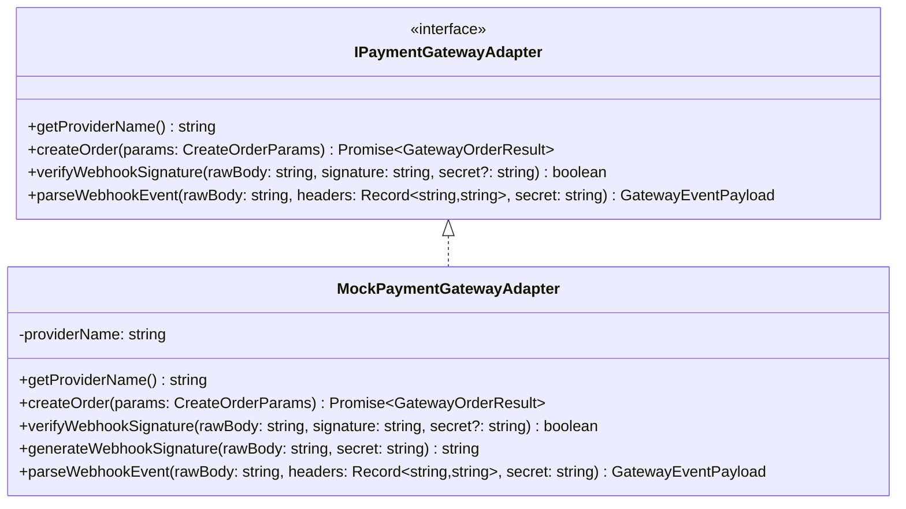

# Phase 6: Payments Foundation — Verification Report & Architecture Specification

**Project:** Smart Municipal Waste Management Platform  
**Workspace:** `D:\project`  
**Phase:** 6 of 9 (Payments Foundation)  
**Status:** Completed & PostgreSQL Verified (84 Passing Tests Across Full Test Suite)  
**Date:** October 2026  

---

## 1. Executive Summary

Phase 6 implements the **Payments Foundation** for the Smart Municipal Waste Management Platform. In strict compliance with municipal guidelines, this foundation provides a provider-neutral gateway integration layer without enabling real-money transactions or connecting live external financial institutions.

Key deliverables include:
- A provider-neutral `IPaymentGatewayAdapter` interface and an authentic cryptographic `MockPaymentGatewayAdapter` sandbox.
- Relational schema additions in migration `006_payments.sql` defining `bills`, `payment_transactions`, and `payment_events`.
- Strict PostgreSQL Row-Level Security (RLS) enforcement under the unprivileged runtime role `waste_app_user` (`NOSUPERUSER`, `NOBYPASSRLS`).
- Dual-layer idempotency: client idempotency on `(tenant_id, idempotency_key)` and gateway event deduplication on `(gateway_provider, gateway_event_id)`.
- Server-side cryptographic HMAC SHA-256 webhook signature validation using constant-time comparison (`crypto.timingSafeEqual`). Client-supplied payment status is never trusted.
- Automated, transactional coordination between payment lifecycle transitions and the double-entry general ledger:
  - **Payment Capture:** Debit `1030` (*Payment Gateway Clearing Account*), Credit `1040` (*Citizen Accounts Receivable*).
  - **Payment Refund:** Debit `1040` (*Citizen Accounts Receivable*), Credit `1030` (*Payment Gateway Clearing Account*).
  - **Immutability:** Original posted journal entries remain strictly unchanged; compensating reversals are posted as discrete, balanced records.
- Strict deactivation of doorstep cash collection (`doorstepCashEnabled: false`, HTTP 403 `DOORSTEP_CASH_DISABLED`).
- Out-of-order and anomalous events quarantined safely with `ANOMALY_PENDING_REVIEW` without corrupting ledger or transaction states.
- All monetary calculations maintained strictly in integer minor units (`BIGINT` paise).

---

## 2. Implemented Source Files & Architecture Inventory

| File Path | Description |
|---|---|
| [`src/db/migrations/006_payments.sql`](file:///D:/project/src/db/migrations/006_payments.sql) | DDL migration defining `bills`, `payment_transactions`, `payment_events`, foreign keys, check constraints, RLS policies, indexes, and demo inheritance triggers. |
| [`src/types/payment.types.ts`](file:///D:/project/src/types/payment.types.ts) | Domain TypeScript types: `PaymentStatus`, `PaymentMethod`, `BillStatus`, `PaymentEventType`, `EventProcessingStatus`, `CreateOrderParams`, `GatewayOrderResult`, `GatewayEventPayload`. |
| [`src/services/payment-gateway.adapter.ts`](file:///D:/project/src/services/payment-gateway.adapter.ts) | Provider-neutral interface `IPaymentGatewayAdapter` and sandbox implementation `MockPaymentGatewayAdapter` with timing-safe HMAC SHA-256 signature verification. |
| [`src/services/payment.service.ts`](file:///D:/project/src/services/payment.service.ts) | Core payment domain service: order creation, client idempotency, webhook ingestion, payment state machine, bill balance updates, and double-entry ledger integration. |
| [`src/api/v1/payment.routes.ts`](file:///D:/project/src/api/v1/payment.routes.ts) | Citizen REST API routes for order creation (`POST /create-order`), bill listing (`GET /bills`), payment history (`GET /history`), and payment lookup (`GET /:id`). |
| [`src/api/v1/webhook.routes.ts`](file:///D:/project/src/api/v1/webhook.routes.ts) | Webhook callback route (`POST /api/v1/webhooks/payments/:gateway`) with raw body extraction and HMAC signature verification. |
| [`src/api/middleware/error.middleware.ts`](file:///D:/project/src/api/middleware/error.middleware.ts) | Error handling middleware updated with explicit mappings for `DOORSTEP_CASH_DISABLED`, `AUTH_FORBIDDEN_BILL_ACCESS`, `INVALID_AMOUNT`, `OVERPAYMENT_NOT_PERMITTED`, and `BILL_STATUS_CONFLICT`. |
| [`src/app.ts`](file:///D:/project/src/app.ts) | Express application entrypoint updated with raw body buffer preservation on `express.json` to enable byte-exact HMAC signature calculation. |
| [`src/config/index.ts`](file:///D:/project/src/config/index.ts) | Configuration module extended with `config.payments` (mock webhook secret, default currency, default gateway provider). |
| [`src/db/seed.ts`](file:///D:/project/src/db/seed.ts) | Synthetic demo seeder extended with fictional assessment bills and synthetic payment orders for Verdant Hills and Oceanfront Nagar Panchayat. |
| [`tests/payments.test.ts`](file:///D:/project/tests/payments.test.ts) | 21 comprehensive integration tests verifying gateway adapters, HMAC signatures, order creation, idempotency, webhook transitions, out-of-order anomalies, refunds, citizen authorization, and PostgreSQL RLS. |

---

## 3. Provider-Neutral Gateway Adapter Design



### 3.1 Interface Contract (`IPaymentGatewayAdapter`)
The payment gateway adapter abstracts third-party payment aggregator specifics (e.g. Razorpay, PayU, BillDesk, SBI ePay) behind a uniform interface:
- **`createOrder(params)`**: Generates an operational order ID (`order_<provider>_<hex>`) with integer minor units and currency.
- **`verifyWebhookSignature(rawBody, signature, secret)`**: Validates cryptographic signature using constant-time comparison.
- **`parseWebhookEvent(rawBody, headers, secret)`**: Normalizes provider-specific payloads into standard `GatewayEventPayload` objects.

### 3.2 Cryptographic Signature Verification & Timing Attack Prevention
Webhook signatures are verified using HMAC SHA-256 calculated over the byte-exact raw request body:
```typescript
const cleanSignature = signature.startsWith('sha256=') ? signature.slice(7) : signature;
const expectedHmac = crypto.createHmac('sha256', activeSecret).update(rawBody, 'utf8').digest('hex');

if (cleanSignature.length !== expectedHmac.length) {
  return false;
}

return crypto.timingSafeEqual(
  Buffer.from(cleanSignature, 'hex'),
  Buffer.from(expectedHmac, 'hex')
);
```
Using `crypto.timingSafeEqual` prevents timing side-channel attacks by guaranteeing evaluation duration is independent of matching character prefixes.

---

## 4. Payment Lifecycle & State Machine

```mermaid
stateDiagram-v2
    [*] --> PENDING : createPaymentOrder()
    PENDING --> SUCCESSFUL : Webhook: PAYMENT_CAPTURED\n(Valid Signature & Match)
    PENDING --> FAILED : Webhook: PAYMENT_FAILED\n(Valid Signature)
    SUCCESSFUL --> REFUNDED : Webhook: REFUND_PROCESSED\n(Compensating Reversal Posted)
    
    FAILED --> [*]
    REFUNDED --> [*]

    state PENDING {
        note right of PENDING: Receipt allocated\nBill remains UNPAID\nNo ledger entry
    }
    state SUCCESSFUL {
        note right of SUCCESSFUL: Bill marked PAID\nDebit 1030 (Clearing)\nCredit 1040 (AR)
    }
    state REFUNDED {
        note right of REFUNDED: Bill reopened\nDebit 1040 (AR)\nCredit 1030 (Clearing)\nOrig entry IMMUTABLE
    }
```

### 4.1 State Transitions
1. **`PENDING`**: Initial state upon calling `POST /api/v1/payments/create-order`. Records operational intent and allocates a unique municipal receipt reference (`REC-<TENANT>-<YEAR>-<HEX>`). No accounting postings occur.
2. **`SUCCESSFUL`**: Triggered strictly by server-verified `PAYMENT_CAPTURED` webhook. Row-level lock (`SELECT ... FOR UPDATE`) is acquired. The associated bill's `amount_paid_minor_units` is incremented. If `amount_paid >= amount_due`, the bill status transitions to `PAID`. A balanced, posted journal entry is recorded.
3. **`FAILED`**: Triggered by server-verified `PAYMENT_FAILED` webhook. Records failure reason. The bill balance remains untouched. No ledger postings occur.
4. **`REFUNDED`**: Triggered by server-verified `REFUND_PROCESSED` webhook for an existing `SUCCESSFUL` payment. Reopens the bill balance and posts a compensating reversal journal entry.

---

## 5. Double-Entry Accounting Coordination

### 5.1 Invariant Rules Preserved
1. **Integer Minor Units:** All monetary ledger lines are stored in `BIGINT` integer minor units (paise). Floating-point arithmetic is prohibited.
2. **Posted Journal Immutability:** In accordance with Phase 3/4 invariants, `journal_entries.status` is strictly `('DRAFT', 'POSTED')`. Once an entry transitions to `POSTED`, database triggers reject any SQL `UPDATE` or `DELETE`.
3. **Compensating Reversals:** Refunds and reversals are never recorded by mutating or deleting original journal entries. They are posted as independent, balanced journal entries.

### 5.2 Scenario Journal Postings

#### Scenario A: Payment Capture Settlement
- **Trigger:** Webhook `PAYMENT_CAPTURED` for transaction `TX-VHMC-001` (Amount: Rs. 150.00 = 15,000 paise).
- **Business Event Type:** `PAYMENT_GATEWAY_SETTLEMENT`
- **Business Event ID:** `TX-VHMC-001`
- **Journal Lines:**
  - Line 1: **Debit** Account `1030` (*Payment Gateway Clearing Account*), Amount: 15,000 paise.
  - Line 2: **Credit** Account `1040` (*Citizen Accounts Receivable*), Amount: 15,000 paise.
- **Verification:** Debits (15,000) = Credits (15,000). Status: `POSTED`.

#### Scenario B: Payment Refund Reversal
- **Trigger:** Webhook `REFUND_PROCESSED` for transaction `TX-VHMC-001`.
- **Business Event Type:** `PAYMENT_GATEWAY_REFUND`
- **Business Event ID:** `TX-VHMC-001`
- **Original Entry:** Remains unchanged in `POSTED` status.
- **Compensating Reversal Lines:**
  - Line 1: **Debit** Account `1040` (*Citizen Accounts Receivable*), Amount: 15,000 paise (reinstates citizen receivable).
  - Line 2: **Credit** Account `1030` (*Payment Gateway Clearing Account*), Amount: 15,000 paise (clearing account reversed).
- **Verification:** Debits (15,000) = Credits (15,000). Status: `POSTED`.

---

## 6. Multi-Tenant Isolation & PostgreSQL Row-Level Security

### 6.1 Database Role Architecture
In compliance with the tripartite role separation:
- **`waste_app_user` (Runtime):** Unprivileged role (`NOSUPERUSER`, `NOBYPASSRLS`). Connects for all API requests. Constrained unconditionally by `FORCE ROW LEVEL SECURITY`.
- **`waste_migration_user` (Migration):** Table owner executing schema DDL (`NOSUPERUSER`, `NOBYPASSRLS`).
- **`waste_dba_admin` (DBA):** Administrative cluster bootstrap only.

### 6.2 Table Policies in `006_payments.sql`
```sql
-- Standard Tenant Isolation Policies
CREATE POLICY tenant_isolation_bills ON bills
    FOR ALL
    USING (tenant_id = NULLIF(current_setting('app.current_tenant_id', true), '')::UUID)
    WITH CHECK (tenant_id = NULLIF(current_setting('app.current_tenant_id', true), '')::UUID);

CREATE POLICY tenant_isolation_payment_transactions ON payment_transactions
    FOR ALL
    USING (tenant_id = NULLIF(current_setting('app.current_tenant_id', true), '')::UUID)
    WITH CHECK (tenant_id = NULLIF(current_setting('app.current_tenant_id', true), '')::UUID);

CREATE POLICY tenant_isolation_payment_events ON payment_events
    FOR ALL
    USING (tenant_id = NULLIF(current_setting('app.current_tenant_id', true), '')::UUID)
    WITH CHECK (tenant_id = NULLIF(current_setting('app.current_tenant_id', true), '')::UUID);

-- Scoped Permissive Lookup Policy for Asynchronous Webhook Resolution
CREATE POLICY payment_webhook_lookup_transactions ON payment_transactions
    FOR SELECT
    USING (current_setting('app.payment_webhook_lookup', true) = 'true');

CREATE POLICY payment_webhook_lookup_events ON payment_events
    FOR SELECT
    USING (current_setting('app.payment_webhook_lookup', true) = 'true');
```

### 6.3 Safe Un-Tenanted Webhook Lookup Mechanism
External payment gateways invoke webhook URLs with provider identifiers (`gateway_order_id`, `gateway_payment_id`), but have no knowledge of internal tenant UUIDs. To safely locate the tenant without weakening RLS:
1. In `PaymentService.handleWebhook`, a read-only transaction activates:
   `SELECT set_config('app.payment_webhook_lookup', 'true', true)`
2. The query finds the matching `payment_transactions` record to extract `tenant_id`.
3. The transaction is committed and closed.
4. All subsequent mutations (payment status update, bill update, ledger posting, audit log insert) execute strictly inside `withTenantTransaction(tenantId, ...)`.

---

## 7. Anti-Fraud & Security Controls

1. **Strict Doorstep Cash Prohibition:**
   - Doorstep cash is deactivated via configuration (`policies.doorstepCashEnabled: false`) and hard guard rails in `PaymentService.createPaymentOrder`.
   - Requests specifying `paymentMethod: 'DOORSTEP_CASH'` are rejected with HTTP 403 `DOORSTEP_CASH_DISABLED`.
2. **Never Trust Client-Supplied Status:**
   - No endpoint allows a citizen client to update payment status to `SUCCESSFUL`. State changes occur exclusively via verified server-side webhooks.
3. **Idempotency Guarantees:**
   - **Client Orders:** Unique constraint `(tenant_id, idempotency_key)` on `payment_transactions`. Resubmission of identical idempotency keys returns existing payment records without creating duplicate rows or double-charging.
   - **Gateway Events:** Unique constraint `(gateway_provider, gateway_event_id)` on `payment_events`. Duplicate webhooks return `DUPLICATE_IGNORED` without re-crediting bills or re-posting journals.
4. **Out-of-Order & Anomalous Event Quarantine:**
   - If a gateway delivers a `PAYMENT_CAPTURED` webhook for a transaction that is already `FAILED` or `REFUNDED`, the event is recorded in `payment_events` with status `ANOMALY_PENDING_REVIEW`.
   - The transaction status is **not** mutated, and **no journal entries are posted**, protecting financial records from corruption.
5. **No Sensitive Payment Data Storage:**
   - In accordance with PCI-DSS boundaries, no card numbers, CVVs, expiry dates, or banking credentials are accepted or stored in database tables.
6. **Object-Level Citizen Authorization:**
   - Citizens can only pay and list bills linked to their authenticated `citizen_user_id` or registered property ownership. Cross-citizen or cross-tenant bill access is rejected with HTTP 403.

---

## 8. API Contracts

### 8.1 Create Payment Order
`POST /api/v1/payments/create-order`
- **Headers:** `Authorization: Bearer <citizen_token>`, `X-Tenant-Id: <tenant_id>`
- **Request Body:**
  ```json
  {
    "billId": "a1020a4d-e681-420f-b979-55aa0e454ed1",
    "paymentMethod": "ONLINE_GATEWAY",
    "amountMinorUnits": "15000",
    "currency": "INR",
    "idempotencyKey": "order-vhmc-2026-001"
  }
  ```
- **Response (201 Created):**
  ```json
  {
    "status": "SUCCESS",
    "data": {
      "payment": {
        "id": "e4587c6f-7023-4458-ba6d-55eebbc89101",
        "tenant_id": "84d5f963-c79b-449e-b9b2-ea491f084ba6",
        "bill_id": "a1020a4d-e681-420f-b979-55aa0e454ed1",
        "property_id": "c8942e12-4299-4c04-bda0-1289fe129845",
        "citizen_user_id": "b1020a4d-e681-420f-b979-55aa0e454ed3",
        "payment_method": "ONLINE_GATEWAY",
        "amount_minor_units": "15000",
        "currency": "INR",
        "status": "PENDING",
        "gateway_provider": "MOCK_GATEWAY",
        "gateway_order_id": "order_mock_7981ab23cd45ef67",
        "receipt_number": "REC-VERD-2026-A1B2C3D4",
        "idempotency_key": "order-vhmc-2026-001"
      },
      "order": {
        "gatewayOrderId": "order_mock_7981ab23cd45ef67",
        "gatewayProvider": "MOCK_GATEWAY",
        "amountMinorUnits": "15000",
        "currency": "INR",
        "status": "CREATED"
      }
    }
  }
  ```

### 8.2 Payment Gateway Webhook
`POST /api/v1/webhooks/payments/:gateway`
- **Headers:** `x-mock-signature: <hex_hmac_sha256>`, `Content-Type: application/json`
- **Request Body:**
  ```json
  {
    "event": "payment.captured",
    "id": "evt_capture_1001",
    "created_at": "2026-10-18T19:30:00Z",
    "payload": {
      "payment": {
        "id": "pay_mock_99812481",
        "order_id": "order_mock_7981ab23cd45ef67",
        "amount": 15000,
        "currency": "INR",
        "status": "captured"
      }
    }
  }
  ```
- **Response (200 OK):**
  ```json
  {
    "status": "SUCCESS",
    "data": {
      "received": true,
      "processingStatus": "PROCESSED",
      "eventId": "evt_capture_1001",
      "paymentStatus": "SUCCESSFUL"
    }
  }
  ```

### 8.3 List Citizen Bills
`GET /api/v1/payments/bills`
- **Headers:** `Authorization: Bearer <citizen_token>`, `X-Tenant-Id: <tenant_id>`
- **Response (200 OK):**
  ```json
  {
    "status": "SUCCESS",
    "data": {
      "bills": [
        {
          "id": "a1020a4d-e681-420f-b979-55aa0e454ed1",
          "tenant_id": "84d5f963-c79b-449e-b9b2-ea491f084ba6",
          "property_id": "c8942e12-4299-4c04-bda0-1289fe129845",
          "citizen_user_id": "b1020a4d-e681-420f-b979-55aa0e454ed3",
          "bill_number": "BILL-VHMC-2026-03",
          "billing_period_start": "2026-03-01",
          "billing_period_end": "2026-03-31",
          "amount_due_minor_units": "15000",
          "amount_paid_minor_units": "15000",
          "status": "PAID",
          "due_date": "2026-04-15"
        }
      ],
      "count": 1
    }
  }
  ```

---

## 9. Unresolved Policy Decisions

In strict accordance with the municipal instructions, the following 6 policy areas remain explicitly unconfirmed and are pending formal municipal stakeholder direction:

1. **GST & Statutory Tax Treatment:**
   - Whether municipal waste collection assessment fees attract Goods and Services Tax (GST) or are exempt under Article 243W / pure services exemption.
   - All tax fields in database fixtures remain `NULL` with note `UNCONFIRMED_PENDING_TAX_AUTHORITY_REVIEW`.
2. **Municipal Revenue Recognition Rules:**
   - Whether assessment revenues are recognized on an accrual basis upon billing issuance or on a cash basis upon gateway settlement confirmation.
3. **Gateway Processing Fee Accounting:**
   - Whether payment gateway charges (MDR/convenience fees) are absorbed by the municipality (Debit Expense `5010`) or passed directly to citizens, and whether settlement occurs via net remittance or gross invoice.
4. **Property Identifier (PIN) Unification:**
   - Whether municipal GIS property identification numbers supersede physical street addresses across legacy revenue records.
5. **Audit Trail Data Retention & Purge Schedules:**
   - Retention duration for `payment_events` webhook payloads, audit logs, and anonymization requirements under applicable state public records statutes.
6. **Citizen Service Request Photo Privacy:**
   - Privacy classification and redaction standards for citizen grievance evidence photographs.

---

## 10. Automated Test Results & Verification

All automated tests executed against disposable PostgreSQL 18.4 on Windows x64:

```
▶ Phase 6: Payments Foundation & Ledger Integration Tests
  ▶ 1. Gateway Adapter & HMAC Signature Verification
    ✔ generates mock payment order with correct amount, currency, and provider (1.2ms)
    ✔ validates authentic webhook payload and signature with HMAC SHA-256 (1.7ms)
    ✔ rejects tampered webhook signature (0.3ms)
    ✔ rejects tampered payload content with valid original signature (0.2ms)
    ✔ rejects missing or empty signature (0.1ms)
  ✔ 1. Gateway Adapter & HMAC Signature Verification (4.4ms)
  ▶ 2. Strict Doorstep Cash Prohibition
    ✔ strictly rejects DOORSTEP_CASH paymentMethod via API with HTTP 403 (63.8ms)
    ✔ strictly rejects DOORSTEP_CASH directly via PaymentService (0.8ms)
  ✔ 2. Strict Doorstep Cash Prohibition (160.4ms)
  ▶ 3. Payment Order Creation & Client Idempotency
    ✔ rejects zero or negative payment amounts with HTTP 400 (8.9ms)
    ✔ rejects overpayment exceeding bill outstanding balance with HTTP 400 (15.3ms)
    ✔ successfully creates a PENDING payment order for citizen (19.5ms)
    ✔ returns identical payment order upon resubmission with same idempotency key (idempotency guarantee) (19.9ms)
  ✔ 3. Payment Order Creation & Client Idempotency (68.5ms)
  ▶ 4. Webhook Ingestion, Signature Enforcement & State Transitions
    ✔ rejects webhook request without signature with HTTP 401 (5.6ms)
    ✔ rejects webhook request with invalid/tampered signature with HTTP 401 (5.6ms)
    ✔ processes authentic PAYMENT_CAPTURED webhook and coordinates state transition and accounting journal (59.2ms)
    ✔ deduplicates duplicate webhook event safely without re-crediting or re-posting (Idempotent) (8.3ms)
  ✔ 4. Webhook Ingestion, Signature Enforcement & State Transitions (101.2ms)
  ▶ 5. Out-of-Order & Anomalous Event Handling
    ✔ records out-of-order capture on terminal FAILED transaction as ANOMALY_PENDING_REVIEW without corrupting ledger (10.3ms)
  ✔ 5. Out-of-Order & Anomalous Event Handling (14.6ms)
  ▶ 6. Refund Processing & Compensating Reversal Journal
    ✔ processes REFUND_PROCESSED webhook, transitions status to REFUNDED, and posts compensating reversal entry (19.2ms)
  ✔ 6. Refund Processing & Compensating Reversal Journal (27.4ms)
  ▶ 7. Citizen Payment API, Object-Level Authorization & Cross-Tenant Boundaries
    ✔ lists bills strictly belonging to authenticated citizen (7.0ms)
    ✔ rejects cross-tenant bill payment: Citizen 2 (ONP) cannot pay Citizen 1 (VHMC) bill (10.8ms)
    ✔ rejects cross-tenant context forgery: Citizen 1 (VHMC) attempting to request ONP tenant header (5.5ms)
    ✔ verifies PostgreSQL RLS directly on payments tables under runtime role waste_app_user (3.9ms)
  ✔ 7. Citizen Payment API, Object-Level Authorization & Cross-Tenant Boundaries (32.2ms)
✔ Phase 6: Payments Foundation & Ledger Integration Tests (8375.9ms)

Summary:
ℹ tests 84
ℹ suites 19
ℹ pass 84
ℹ fail 0
ℹ cancelled 0
ℹ skipped 0
ℹ duration_ms 27619.4ms
```

### 10.1 Build Verification
- Command: `npm run build` (`tsc`)
- Exit Code: `0`
- Compilation Errors: `0`
